# 캘린더 뷰의 화면 안

작성: 2026-11-11 00:00 KST(기준 커밋 `ad44e4d4`, "Small shared parts the screens build on: icon button, avatar, confirm dialog").

캘린더 뷰를 어떻게 그릴지 **구현하기 전에 고르기 위한 자료**다. 모바일 화면 안(`docs/mobile-proposal.md`)의 질문 Q28의 답("캘린더는 만들기 전에 같은 방식으로 안을 낸다")에 해당하고, 그 문서와 같은 방식으로 만들었다. 완성된 화면이 아니다. 가짜 데이터로 그린 정적인 화면이고, 열리고 닫히는 것, 달과 주를 넘기는 것, 날을 고르는 것, 월·주를 바꾸는 것만 움직인다. 서버, API, 라우터, 상태 모듈, 드래그는 들어 있지 않다. 드래그는 끄는 도중의 모습을 그림으로만 그렸다. 제품 코드(`src/`)는 고치지 않았고 의존성도 더하지 않았다.

읽는 순서: 보는 법 → 크기와 단계 → 깔린 규칙 → 화면별 안과 권고(열 절) → 질문 목록(C1–C24) → 한가운데 세로선 → 창 크기가 바뀔 때 → 구현할 때의 범위 어림 → 로직에 있는 것과 없는 것 → 확인하지 못한 것. 답이 필요한 것은 질문 목록에 모았다.

## 보는 법

화면은 스파이크 `spikes/calendar/`에 있다. 모바일 스파이크(`spikes/mobile/`)의 틀을 그대로 쓴다: 같은 사이드바와 위쪽 막대, 같은 경계 값, 같은 바닥 시트와 팝오버, 같은 주소 인자.

```bash
pnpm --filter web run spikes        # 개발 서버. 포트를 바꾸려면 뒤에 -- --port <번호>
# http://127.0.0.1:5173/spikes/calendar/                          고르는 화면: 화면과 크기를 고르면 두 안이 그 크기의 틀에 나란히 뜬다
# http://127.0.0.1:5173/spikes/calendar/?screen=month&variant=a   한 화면만
```

주소의 인자:

| 인자            | 값                                                                                                  |
| --------------- | --------------------------------------------------------------------------------------------------- |
| `screen`        | `month`, `more`, `range`, `move`, `create`, `display`, `week`, `regional`                           |
| `variant`       | `a`, `b`(`week`에는 `a`뿐이다. `regional`의 둘은 안이 아니라 같은 보드를 보는 두 사람이다)          |
| `open`          | `0`이면 닫힌 상태로 뜬다. `move`에서는 `menu`(카드 메뉴), `display`에서는 `by`(표시 기준 속성 목록) |
| `theme`         | `dark`, `light`. 없으면 기기 설정                                                                   |
| `safe=1`        | 노치와 홈 인디케이터의 자리를 가짜로 그린다. `safe=right`는 오른쪽 84px                             |
| `fold=1`        | 화면 한가운데에 세로로 접히는 자리를 그린다(가정이다)                                               |
| `sidebar=strip` | 넓은 단계의 고정 사이드바를 띠로 접은 채 시작한다                                                   |
| `week`          | 주의 시작 요일: `sunday`, `monday`, `saturday`, `auto`. 계정 설정 `weekStart`의 값 그대로다         |
| `zone`          | 보는 사람의 시간대(IANA 이름. 예: `America/Los_Angeles`). 없으면 `Asia/Seoul`                       |
| `tint=1`        | 막대를 카드의 상태 색으로 칠한다(질문 C6의 둘째 선택지를 보려고 넣었다)                             |

가짜 데이터의 "지금"은 **2026-11-10 09:00 KST**로 데이터에 박혀 있다(`data.ts`의 `NOW`). 언제 열어도 2026년 11월이 뜨고 오늘은 10일(서울)이다. 요일과 달의 이름, 날짜의 순서는 손으로 적지 않고 `Intl`이 페이지의 언어(`ko`)로 낸다.

### 스크린샷을 다시 찍는 명령

```bash
FVOCI_CALENDAR_SHOTS=1 pnpm --filter web run spikes:e2e calendar/shots --project desktop
```

- `spikes/calendar/shots.spec.ts`가 `docs/calendar/`에 PNG 61장을 쓴다(1분 20초에서 2분. 기기가 바쁘면 더 걸린다). 환경 변수가 없으면 건너뛴다. 포트가 겹치면 앞에 `FVOCI_SPIKES_PORT=<번호>`를 붙인다. 같은 명령이 끝에 "한가운데 세로선에 무엇이 오는가"를 화면·안마다 한 줄씩 찍어 낸다.
- 360, 626, 820, 890은 터치 기기 설정(`hasTouch`, `isMobile`, 기기 픽셀 비율 2), 1280×800은 데스크톱(마우스)이다.
- 브라우저의 시계도 같은 순간으로 고정하고(생성된 날짜 선택기가 브라우저에 "오늘"을 묻는다), 한글 글꼴이 실리고 애니메이션이 끝난 뒤에 찍는다.

파일 이름은 `<화면>-<안>-<너비>.png`이고 꼬리는 다음과 같다: `-dark`(어두운 화면), `-tint`(상태 색 막대), `-safe`(노치·홈 인디케이터), `-fold`(접히는 자리), `-strip`(사이드바를 띠로), `-closed`(닫힌 상태), `-menu`(카드 메뉴), `-by`(표시 기준 목록), `-saturday`(토요일 시작).

## 크기와 단계

모바일 안의 다섯 크기에서 그렸다. 가운데 세 크기는 그 문서와 같은 **어림값**이다(폴더블의 안쪽 화면을 세워서·눕혀서, 태블릿을 세워서).

| 크기(CSS 픽셀) | 단계 | 사이드바        | 칸(보드가 놓이는 자리) | 달력의 모습              | 날짜 한 칸의 너비 | 한 주의 높이 | 한 칸의 줄 수 |
| -------------- | ---- | --------------- | ---------------------- | ------------------------ | ----------------- | ------------ | ------------- |
| 360×740        | 좁음 | 서랍            | 360                    | 줄인 격자 또는 일정 목록 | 51px              | 60px         | 점과 선       |
| 626×890        | 중간 | 띠              | 570                    | 막대가 있는 격자         | 81px              | 141px        | 4             |
| 820×1180       | 중간 | 띠              | 764                    | 막대가 있는 격자         | 109px             | 199px        | 7             |
| 890×626        | 넓음 | 고정, 접으면 띠 | 634, 띠로 접으면 834   | 막대가 있는 격자         | 91px, 119px       | 88px         | 2             |
| 1280×800       | 넓음 | 고정            | 1024                   | 막대가 있는 격자         | 146px             | 123px        | 3             |

- 칸의 너비는 테스트가 잰 값(634, 1024)과 모바일 안의 표의 값이고, 한 주의 높이는 다섯 주짜리 달(2026년 11월, 일요일 시작)에서 계산한 값이다(창의 높이에서 위쪽 막대 56px, 뷰 머리글 48px, 달력의 줄 48px, 요일 줄 33px를 뺀 것을 다섯으로 나눈다).
- "한 칸의 줄 수"는 날짜 숫자 아래에 들어가는 줄의 수다. 카드가 그보다 많은 날은 마지막 줄이 "+N"이 된다(줄 수가 3이면 막대 둘과 "+N").

### 경계 값: 새 경계는 하나, 그것도 한 안에서만

달력은 창이 아니라 **달력이 놓인 상자의 너비**를 본다(모바일 안의 "뷰포트가 아니라 상자를 본다"와 같다). 상자는 칸에서, 격자 곁에 선 것(그날의 목록, "날짜 없음" 서랍)을 뺀 자리다.

| 상자        | 경계          | 이름         | 그 너비에서 바뀌는 것                                                    | 이 값인 까닭                                                                                                                                           |
| ----------- | ------------- | ------------ | ------------------------------------------------------------------------ | ------------------------------------------------------------------------------------------------------------------------------------------------------ |
| 달력의 상자 | 34rem (544px) | `columns`    | 줄인 격자(또는 일정 목록)가 막대가 있는 격자로                           | **새 값이 아니다.** 칸반이 한 열에서 두 열로 바뀌는 경계를 그대로 쓴다. 544px에서 날짜 한 칸이 77px이고, 13px 글자로 한글 네댓 자가 들어간다           |
| 칸          | 54rem (864px) | `day-beside` | 격자 위에 겹쳐 뜨던 옆 칸(그날의 목록, "날짜 없음")이 격자 **곁에** 선다 | **새 값이다.** 막대 격자의 최소 너비 34rem과 옆 칸 20rem의 합이다. "+N"의 안 B(C3)나 "날짜 없음" 서랍(C16)을 고를 때만 필요하다. `calendar.css`에 있다 |

- 그 밖의 경계(페이지 600·840, 칸 992)는 모바일 안의 값 그대로이고 뜻도 같다: 페이지가 600px 미만이면 메뉴와 날짜 선택기가 바닥 시트, 칸이 992px 미만이면 뷰 머리글이 접힌다.
- 544px 경계가 달력에도 맞는지는 실제 제목으로 봐야 한다. 81px 칸(626×890)에서는 "베타 테스…", "릴리스 노…"처럼 너덧 자에서 잘린다(`month-a-626.png`). 더 넓어야 한다고 보면 경계를 따로 두는 것이 C18이다.
- 테스트로 확인한 것: 창 543px에서는 줄인 격자, 544px에서는 막대 격자다. 1280px 창에서 그날의 목록을 곁에 열면 달력의 상자가 1024px에서 704px로 줄고 격자는 그대로 막대다. 890px 창(칸 634px)에서는 같은 목록이 격자 위에 겹쳐 뜨고 상자는 634px 그대로다.

## 모든 화면에 깔린 규칙

두 안이 함께 따르는 것이다. 모바일 안의 규칙(배치는 너비로, 크기는 포인터로, 숨김은 hover로. 좁은 단계의 메뉴는 바닥 시트. 뒤로 가기로 닫힌다)은 그대로이고, 달력에서 더해지는 것만 적는다.

1. **날짜는 달력의 날이고, 시각이 붙은 값만 순간이다.** 시각이 없는 값("12일")은 누가 어디서 봐도 12일에 놓인다. 시각이 붙은 값은 **보는 사람의 시간대에서의 날**에 놓인다. 그래서 같은 카드를 두 사람이 서로 다른 날에 볼 수 있다(아래 "9. 주의 시작 요일과 시간대"). 로직(`src/lib/logic/dates.ts`의 `daysOf`)이 이미 그렇게 답한다.
2. **"오늘"은 보는 사람의 시간대의 오늘이다.** 기기의 시간대가 아니라 계정 설정의 시간대를 인자로 받는다.
3. **주의 첫 요일은 계정 설정(`weekStart`)이다.** 일요일, 월요일, 토요일. `auto`는 언어를 따른다(한국어는 일요일).
4. **무엇이 눌리는가는 너비가 아니라 포인터가 정한다.** 막대는 22px다. 마우스에서는 막대가 단추다. 손가락에서는 막대를 누르는 대상으로 삼지 않고 **날짜 칸 전체가 단추 하나**다(그린 크기 가운데 가장 작은 것이 81px×141px와 91px×88px다). 누르면 그날의 목록이 열리고, 카드는 그 목록의 줄(48px)에서 연다. 주 보기에서는 막대가 두 줄(44px 이상)이라 손가락에서도 단추다. C2에서 확인을 받는다.
5. **모든 조작은 키보드로 닿게 한다.** 드래그로만 되는 것은 없다: 날짜는 카드 메뉴의 "날짜 바꾸기"로도 바꾸고(C9), 카드는 "+" 단추나 그날의 목록의 "새 카드"로도 만든다(C11).
6. **보던 달과 고른 날은 그리는 부품 밖에 둔다.** 줄인 격자, 막대 격자, 일정 목록은 서로 다른 부품이고 창의 크기가 바뀌면 갈아 끼워진다. 그래도 달과 날은 남아야 한다(아래 "창 크기가 바뀔 때").
7. **색은 토큰만.** 막대의 무채색 바탕은 글자색 토큰의 10%(`bg-foreground/10`), 상태 색 막대는 앱의 선택지 색 토큰(`--option-*`)이다. 이 스파이크가 새로 적은 색은 없다. 사람 얼굴과 상태 딱지의 바탕은 모바일 스파이크의 임시 색(`--chip-*`, `spikes/mobile/mobile.css`)을 그대로 쓴다.

## 1. 월 보기: 좁은 칸 (달력의 상자 544px 미만)

| 안 A: 줄인 격자와 그날의 목록                                            | 안 B: 날짜별 일정 목록과 주 띠                                           |
| ------------------------------------------------------------------------ | ------------------------------------------------------------------------ |
|    | 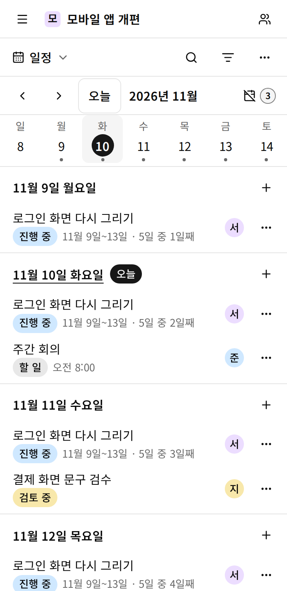   |
| 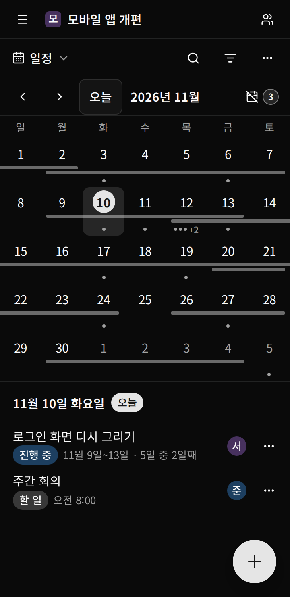 | 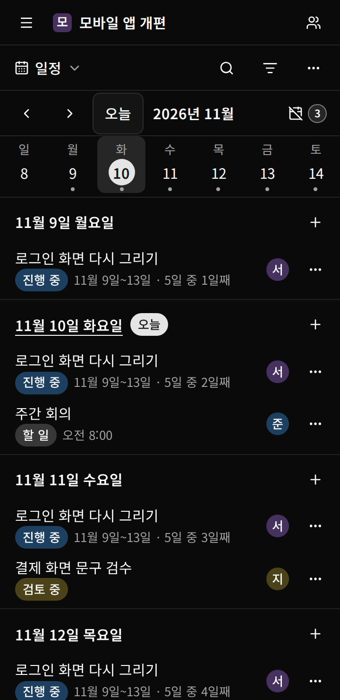 |

- **안 A.** 달 전체가 보인다. 날짜 한 칸은 51px×60px의 단추이고, 숫자 아래에 그날 얼마나 있는지만 그린다. 하루짜리 카드는 점(셋까지, 넘으면 "+N"), 여러 날에 걸친 카드는 그 날들을 잇는 선(두 줄까지, 셋째부터는 점으로 센다). 오늘은 숫자를 채운 원으로, 고른 날은 칸의 바탕으로 표시한다. 격자 아래가 **고른 날의 목록**이다: 제목 전체, 상태, 시각, 기간("11월 9일~13일 · 5일 중 2일째"), 담당자, 줄 끝의 "…". 처음에는 오늘이 골라져 있다.
- **안 B.** 격자가 없다. 위에 한 주의 띠(요일, 숫자, 카드가 있으면 점)가 있고, 그 아래에 날짜별로 카드를 쌓은 목록이 이어진다. 카드가 없는 날은 건너뛴다(오늘과 고른 날은 남긴다). 여러 날에 걸친 카드는 걸친 날마다 되풀이된다. 화살표는 한 주씩 넘긴다. 날마다 머리줄에 "+"가 있다.

|      | 안 A                                                                                                                                                         | 안 B                                                                                                                                                                                          |
| ---- | ------------------------------------------------------------------------------------------------------------------------------------------------------------ | --------------------------------------------------------------------------------------------------------------------------------------------------------------------------------------------- |
| 장점 | 월 보기가 하는 일이 남는다: 달 전체에서 어디에 몰려 있고 어디가 비었는지. 넓은 화면과 같은 것(달, 화살표가 한 달씩)이라 창이 넓어져도 보던 것이 그대로다     | 누르지 않아도 제목이 보인다. 세로로만 민다. 날마다 "+"가 있어 어느 날에 만드는지 분명하다                                                                                                     |
| 단점 | 제목을 보려면 날을 눌러야 한다. 점과 선만으로는 무엇인지 모른다. 격자가 330–390px를 차지해 목록에 남는 높이가 210–270px이다(여섯 주짜리 달에서는 카드 세 줄) | 달이 보이지 않는다(한 주의 띠뿐이다). "월 보기"라는 이름과 맞지 않고, 화살표의 뜻이 넓은 화면(한 달)과 다르다(한 주). 기간이 긴 카드가 날마다 되풀이돼 목록이 길어진다. 빈 날이 보이지 않는다 |

**권고: 안 A.** 테이블의 "행을 쌓기"(Q5의 안 B)와 같은 까닭이다: 안 B는 좁은 화면의 월 보기가 아니라 다른 뷰(일정 목록)에 가깝다. 다만 버리지 않는다. **주 보기를 둔다면 좁은 화면의 주 보기가 곧 안 B의 모습**이다(아래 "8. 주 보기"). 제목을 바로 보고 싶은 사람은 "주"를 고르면 된다.

안전 영역: 격자 아래의 목록과 둥근 단추가 홈 인디케이터를 비운다(`month-a-360-safe.png`).

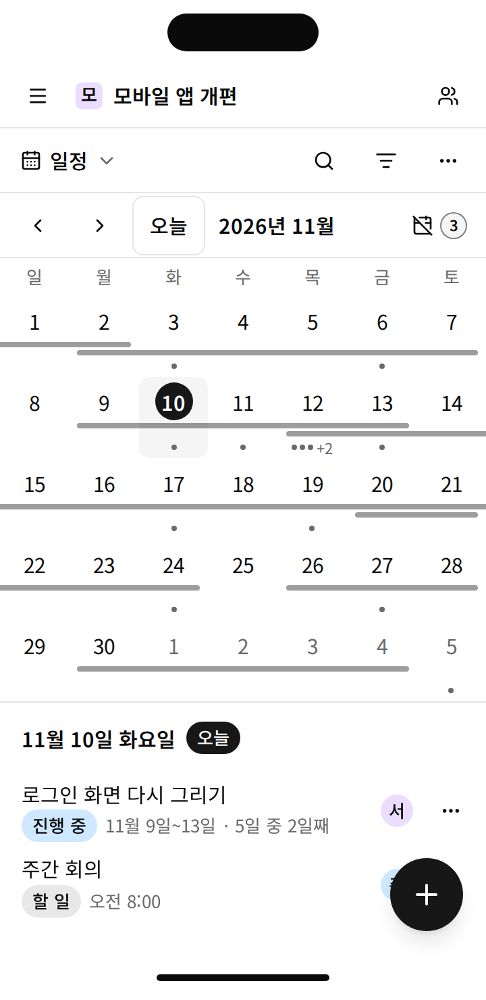

## 2. 월 보기: 막대가 있는 격자 (달력의 상자 544px 이상)

두 안이 같다(`month-a-1280.png`와 `month-b-1280.png`는 같은 그림이다).


- 위에서부터: 뷰 머리글(뷰 탭, 속성, **표시 기준**, 필터, 검색, "…", 새로 만들기), 달력의 줄(이전·다음, "오늘", 보는 달, "날짜 없음", 월·주), 요일 줄, 주마다 한 줄.
- 한 주는 CSS grid 하나다: 일곱 열, 날짜 숫자의 줄(28px), 막대 한 줄마다 24px. 카드는 걸친 날만큼의 열을 차지하는 막대이고 제목 한 줄을 적는다(시각이 있으면 앞에 "오전 8:00"). 달 밖의 날은 바탕을 흐리게 한다.
- **한 칸에 몇 줄이 들어가는지는 칸의 높이에서 나온다.** 달이 화면 높이에 꼭 맞게 주들이 높이를 나눠 갖고(주 하나는 88px보다 낮아지지 않는다. 그보다 모자라면 격자가 세로로 스크롤된다), 들어가는 만큼만 그린다. 넘치는 날은 마지막 줄이 "+N"이다. 원본은 줄 수를 다섯으로 고정한다(`dayMaxEventRows={5}`. C4).
- 달력의 줄은 화살표와 "오늘"이 먼저, 달의 이름이 그 뒤다. 넓은 화면의 한가운데 세로선에 단추가 오지 않게 하려는 순서다(아래 "한가운데 세로선").

중간 단계와, 높이가 낮은 넓은 단계:

| 626×890: 칸 81px, 네 줄                                               | 820×1180: 칸 109px, 일곱 줄                                           |
| --------------------------------------------------------------------- | --------------------------------------------------------------------- |
| 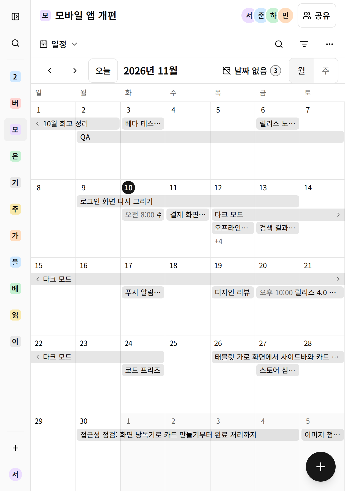 | 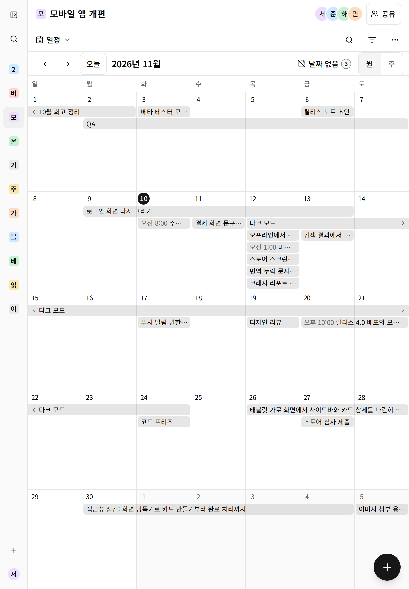 |

| 890×626, 사이드바를 펼침: 칸 91px, 두 줄                                  | 890×626, 사이드바를 띠로: 칸 119px, 두 줄                                     |
| ------------------------------------------------------------------------- | ----------------------------------------------------------------------------- |
| 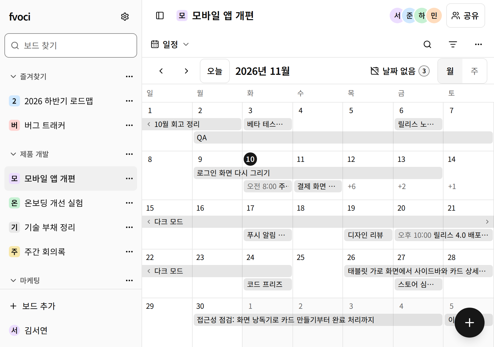 | 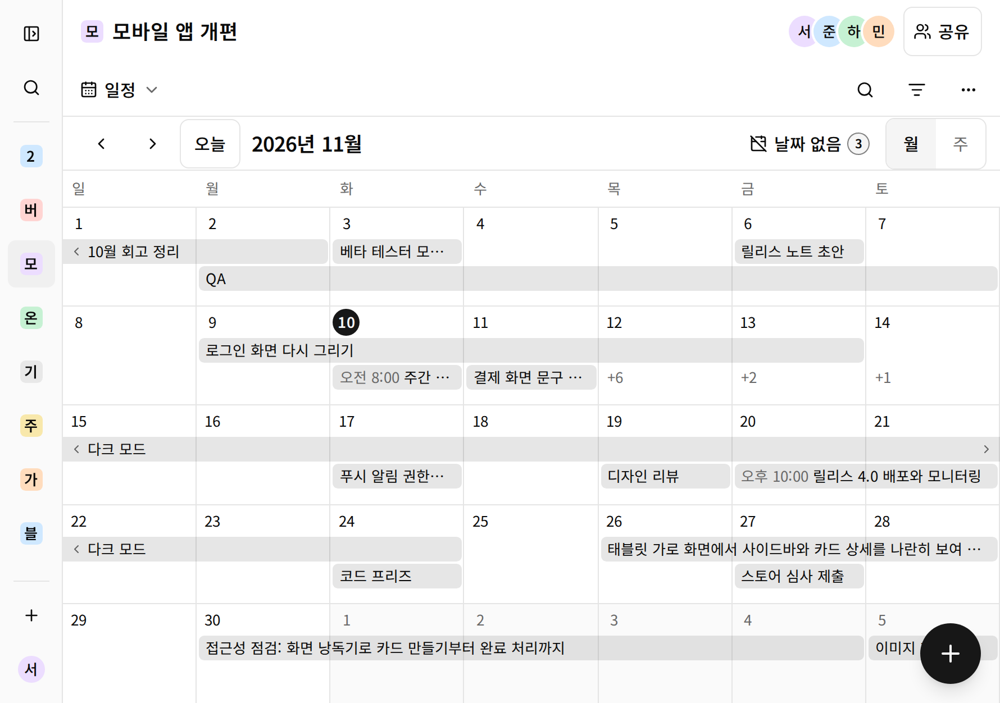 |

890×626에서는 한 주가 88px라 막대 한 줄과 "+N"뿐이다. 12일은 "+6", 13일은 "+2", 14일은 "+1"이 된다. 14일에는 카드가 하나뿐인데도 "+1"인 것은, 그 카드(다크 모드, 12–24일)의 막대가 12일에서 넘쳐 **주 안에서 통째로** 숨기 때문이다(막대를 날마다 따로 자르지 않는다. C4).

### 손가락으로 쓰는 격자

626, 820, 890의 그림은 터치 기기다. 막대는 22px 그대로이고 누르는 대상이 아니다. **칸 전체가 단추**이고(화면 낭독기에는 "11월 12일 목요일, 카드 7개"), 누르면 그날의 목록이 뜬다. 막대 위를 눌러도 같다(막대는 누름을 아래의 칸으로 흘려보낸다. 테스트로 확인했다). 마우스에서는 숫자, 막대, "+N", "+"가 저마다 단추다.

|      | 칸 전체가 단추 (그림)                                                                                                              | 막대를 44px로 키운다                                                               |
| ---- | ---------------------------------------------------------------------------------------------------------------------------------- | ---------------------------------------------------------------------------------- |
| 장점 | 한 칸에 들어가는 카드의 수가 마우스 화면과 같다(626×890에서 넷). 잘못 누를 일이 없다. 좁은 격자(안 A)와 같은 동작이다: 날을 누른다 | 카드가 한 번에 열린다                                                              |
| 단점 | 카드를 여는 데 두 번 누른다(날, 카드). 보이는 막대를 눌렀는데 그 카드가 아니라 그날의 목록이 뜬다                                  | 626×890에서 한 칸에 둘, 890×626에서 하나가 들어간다. 달이 거의 "+N"으로만 채워진다 |

**권고: 칸 전체가 단추.** 한 번에 여는 것이 중요하면 주 보기가 있다(막대가 두 줄이라 손가락으로 바로 누른다).

## 3. "+N 더 보기"가 여는 것

한 칸에 다 못 들어간 날의 "+N"(손가락에서는 칸)이 그날의 카드를 모두 보여 준다. 내용은 좁은 격자 아래의 목록과 같은 부품이고, 어디에 놓는가가 갈림길이다.

| 안 A: 칸 옆의 팝오버                                                   | 안 B: 격자 곁의 "그날의 목록"                                          |
| ---------------------------------------------------------------------- | ---------------------------------------------------------------------- |
| 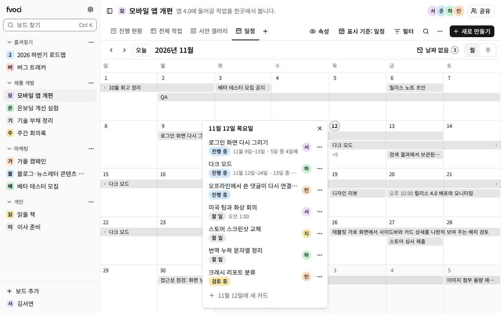 | 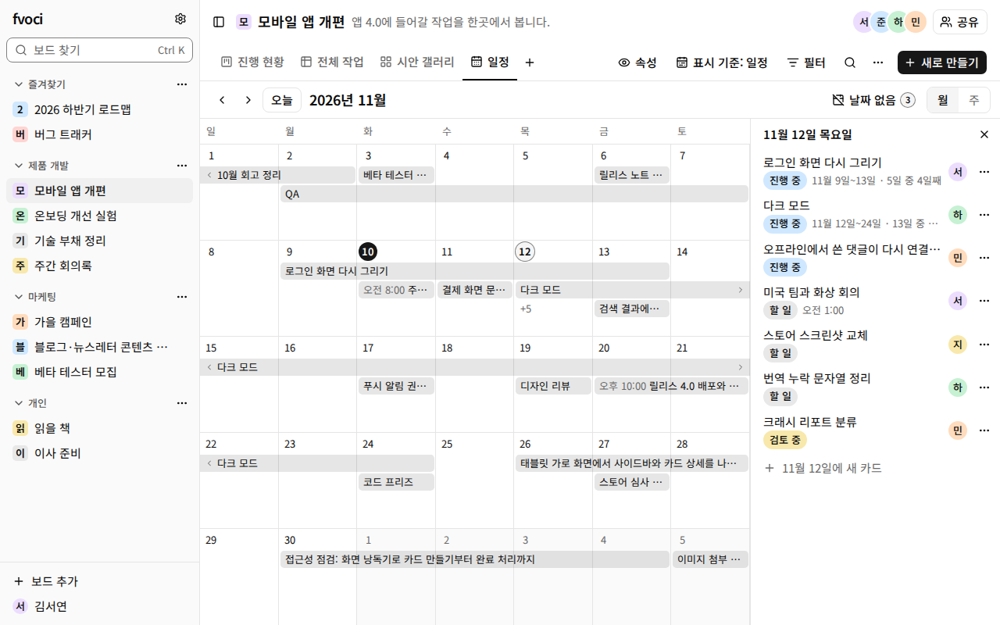 |
| 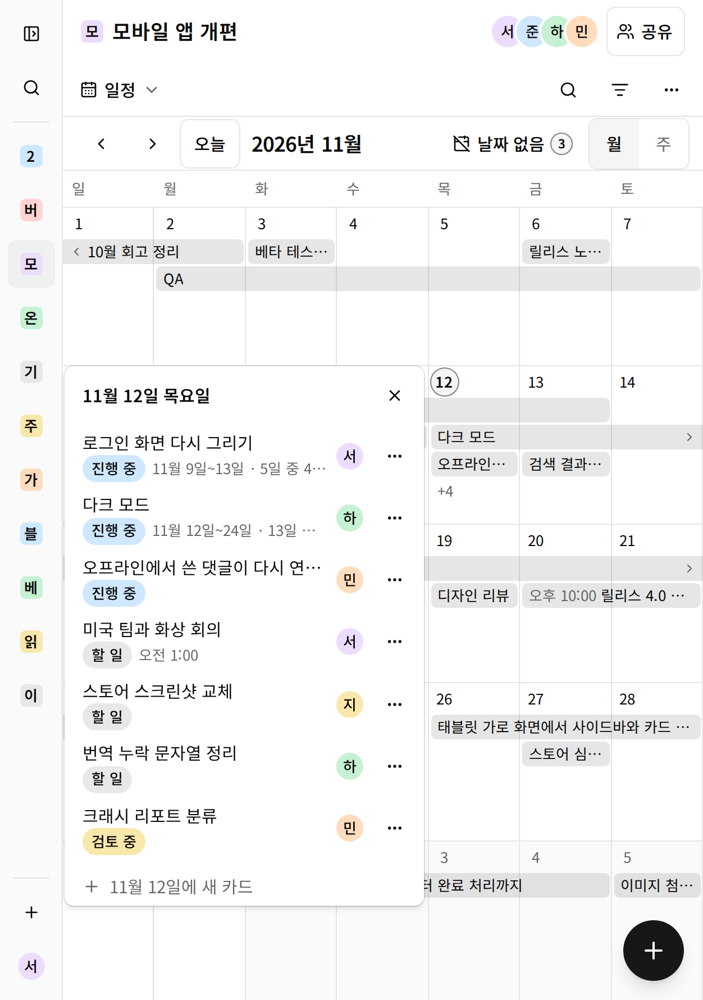        | 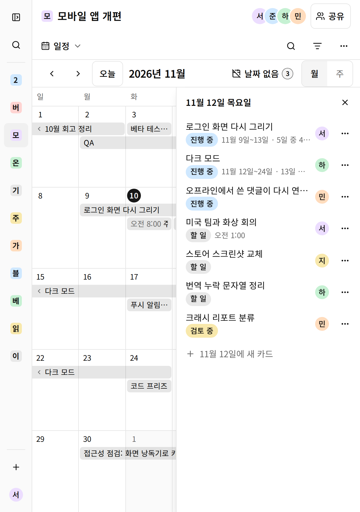        |

- **안 A.** 고른 칸 옆에 320px 팝오버가 뜬다. 머리에 날짜와 닫기, 카드의 줄들, 맨 아래에 "11월 12일에 새 카드". 바깥을 누르거나 Esc로 닫힌다. 원본이 쓰는 달력 라이브러리도 이 자리에서 팝오버를 띄운다(코드와 그 라이브러리의 기본값으로 아는 것이고, 띄워 보지는 않았다).
- **안 B.** 격자의 오른쪽에 320px의 칸이 생기고 거기에 고른 날의 목록이 놓인다. 다른 날을 누르면 내용이 바뀐다. 칸이 864px 이상이면 격자 **곁에** 서고(격자는 그만큼 좁아진 너비로 다시 그려진다: 1280px 창에서 1024px → 704px), 그보다 좁으면 격자 **위에 겹쳐** 뜬다(626×890에서는 일곱 열 가운데 넷을 가린다).

|      | 안 A (팝오버)                                                                                                              | 안 B (옆 칸)                                                                                                                                                                                              |
| ---- | -------------------------------------------------------------------------------------------------------------------------- | --------------------------------------------------------------------------------------------------------------------------------------------------------------------------------------------------------- |
| 장점 | 가볍다. 누른 칸 옆이라 무엇의 목록인지 분명하다. 격자의 너비가 바뀌지 않는다. 원본과 같고 만들 것이 적다                   | 좁은 화면(격자 아래의 목록)과 같은 생각이다: "고른 날의 목록"이 늘 한자리에 있다. 격자가 가려지지 않아(864px 이상) 목록의 카드를 다른 날로 끌 수 있다. 넓은 화면의 오른쪽 끝이라 한가운데 세로선을 피한다 |
| 단점 | 이웃한 날들을 가린다. 팝오버 안의 "…" 메뉴와 날짜 선택기가 팝오버 위에 또 뜬다. 뜨는 자리가 넓은 화면의 한가운데일 수 있다 | 칸 864px 미만(그린 크기 가운데 626, 820, 890)에서는 격자의 절반 안팎을 가려, 고른 날이 가려지기도 한다. 격자가 줄었다 늘었다 한다. 경계가 하나 는다(54rem)                                                |

**권고: 안 A.** 넓은 화면에서 안 B가 더 낫다는 것은 인정하지만, 그린 다섯 크기 가운데 안 B가 제 모습(곁에 서는 것)인 것은 1280×800 하나뿐이다. 카드를 여는 방식의 "옆 칸" 설정(플랜의 "모바일 안의 결정과 설정")을 만들 때 같은 자리를 쓰게 되므로, 그때 다시 본다.

좁은 격자에는 "+N"이 여는 것이 따로 없다. 날을 누르면 격자 아래의 목록이 바뀐다(`more-a-360.png`와 `more-b-360.png`는 같은 그림이다).

## 4. 기간이 있는 카드

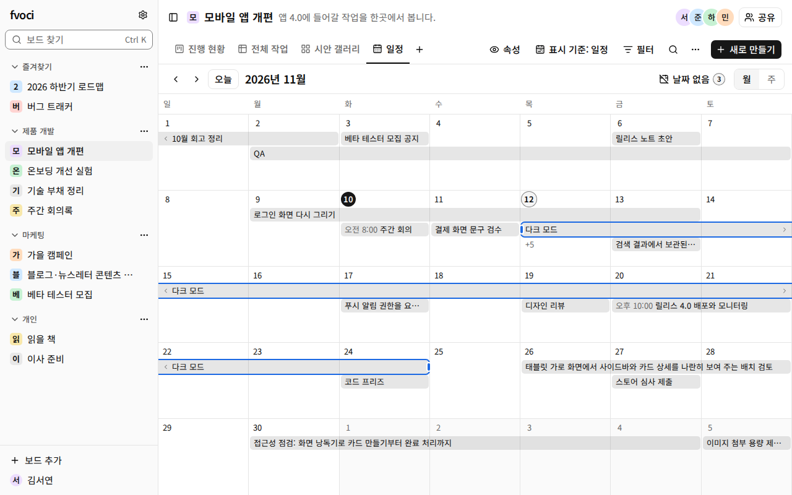

- **막대.** 여러 날에 걸친 카드는 주마다 막대 하나다. 주를 넘어가는 쪽은 모서리를 둥글리지 않고 칸의 끝까지 붙이며 화살표(‹, ›)를 그린다. 제목은 주마다 다시 적는다. 그림의 "다크 모드"(11월 12–24일)는 세 주에 걸쳐 막대가 셋이다. "10월 회고 정리"(10월 29일–11월 2일)는 달의 처음을, "접근성 점검"(11월 30일–12월 4일)은 달의 끝을 넘는다.
- **줄 자리.** 한 주 안에서 일찍 시작한 카드가 위, 같은 날이면 긴 카드가 위다. 줄은 주마다 따로 정하므로 한 카드가 주마다 다른 줄에 올 수 있다(그림의 "다크 모드"는 첫 주에 둘째 줄, 다음 주에 첫 줄).
- **양 끝의 손잡이.** 그림은 "다크 모드"를 고른 모습이다: 테두리가 생기고, 카드가 **정말 시작하고 끝나는 쪽**에만 손잡이가 붙는다(12일의 왼쪽, 24일의 오른쪽). 끌면 시작일이나 종료일이 바뀐다. 그림일 뿐이고 움직이지 않는다. 손가락과 키보드에서는 "날짜 바꾸기"의 날짜 선택기에서 종료일을 고친다.
- **시각이 붙은 기간.** "릴리스 4.0 배포와 모니터링"은 서울에서 20일 22:00부터 21일 06:00까지라 이틀에 걸친 막대다. 로스앤젤레스에서는 20일 하루다(아래 9절).

좁은 화면:

| 안 A의 격자: 날들을 잇는 선                                            | 안 B의 목록: 걸친 날마다 되풀이                                        | 626×890                                                               |
| ---------------------------------------------------------------------- | ---------------------------------------------------------------------- | --------------------------------------------------------------------- |
| 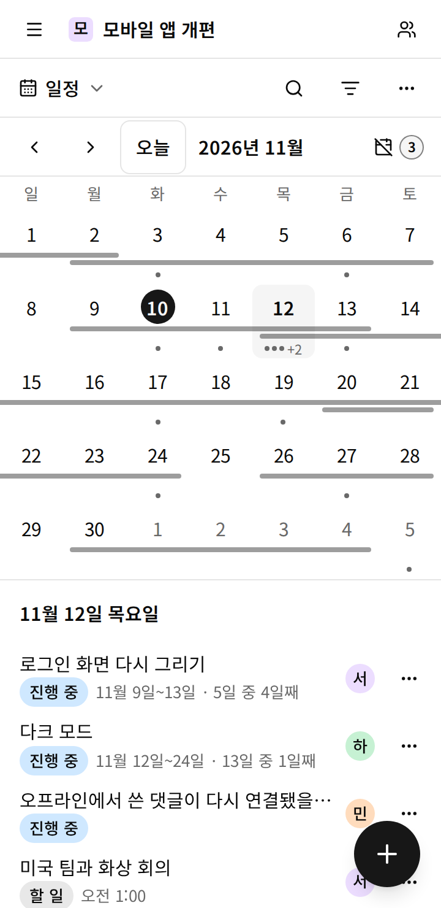 | 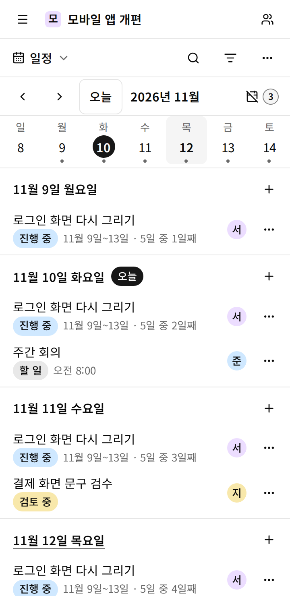 | 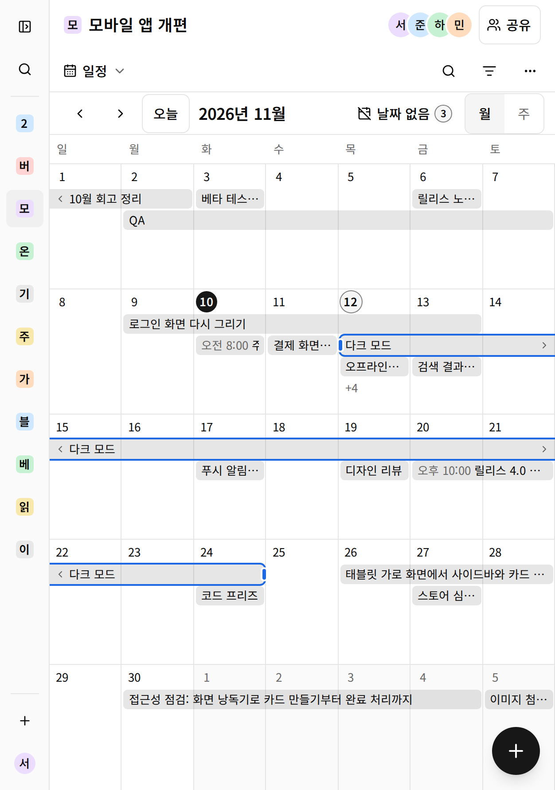 |

줄인 격자에서는 기간이 4px의 선이고, 주를 넘는 쪽은 칸의 끝까지 닿는다. 목록에서는 줄마다 "11월 9일~13일 · 5일 중 4일째"를 적는다. 일정 목록(안 B, 좁은 주 보기)에서 13일짜리 카드는 열세 번 나온다(C7).

## 5. 날짜를 바꾸는 방법

| 안 A: 끌어서 옮기기                                                    | 안 B: 카드 메뉴의 "날짜 바꾸기"                                        |
| ---------------------------------------------------------------------- | ---------------------------------------------------------------------- |
| 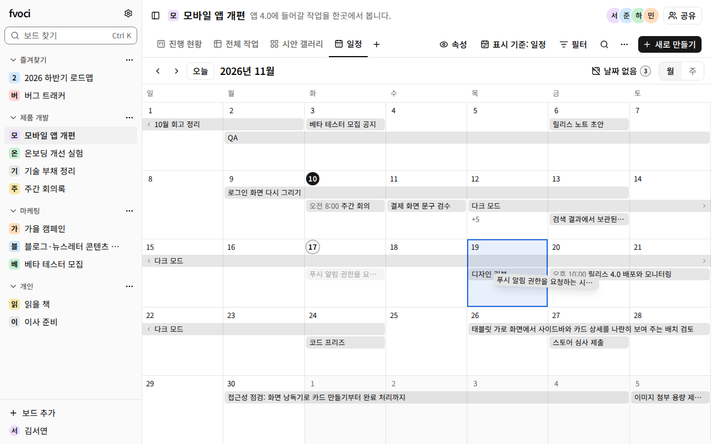 | 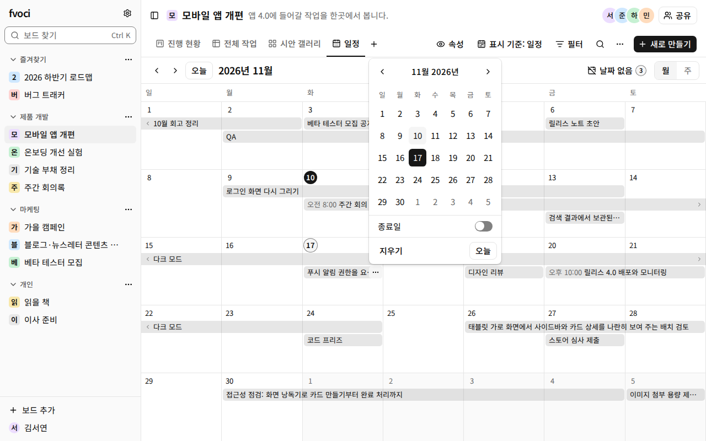 |
| 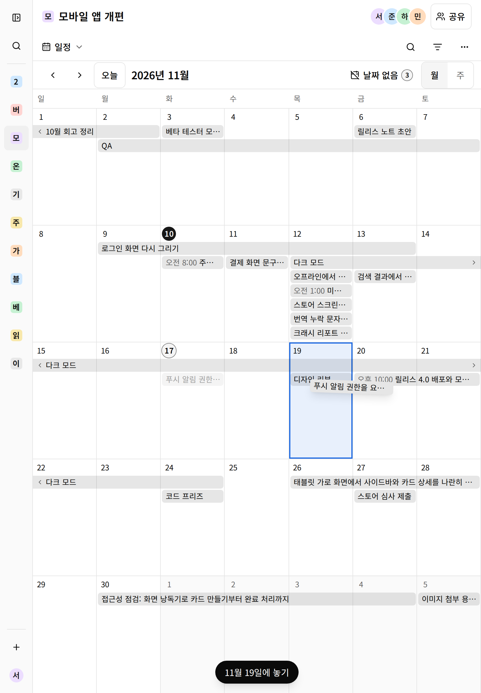     | 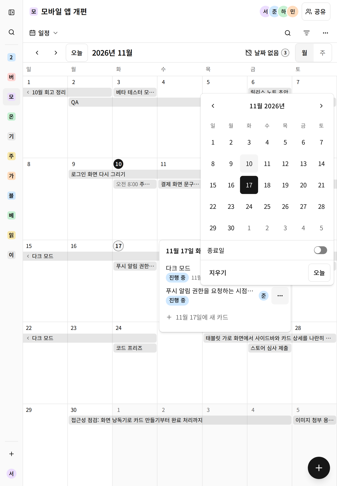     |
| 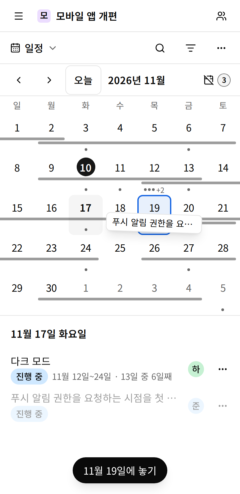  | 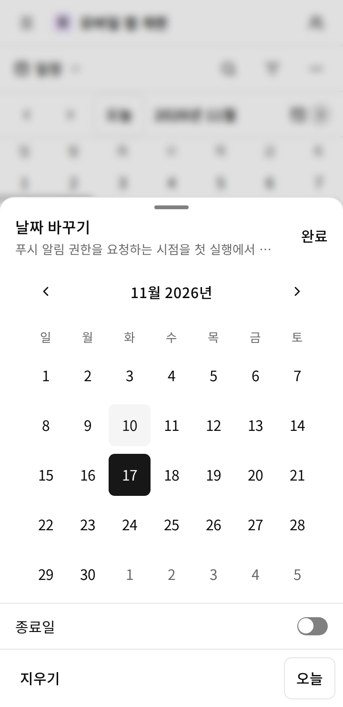  |

- **안 A.** 마우스로는 막대를 4px 움직이면 집힌다. 손가락과 펜으로는 300ms 길게 누르면 집힌다(드래그 기반 `src/lib/drag/`의 규칙 그대로). 그림은 17일의 카드를 19일로 끄는 도중이다: 제자리의 막대는 흐려지고, 사본이 포인터를 따라가고, 놓일 칸에 테두리가 생긴다. 손가락은 놓일 칸을 가리므로 화면 아래에 "11월 19일에 놓기"를 적는다. 기간이 있는 카드는 길이를 지킨 채 옮겨진다. 좁은 격자에서는 목록의 줄을 위의 날짜 칸으로 끈다. **그림은 모두 정지 화면이고 실제로 끌리지 않는다.**
- **안 B.** 카드의 "…" 메뉴 맨 위에 "날짜 바꾸기"가 있고, 누르면 날짜 선택기가 뜬다(좁은 단계에서는 바닥 시트, 그 밖에서는 팝오버. 제품에서는 속성 편집기의 날짜 선택기를 그대로 쓴다. 그림의 것은 모바일 스파이크의 목업이다). 마우스에서는 막대를 가리키면 끝에 "…"가 나타난다. 손가락에서는 그날의 목록의 줄 끝에 "…"가 늘 있다.

메뉴 자체의 그림: `move-b-360-menu.png`(바닥 시트), `move-b-1280-menu.png`(드롭다운).

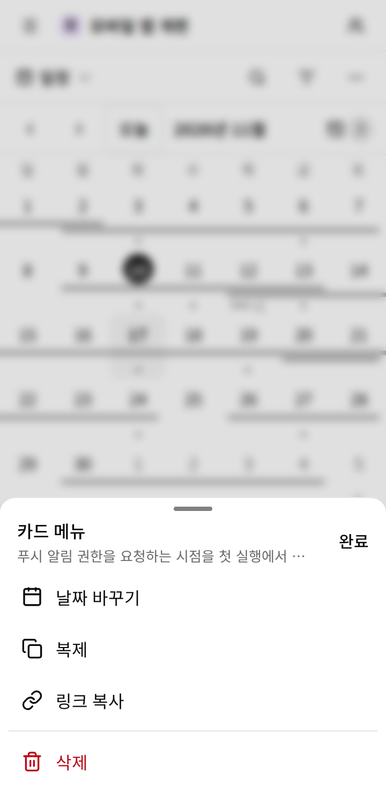 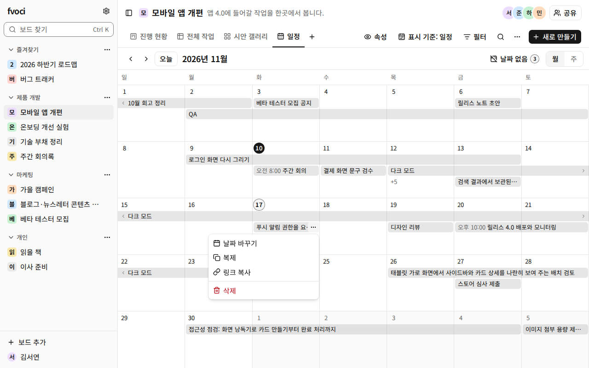

|      | 안 A (드래그)                                                                                                                                                                                                          | 안 B (메뉴)                                                                                                                        |
| ---- | ---------------------------------------------------------------------------------------------------------------------------------------------------------------------------------------------------------------------- | ---------------------------------------------------------------------------------------------------------------------------------- |
| 장점 | 마우스에서는 가장 빠르고 원본의 방식이다. 옮길 곳을 보면서 옮긴다                                                                                                                                                      | 키보드와 화면 낭독기로 닿는다. 다른 달로도 한 번에 간다. 어느 화면 크기에서도 같다. 기간과 시각을 함께 고친다. 만들 것이 이미 있다 |
| 단점 | 손가락에서는 22px 막대를 길게 눌러 집어야 한다. 좁은 격자에서는 51px 칸에 놓아야 하고 끄는 것이 목록의 줄이다. 일정 목록(안 B)에는 놓을 격자가 없다. 다른 달로 옮기려면 끄는 중에 달을 넘겨야 한다. 키보드로는 못 한다 | 세 번 누른다("…", 날짜 바꾸기, 날짜). 옮길 곳의 사정(그날 얼마나 있는지)을 보지 못한다                                             |

**권고: 둘 다 두되 순서를 나눈다.** 마우스의 드래그(옮기기와 양 끝 늘이기)와 메뉴의 "날짜 바꾸기"는 W5에 함께 만든다. 손가락의 길게 눌러 끌기는 W6으로 미룬다(모바일 안의 Q24의 답과 같은 순서: 터치 드래그는 칸반 카드부터, 나머지는 메뉴 항목을 먼저). 메뉴는 포인터와 무관하게 늘 있다.

표시 기준이 읽기 전용 속성(만든 날짜, 수정한 날짜)일 때는 드래그도 "날짜 바꾸기"도 없다(원본도 끌지 못하게 한다).

## 6. 빈 날에 카드 만들기

| 안 A: 칸을 누르면                                                        | 안 B: 칸의 "+"                                                           |
| ------------------------------------------------------------------------ | ------------------------------------------------------------------------ |
| 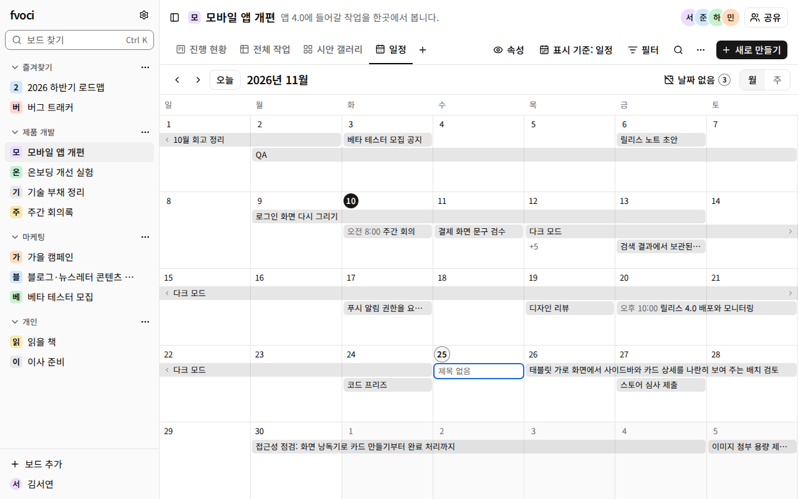 | 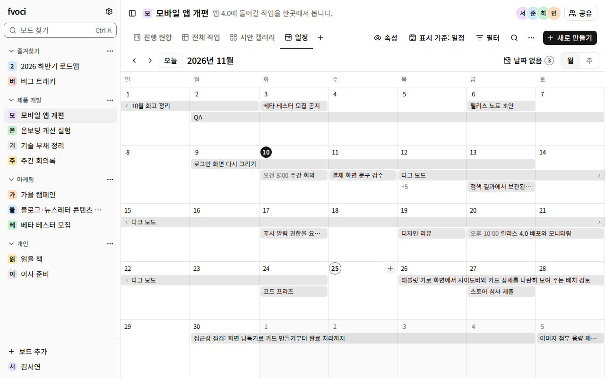 |
| 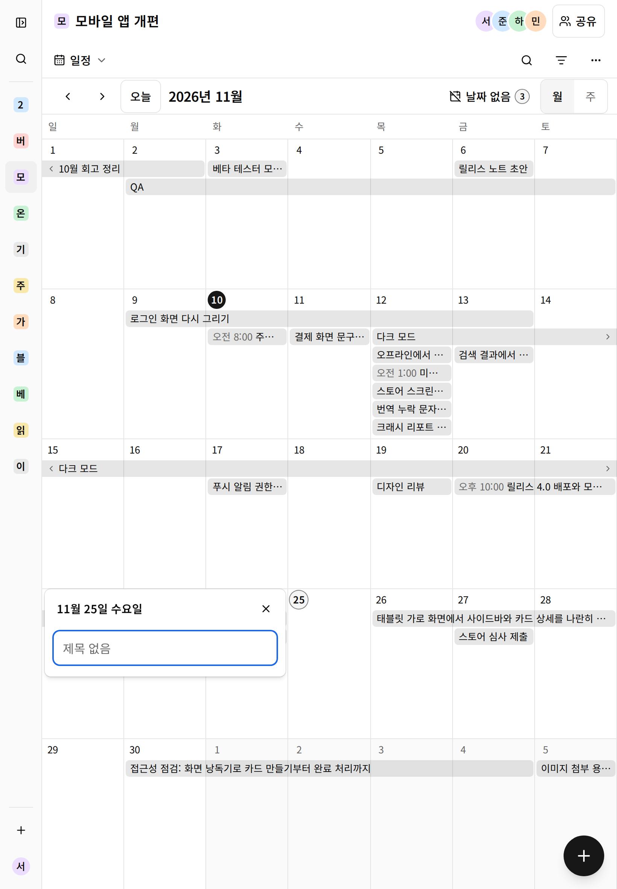     | 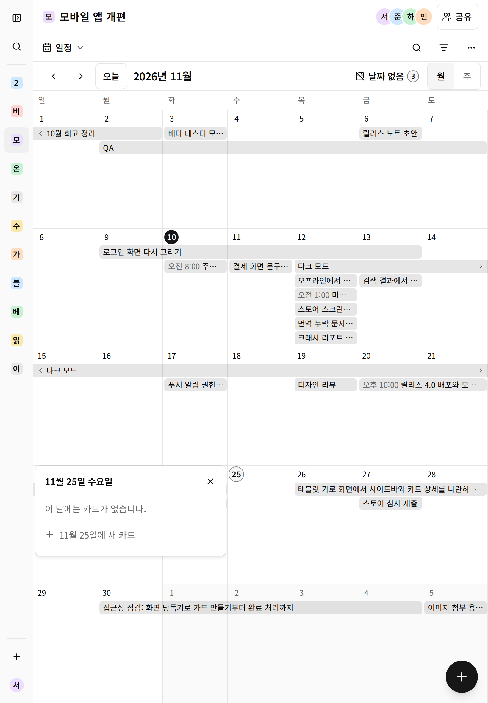     |
| 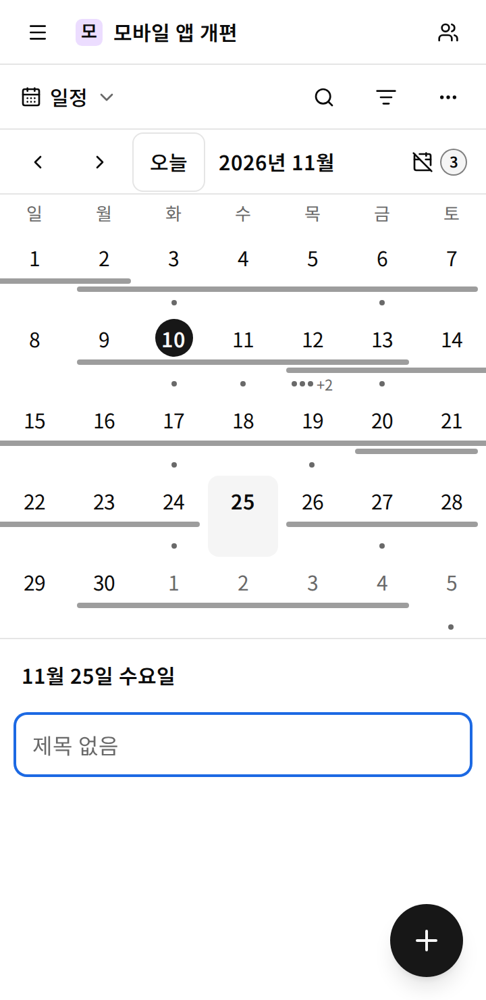  | 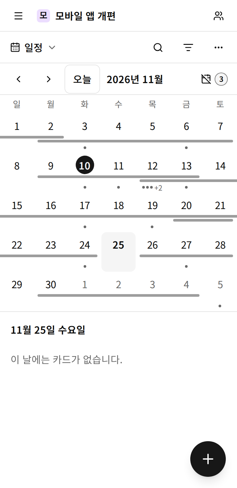  |

- **안 A.** 칸의 빈 자리를 누르면 그날에 카드가 바로 생기고 제목을 기다린다. 마우스에서는 칸 안에 입력 칸이 생긴다. 손가락에서는 칸이 그날의 목록을 여는 단추이기도 하므로, **빈 날**을 누르면 목록이 뜨면서 그 안에 새 카드의 입력 줄이 생긴다(글자는 16px). 원본은 칸을 누르면 카드를 만들고 곧바로 연다. 그림은 누른 뒤의 모습이고, 누르는 동작 자체는 목업에 없다.
- **안 B.** 칸을 눌러도 카드는 생기지 않는다. 마우스에서는 칸을 가리키면(또는 초점이 가면) 오른쪽 위에 "+"가 나타난다(그림은 25일을 가리킨 모습). 손가락에서는 칸이 그날의 목록을 열고, 목록의 마지막 줄이 "11월 25일에 새 카드"다. 좁은 화면에서는 둥근 단추가 고른 날에 만든다.
- **두 안에 공통.** 그날의 목록(팝오버, 옆 칸)에는 늘 "새 카드" 줄이 있다. 키보드로 만드는 길이 이것이다. 뷰 머리글이 접힌 칸에서는 다른 뷰처럼 오른쪽 아래의 둥근 단추가 있고, 달력에서는 **고른 날**에 만든다(단추의 이름이 "11월 10일에 새 카드"다). 일정 목록에는 날마다 "+"가 있어 둥근 단추를 두지 않았다.

|      | 안 A (칸을 누르면)                                                                                                                                       | 안 B ("+")                                                                                        |
| ---- | -------------------------------------------------------------------------------------------------------------------------------------------------------- | ------------------------------------------------------------------------------------------------- |
| 장점 | 가장 빠르다. 원본의 동작이다. 단추를 찾을 필요가 없다                                                                                                    | 잘못 눌러 카드가 생기지 않는다. 마우스, 손가락, 키보드에서 같은 뜻이다(칸은 고르기, "+"는 만들기) |
| 단점 | 빗나간 누름 하나가 데이터를 만든다(빈 카드가 남는다). 손가락에서 "칸을 누르면 목록이 열린다"와 겹쳐, 빈 날과 찬 날의 동작이 달라진다. 키보드로는 못 한다 | 마우스에서 가리켜야 보인다. 한 번 더 누른다(손가락: 칸, "새 카드")                                |

**권고: 안 B.** 달력의 칸은 넓고 자주 눌리는 자리라, 누름마다 카드가 생기면 실수가 쌓인다. 원본에도 "+"가 있다(칸을 가리키면 날짜 숫자 옆에 나타난다). 원본은 둘 다 한다.

## 7. 표시 기준 속성과 날짜 없는 카드

### 표시 기준

캘린더는 **날짜 속성 하나**의 값으로 카드를 놓는다(뷰에 저장되는 `dateDisplayPropertyId`). 그룹과 정렬이 없는 대신 뷰 머리글에 "표시 기준"이 있다.

| 넓은 머리글: 단추와 팝오버                                                        | 접힌 머리글: "…" 메뉴의 둘째 쪽                                                  |
| --------------------------------------------------------------------------------- | -------------------------------------------------------------------------------- |
| 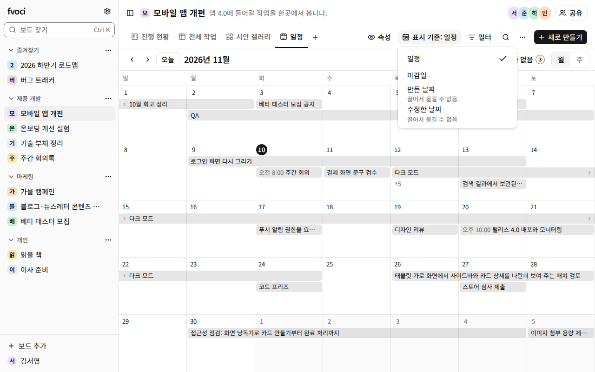 | 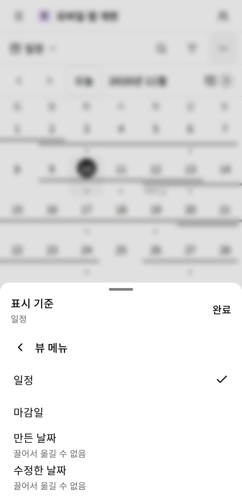 |

- 칸이 992px 이상이면 머리글에 "표시 기준: 일정" 단추가 있고 누르면 날짜 속성의 목록이 뜬다. 접힌 머리글에서는 "…" 메뉴의 첫 줄 "표시 기준 · 일정 ›"이 같은 시트(또는 팝오버)의 둘째 쪽으로 넘어간다(위에 돌아가는 줄).
- 읽기 전용 속성(만든 날짜, 수정한 날짜)에는 "끌어서 옮길 수 없음"을 적는다.
- 접힌 머리글의 "…" 메뉴에는, 달력의 줄에 월·주 단추가 들어가지 않는 좁은 칸(544px 미만)에서만 "월 보기"와 "주 보기"가 더 들어간다.

### 날짜 없는 카드

표시 기준 속성에 값이 없는 카드는 격자에 놓을 자리가 없다. **원본에서는 그런 카드가 캘린더에서 보이지 않는다.** 두 안은 그것을 보여 주는 자리다.

| 안 A: "날짜 없음" 서랍                                                     | 안 B: 격자 아래의 "날짜 없음" 줄                                           |
| -------------------------------------------------------------------------- | -------------------------------------------------------------------------- |
| 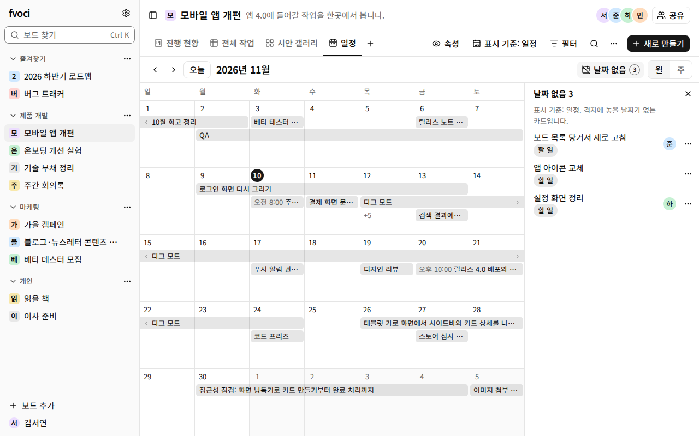  | 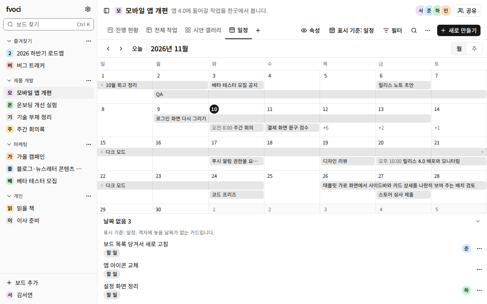  |
| 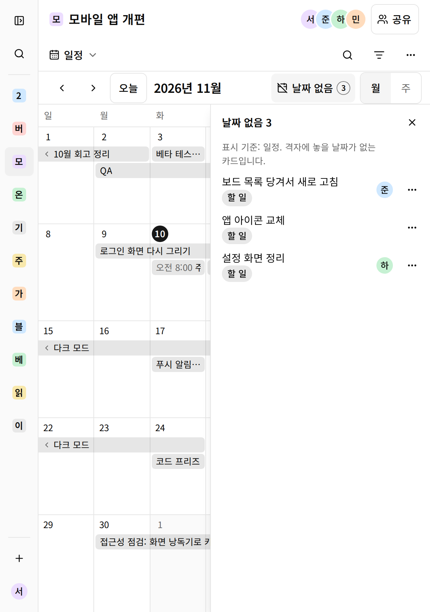         |                                                                            |
| 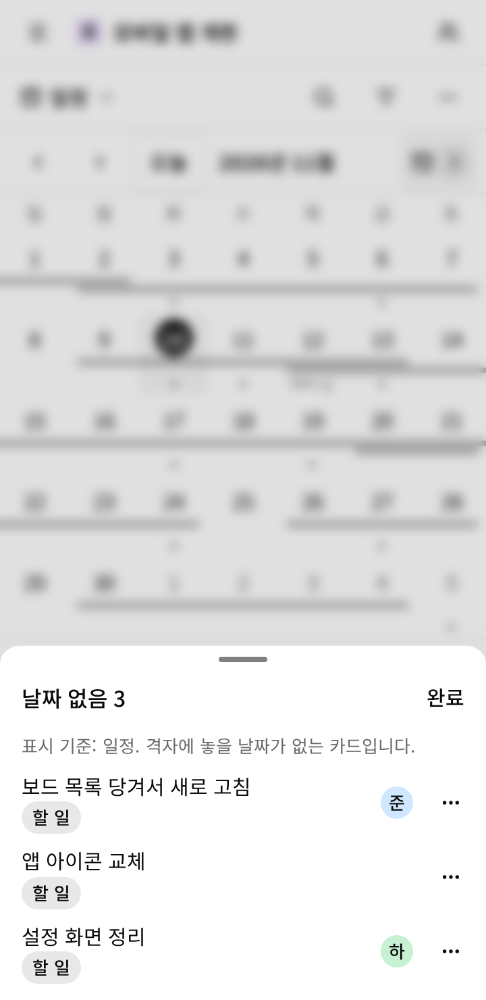   | 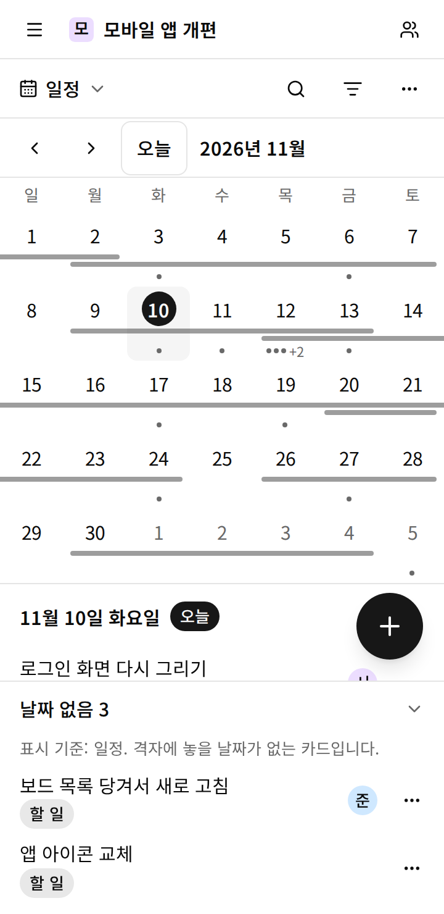   |
|  | 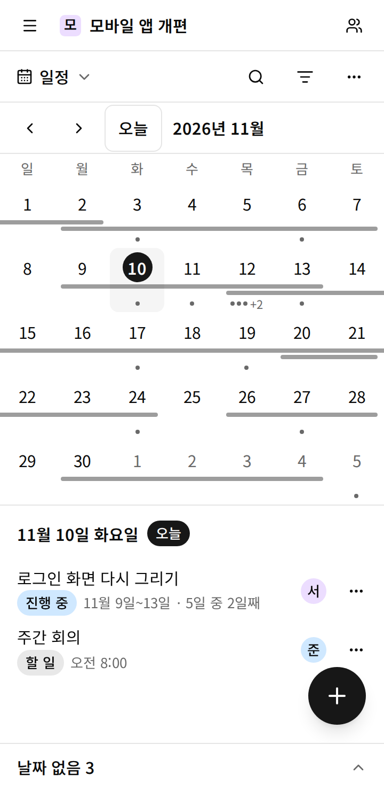 |

- **안 A.** 달력의 줄 오른쪽에 "날짜 없음"과 개수가 있는 단추가 있다(좁은 칸에서는 아이콘과 개수). 누르면 좁은 단계에서는 바닥 시트, 그 밖에서는 오른쪽의 칸(320px. 3절의 옆 칸과 같은 자리이고 같은 경계를 따른다)이 열린다. 카드마다 "…"에 "날짜 정하기"가 있고, 마우스에서는 격자의 날로 끌 수 있다(그리지 않았다).
- **안 B.** 격자 아래에 "날짜 없음 3"이라는 한 줄이 늘 있다. 누르면 펼쳐져 카드가 보인다(높이는 좁은 칸에서 144px, 그 밖에서 224px까지).

|      | 안 A (서랍)                                                                                                                | 안 B (아래의 줄)                                                                                                                                                                        |
| ---- | -------------------------------------------------------------------------------------------------------------------------- | --------------------------------------------------------------------------------------------------------------------------------------------------------------------------------------- |
| 장점 | 닫혀 있을 때 단추 하나의 자리만 쓴다. 개수가 늘 보인다. 열면 목록이 길어도 된다. 넓은 화면에서 격자의 높이를 줄이지 않는다 | 늘 보이는 자리라 "날짜 없는 카드가 있다"는 것을 놓치지 않는다. 넓은 화면에서 격자 바로 아래라 위로 끌기 가깝다                                                                          |
| 단점 | 단추를 눌러야 보인다. 칸 864px 미만에서는 격자를 가린다(626×890에서 넷째 열부터)                                           | 접힌 채로도 40–44px를 늘 쓴다. 펼치면 격자가 줄어 한 주가 88px로 내려가고 마지막 주가 잘린다(1280×800). 좁은 화면에서는 고른 날의 목록이 한 줄만 남고, 둥근 단추가 그 위에 얹힌다(그림) |

**권고: 안 A.** 날짜 없는 카드는 가끔 보는 것이고 달력에서 귀한 것은 세로 높이다.

## 8. 주 보기

원본에는 월과 주가 있다. 안은 하나이고 "둘 것인가"가 질문이다(C17).

| 1280×800                                                                  | 820×1180                                                              | 626×890                                                            | 360×740                                                                  |
| ------------------------------------------------------------------------- | --------------------------------------------------------------------- | ------------------------------------------------------------------ | ------------------------------------------------------------------------ |
| 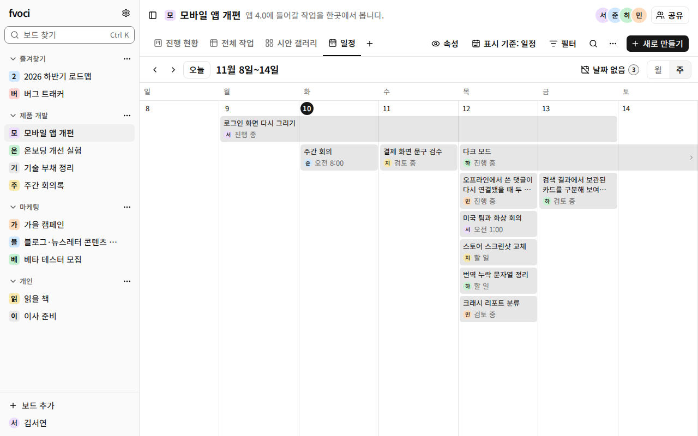 | 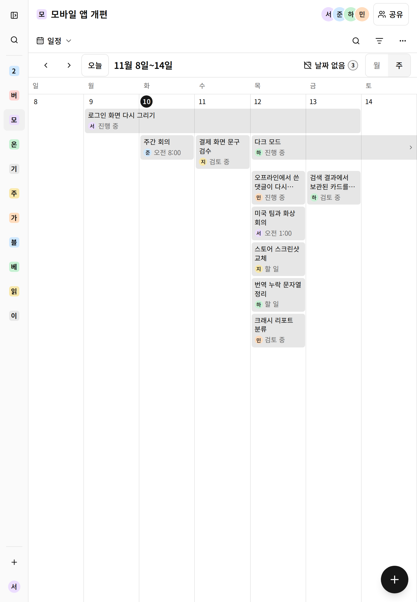 | 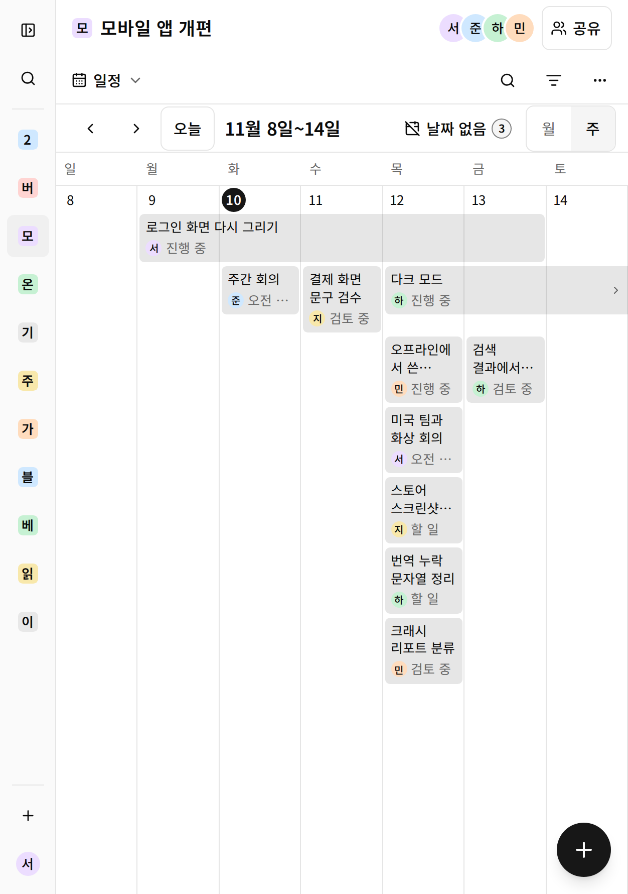 | 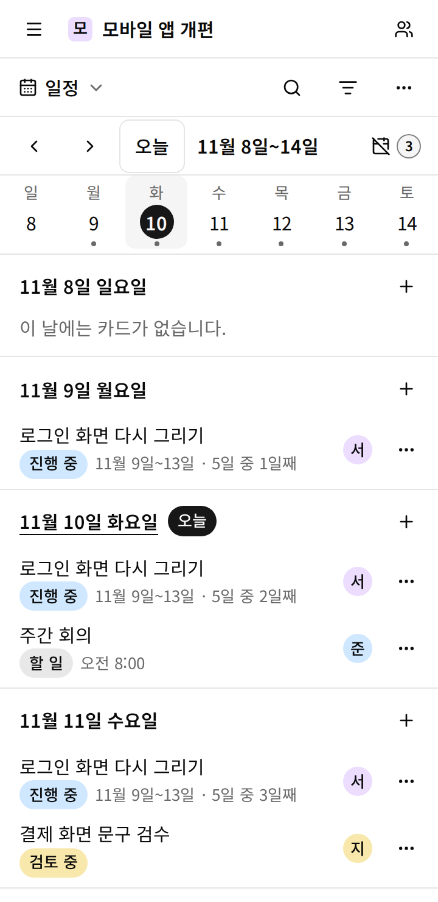 |

- **달력의 상자가 544px 이상이면** 한 주가 화면 높이를 다 쓰는 한 줄이다. "+N"이 없고 그 주의 카드가 모두 보인다(넘치면 세로로 스크롤). 막대는 두 줄이다: 제목(두 줄까지)과, 담당자의 얼굴에 시각이나 상태. 44px 이상이라 손가락으로도 막대가 단추다.
- **그보다 좁으면** 주 띠와 그 주 일곱 날의 목록이다(1절의 안 B와 같은 부품. 빈 날도 "이 날에는 카드가 없습니다"로 남는다).
- 달력의 줄의 제목은 "11월 8일~14일"이 되고 화살표는 한 주씩 넘긴다. 월·주 단추는 칸 544px 이상에서 달력의 줄에, 그보다 좁으면 뷰의 "…" 메뉴에 있다.
- 시간 축(하루를 시간으로 나눈 세로 눈금)은 없다. 원본의 주 보기도 날짜 칸만 있는 격자다. 시각은 글자로만 적는다.

|      | 주 보기를 둔다                                                                                                                              | 두지 않는다                                          |
| ---- | ------------------------------------------------------------------------------------------------------------------------------------------- | ---------------------------------------------------- |
| 장점 | "+N" 없이 한 주를 다 본다. 손가락으로 카드를 한 번에 연다. 좁은 화면에서 제목이 바로 보이는 모습이 생긴다(1절의 안 B를 버리지 않게 된다)    | 만들 것이 준다. 달력의 줄에 단추 둘이 빠진다         |
| 단점 | 격자의 두 번째 모습(줄 수 제한 없음, 두 줄 막대)과 그 사이의 전환, 어느 쪽을 기억할지(C19)가 생긴다. 좁은 화면에서는 단추가 "…" 안에 숨는다 | 카드가 많은 주를 한 번에 볼 방법이 그날의 목록뿐이다 |

**권고: 둔다.** 같은 격자 부품에 인자 하나(주 하나, 줄 수 제한 없음)이고, 좁은 화면의 모습은 일정 목록 부품이라 따로 만들 화면이 아니다.

## 9. 주의 시작 요일과 시간대

같은 보드, 같은 순간(2026-11-10 09:00 KST)을 두 사람이 본다. 안이 아니라 설정에 따라 달라지는 것을 보인 그림이다.

| 그림 1: 주는 일요일부터, 시간대는 서울                                                 | 그림 2: 주는 월요일부터, 시간대는 로스앤젤레스                                                 |
| -------------------------------------------------------------------------------------- | ---------------------------------------------------------------------------------------------- |
| 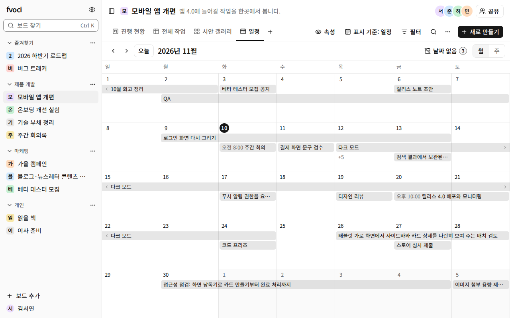           | 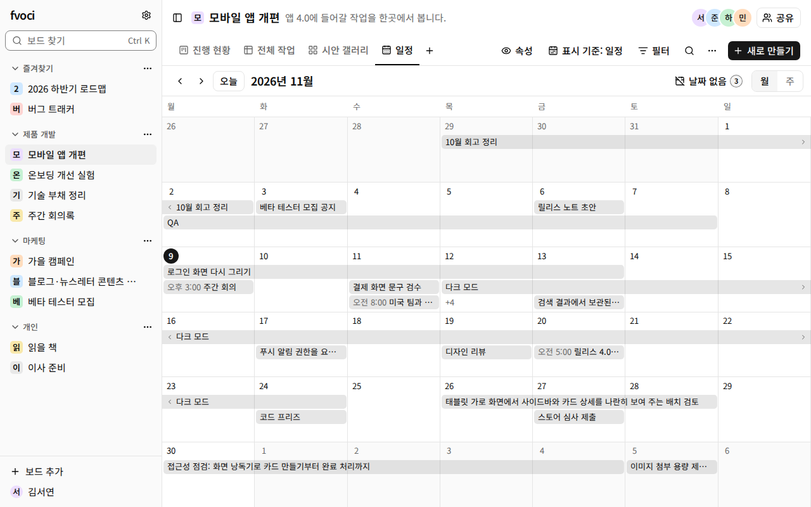           |
| 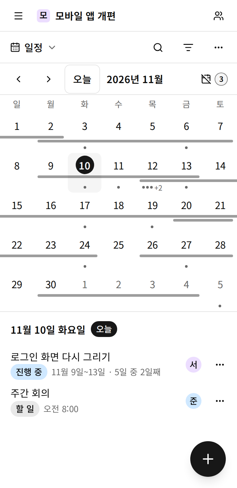 | 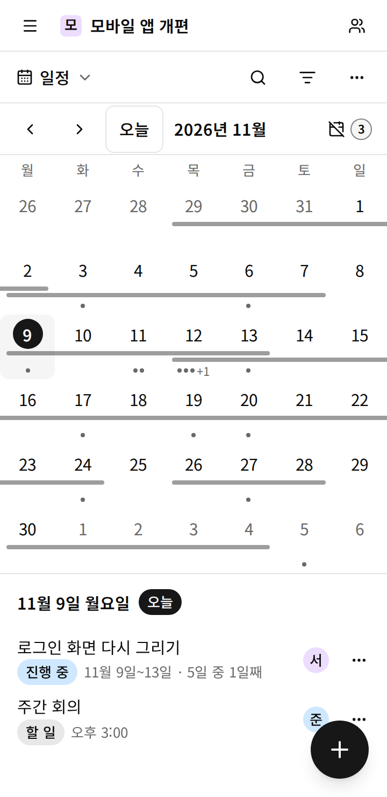 |

| 무엇                                                       | 서울, 일요일 시작          | 로스앤젤레스, 월요일 시작                  |
| ---------------------------------------------------------- | -------------------------- | ------------------------------------------ |
| 요일 줄                                                    | 일 월 화 수 목 금 토       | 월 화 수 목 금 토 일                       |
| 2026년 11월의 주 수(11월 1일은 일요일)                     | 다섯 주(11월 1일–12월 5일) | 여섯 주(10월 26일–12월 6일)                |
| 오늘                                                       | 11월 10일 화요일           | 11월 9일 월요일(그곳은 아직 9일 16:00이다) |
| "주간 회의"(서울의 10일 08:00)                             | 10일, "오전 8:00"          | 9일, "오후 3:00"                           |
| "미국 팀과 화상 회의"(서울의 12일 01:00)                   | 12일, "오전 1:00"          | 11일, "오전 8:00"                          |
| "릴리스 4.0 배포와 모니터링"(서울의 20일 22:00–21일 06:00) | 20–21일, 이틀의 막대       | 20일 하루, "오전 5:00"                     |
| 시각이 없는 카드 전부(예: "결제 화면 문구 검수", 11일)     | 11일                       | 11일(같다)                                 |
| 12일의 카드 수                                             | 7                          | 6                                          |

토요일 시작(`regional-a-1280-saturday.png`)은 10월 31일부터 다섯 주다.

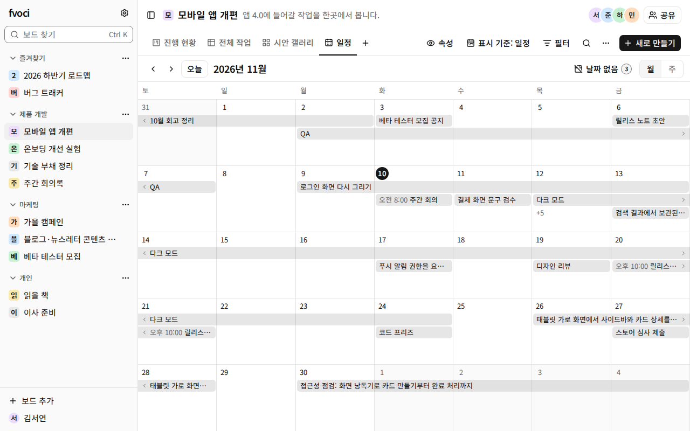

테스트가 위 표의 날짜와 카드 수를 확인한다. 여섯 주가 되면 한 주의 높이가 줄어(1280×800에서 123px → 103px) 한 칸의 줄 수는 같아도 여백이 준다. 좁은 격자는 여섯 주에서 60px가 늘고 그만큼 아래의 목록이 준다(`regional-b-360.png`).

## 10. 어두운 화면과 막대의 색

| 무채색 막대(기본)                                                           | 상태 색 막대(`tint=1`)                                                            |
| --------------------------------------------------------------------------- | --------------------------------------------------------------------------------- |
|    | 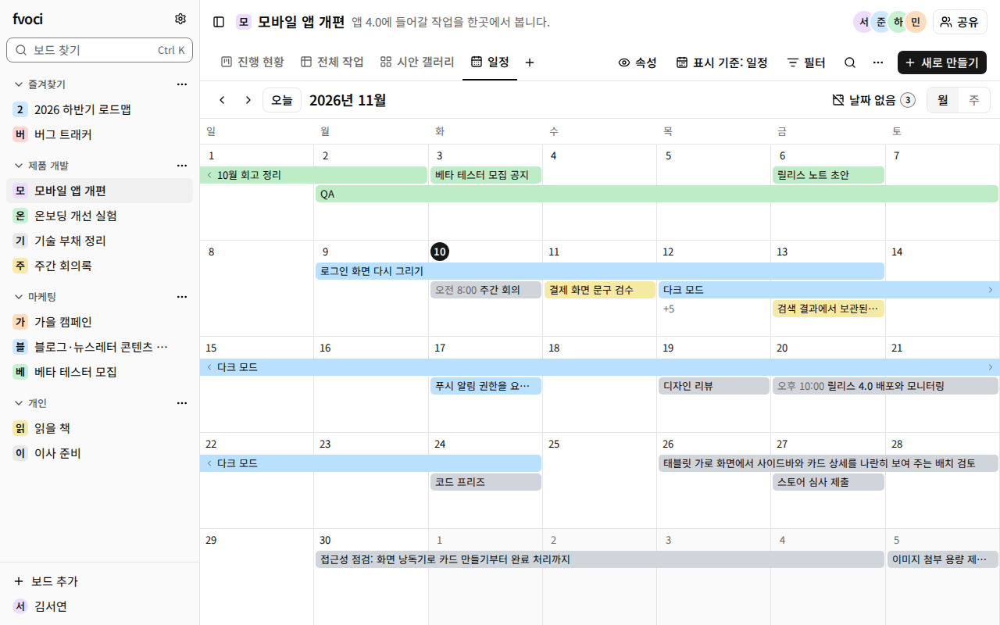   |
| 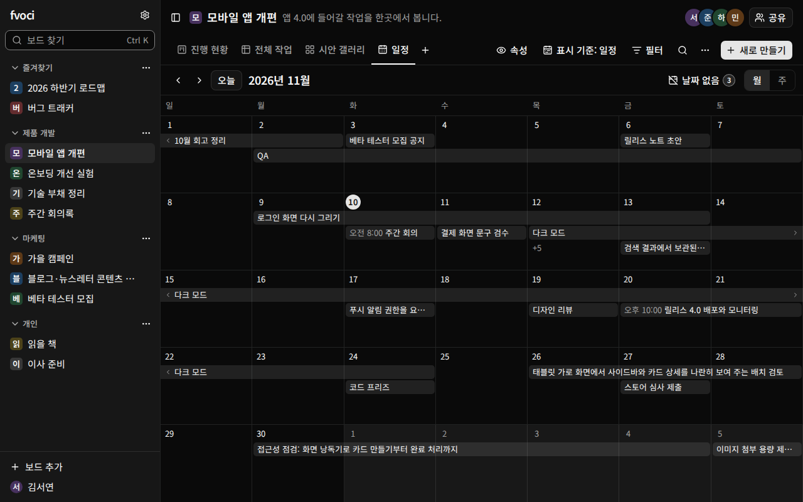 | 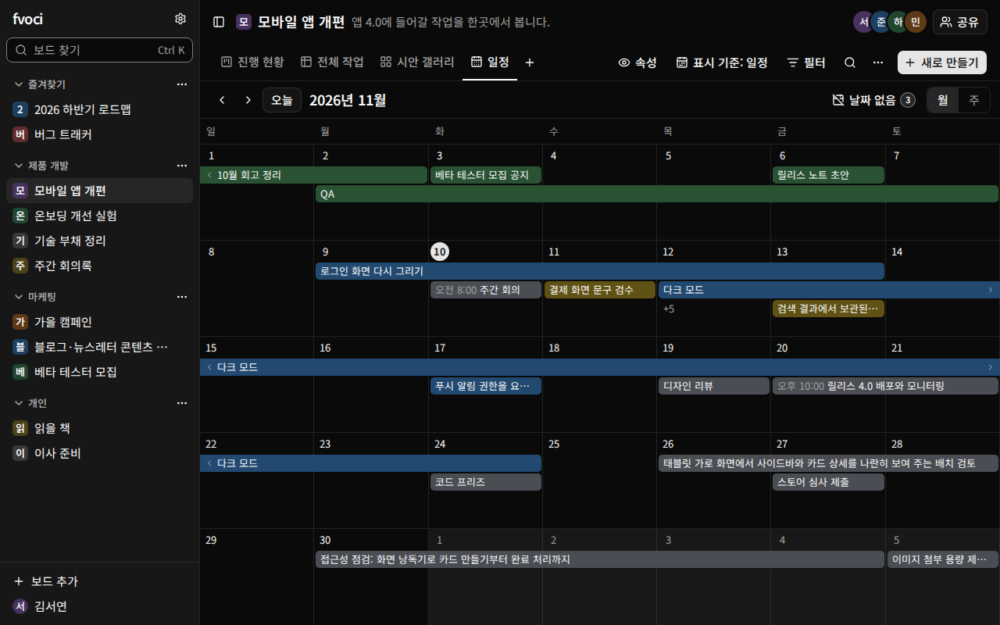 |

- 어두운 화면은 토큰만으로 따라온다(좁은 화면은 1절의 그림).
- 원본의 막대는 색이 없고(흰 카드), 보이게 켠 속성을 막대 안에 줄줄이 적는다. 이 안의 기본은 **무채색 바탕에 제목 한 줄**이다. 상태 색 그림은 "막대를 선택 속성의 색으로 칠하면 이렇게 보인다"를 보이려고 넣은 것이고, 어느 속성으로 칠할지를 고르는 설정은 그리지 않았다(C6).

## 질문 목록

제품 책임자가 답할 것이다. 질문마다 선택지, 권고, 그 답이 정하는 것을 적었다. 번호는 모바일 안의 Q와 섞이지 않게 C로 시작한다.

### 화면별 안

**C1. 좁은 칸의 월 보기: 줄인 격자인가, 일정 목록인가.**
선택지: (A) 달 전체의 줄인 격자(점과 선)와 그 아래 고른 날의 목록 / (B) 격자 없이 한 주의 띠와 날짜별 목록. 권고: A. B의 모습은 좁은 화면의 주 보기로 쓴다(C17). 정하는 것: 캘린더 뷰의 좁은 배치, 화살표가 넘기는 단위.

**C2. 손가락으로 쓰는 막대 격자에서 무엇이 눌리는가.**
선택지: (가) 날짜 칸 전체가 단추이고 그날의 목록을 연다. 막대는 22px 그대로이고 누르는 대상이 아니다(그림) / (나) 막대를 44px로 키워 바로 카드를 연다(한 칸에 들어가는 수가 절반 아래로 준다) / (다) 막대를 22px인 채로 누르게 한다(44px 규칙의 예외). 권고: 가. 정하는 것: 격자의 마크업(포인터에 따라 단추가 칸인지 막대인지), 중간 단계에서 카드를 여는 데 드는 누름의 수.

**C3. "+N 더 보기"가 여는 것.**
선택지: (A) 칸 옆의 팝오버 / (B) 격자 곁의 옆 칸(864px 미만의 칸에서는 겹쳐 뜬다). 권고: A. 카드를 여는 방식의 "옆 칸" 설정을 만들 때 B를 다시 본다. 정하는 것: 그날의 목록의 겉, 새 경계(54rem)가 필요한지.

**C4. 한 칸에 몇 줄을 그리는가, 넘칠 때 기간 카드는.**
선택지: 줄 수는 (가) 칸의 높이에 들어가는 만큼. 달이 화면 높이에 맞고 주의 높이는 88px 아래로 내려가지 않는다(그림) / (나) 원본처럼 다섯 줄로 고정한다(주가 그만큼 높아지고, 화면보다 길면 격자가 세로로 스크롤된다). 넘치는 날에 걸친 기간 카드의 막대는 (가) 그 주에서 통째로 숨기고 걸친 날마다 "+N"에 센다(그림. 890×626의 13일 "+2", 14일 "+1") / (나) 넘치는 날에서만 끊는다(막대가 토막 난다). 권고: 둘 다 가. 낮은 화면(890×626)에서는 막대 한 줄과 "+N"뿐이라는 것을 함께 받아들인다. 정하는 것: 격자의 높이 계산, 줄 배치 로직.

**C5. 막대에 무엇을 적는가.**
선택지: (가) 월 보기는 제목 한 줄(시각이 있으면 앞에), 주 보기는 제목과 속성 한 줄(그림) / (나) 원본처럼 보이게 켠 속성을 막대 안에 모두 적는다(막대의 높이가 카드마다 달라진다). 권고: 가. 뷰의 "속성"(보이게 켠 속성)은 그날의 목록과 주 보기의 둘째 줄에 쓴다(그림에서는 상태와 담당자를 고정으로 그렸다). 정하는 것: 막대의 높이가 고정인지(줄 배치가 쉬워진다), "속성" 메뉴가 캘린더에서 하는 일.

**C6. 막대의 색.**
선택지: (가) 무채색 / (나) 뷰에서 고른 선택 속성의 선택지 색(`month-a-1280-tint.png`). 권고: 가로 만든다. 나는 원본에 없는 기능이고, 뷰에 "색 기준 속성"을 저장할 자리가 서버에 있어야 한다(서버의 API 모양이라 정하지 않았다). 정하는 것: 뷰의 필드, 막대의 바탕 토큰.

**C7. 일정 목록에서 여러 날에 걸친 카드.**
선택지: (가) 걸친 날마다 되풀이하고 "5일 중 2일째"를 적는다(그림) / (나) 첫 날에만 적는다(오늘 진행 중인 카드가 오늘 아래에 없다). 권고: 가. 정하는 것: 일정 목록(좁은 주 보기)의 길이.

**C8. 마우스의 드래그: 옮기기와 양 끝 늘이기.**
선택지: (가) 막대를 끌어 옮기고, 양 끝의 손잡이를 끌어 시작일·종료일을 바꾼다(원본과 플랜의 W5) / (나) 옮기기만. 기간은 날짜 선택기에서. 권고: 가. 하루짜리 카드의 끝을 끌면 기간이 된다. 정하는 것: 드래그 기반에 "늘이기"를 더할지(지금 기반에는 없다. 아래 "범위 어림").

**C9. 손가락으로 날짜를 바꾸는 방법.**
선택지(둘 다 고를 수 있다): (A) 길게 눌러 끌기 / (B) 카드 메뉴의 "날짜 바꾸기". 권고: B를 W5에 포인터와 무관하게 넣고(키보드의 길이기도 하다), A는 W6에. 정하는 것: W5의 범위, W6의 터치 드래그.

**C10. 옮길 때 시각과 기간의 길이.**
선택지: 시각이 붙은 카드를 다른 날로 옮기면 (가) 시각을 지킨다(보는 사람의 시계로 같은 시각. 로직의 `withDay`가 이미 그렇게 한다) / (나) 시각을 지운다. 기간이 있는 카드는 (가) 길이를 지킨 채 옮긴다 / (나) 시작일만 옮긴다. 권고: 둘 다 가. 정하는 것: 드래그가 끝났을 때 쓰는 값.

**C11. 빈 날에 카드 만들기.**
선택지: (A) 칸을 누르면 바로 생긴다(원본) / (B) 칸의 "+"(가리키면 보인다), 그날의 목록의 "새 카드", 좁은 칸의 둥근 단추. 권고: B. 정하는 것: 칸의 누름이 하는 일(마우스에서 빈 자리를 누르면 아무 일도 없다).

**C12. 새 카드의 제목을 어디서 적는가.**
선택지: (가) 만든 자리에서 제목만 적는다(격자 안의 입력 칸, 목록의 입력 줄. 그림) / (나) 원본처럼 카드가 곧바로 열린다. 권고: 가. 다만 칸반과 테이블의 "새 카드"가 정한 방식과 같아야 하므로, 그쪽이 "연다"라면 그쪽을 따른다. 정하는 것: 카드를 만든 뒤의 흐름.

**C13. 좁은 칸의 "새로 만들기".**
선택지: (가) 다른 뷰처럼 둥근 단추를 두고 **고른 날**에 만든다. 일정 목록에서는 날마다의 "+"가 대신한다(그림) / (나) 둥근 단추 없이 그날의 목록의 "새 카드" 줄만. 권고: 가. 둥근 단추가 목록의 오른쪽 끝(담당자의 얼굴, "…")을 가리는 것은 모바일 안의 Q16과 같은 값이다. 정하는 것: 둥근 단추의 뜻(날짜를 무엇으로 정하는가).

**C14. 표시 기준 속성의 자리와 읽기 전용 속성.**
선택지: 자리는 (가) 넓은 머리글의 단추, 접힌 머리글에서는 "…" 메뉴의 줄(그림) / (나) 달력의 줄(달 이름 옆). 읽기 전용 속성(만든 날짜, 수정한 날짜)으로 놓을 때는 (가) 드래그와 "날짜 바꾸기"를 감춘다 / (나) 표시 기준으로 고르지 못하게 한다. 권고: 둘 다 가(원본과 같다). 정하는 것: 뷰 머리글 메뉴의 "표시 기준".

**C15. 날짜 속성이 없는 보드, 표시 기준이 비어 있는 뷰.**
원본: 뷰를 만들 때 첫 날짜 속성을 표시 기준으로 넣고, 없으면 날짜 계열의 아무 속성, 그것도 없으면 만든 날짜로 놓는다. 선택지: (가) 원본대로 / (나) 표시 기준이 없으면 빈 격자와 "날짜 속성을 고르세요" 안내. 권고: 가. 머리글에는 "표시 기준: 만든 날짜"로 사실대로 적는다. 정하는 것: 표시 기준을 찾는 순서(로직에 아직 없다).

**C16. 날짜 없는 카드의 자리.**
선택지: (A) 달력의 줄의 단추와 서랍(좁으면 바닥 시트, 아니면 오른쪽의 칸) / (B) 격자 아래에 늘 있는 줄 / (다) 원본처럼 보여 주지 않는다. 권고: A. 정하는 것: 달력의 줄의 단추 하나, 옆 칸의 자리.

**C17. 주 보기를 둘 것인가.**
선택지: (가) 둔다. 넓으면 한 주를 화면 높이로, 좁으면 주 띠와 목록(그림) / (나) 두지 않는다. 권고: 가. 정하는 것: 달력의 줄의 월·주 단추, C1의 안 B의 부품을 만들지.

### 화면에 걸치는 것

**C18. 막대가 들어가는 너비.**
안: 달력의 상자가 34rem(544px)부터 막대 격자. 칸반의 두 열 경계와 같은 값이다. 선택지: (가) 이 값 / (나) 달력만의 더 넓은 값(예: 40rem이면 날짜 한 칸이 91px부터. 626×890의 폴더블 안쪽 화면은 줄인 격자가 된다). 권고: 가. 폴더블의 안쪽 화면에서 81px 칸에 제목 네댓 자가 쓸 만한지는 실제 보드의 제목으로 봐야 한다. 함께 정할 것: 옆 칸이 곁에 서는 경계 54rem(C3이 B이거나 C16이 A일 때만 쓰인다). 정하는 것: `app.css`의 경계 목록에 줄이 느는지.

**C19. 월·주의 선택과 보던 달을 어디에 기억하는가.**
원본은 어느 것도 기억하지 않는다(뷰를 열면 늘 이번 달의 월 보기). 선택지: 월·주는 (가) 기억하지 않는다 / (나) 기기에 기억한다(뷰마다) / (다) 뷰에 저장한다(보는 모두에게 같다. 서버의 뷰 필드가 는다). 보던 달은 (가) 화면의 상태로만(새로 고치면 이번 달) / (나) 주소에 넣는다(뒤로 가기가 달을 되돌리고, 링크가 그 달을 연다). 권고: 월·주는 나, 보던 달은 가. 다는 서버의 API 모양이라 정하지 않았다. 정하는 것: 라우터, 기기 저장소, 서버에 넘길 것이 있는지.

**C20. 주의 시작 요일과 시간대(확인).**
안: 주의 첫 요일은 계정 설정 `weekStart`(일·월·토, `auto`는 언어), "오늘"과 시각이 붙은 값의 날은 계정 설정의 시간대. 그래서 같은 카드를 두 사람이 서로 다른 날에 본다(9절). 선택지: (가) 이대로 / (나) 보드마다 시간대를 하나 정해 모두가 같은 날에 보게 한다. 권고: 가(로직과 서버 설계가 이미 그렇다). 정하는 것: 없다(가라면). 나라면 보드의 설정과 서버가 바뀐다.

**C21. 달에 따라 달라지는 주의 수, 달 밖의 날.**
선택지: 주의 수는 (가) 그 달에 필요한 만큼(넷에서 여섯. 달을 넘길 때 주의 높이가 달라진다. 그림) / (나) 늘 여섯 주. 달 밖의 날은 (가) 흐린 바탕으로 그리고 그날의 카드도 보이며, 고르면 그 달로 넘어간다(그림) / (나) 비워 둔다. 권고: 둘 다 가. 정하는 것: 격자의 줄 수, 달을 넘길 때의 흔들림.

**C22. 주말과 공휴일.**
그림은 주말을 구분하지 않는다(원본도 그렇다). 선택지: (가) 구분하지 않는다 / (나) 주말의 숫자를 흐리게 / (다) 공휴일까지(달력 데이터가 필요하다). 권고: 가. 정하는 것: 색 토큰이 느는지.

**C23. 쓸어서 넘기기.**
선택지: 좁은 화면에서 좌우로 쓸어 달(주)을 넘기는 것을 (가) W5에는 넣지 않고 화살표만 / (나) 넣는다. 권고: 가, W6에서 다시 본다. iOS의 가장자리 쓸기(뒤로 가기)와 겹치고, 끄는 중에는 꺼야 한다. 정하는 것: W6.

**C24. 한가운데 세로선.**
그날의 목록의 팝오버(C3의 A)는 누른 칸에 따라 넓은 화면의 한가운데에 뜬다(`more-a-890-fold.png`). 날짜 칸과 막대는 "지나가다 가운데에 오는 내용"이다. 선택지: (가) 모바일 안의 Q35의 답과 같이, 받아들이고 실제 기기에서 본 뒤 다시 정한다 / (나) 팝오버가 가운데 선을 피해 뜨게 한다(접히는 자리를 알 수 없어 넓은 단계 전체에서) / (다) C3을 B로. 권고: 가. 정하는 것: 팝오버의 자리 규칙.

질문은 모두 **24개**다.

## 한가운데 세로선

방침: 넓은 화면에서 중요한 단추와 입력을 화면 한가운데 세로선에 두지 않는다(접히는 자리일 수 있다). 모바일 안과 같은 방법으로, 890×626(x=445)과 1280×800(x=640)에서 화면·안마다 가운데 선을 4px마다 짚어 그 자리의 단추와 입력 칸을 모았다(`shots.spec.ts`의 "what lies on the middle line of the calendar". 괄호 안은 그 요소의 왼쪽과 오른쪽 x좌표). 890×626은 터치 기기이고 사이드바를 펼친 채다.

| 무엇                             | 890×626에서 선 위에 있는 것                                                | 1280×800에서 선 위에 있는 것                                                                 | 판단                                                                                                                                 |
| -------------------------------- | -------------------------------------------------------------------------- | -------------------------------------------------------------------------------------------- | ------------------------------------------------------------------------------------------------------------------------------------ |
| 달력의 줄(화살표, "오늘", 월·주) | 없다                                                                       | 없다                                                                                         | 걸리지 않는다. 화살표와 "오늘"을 왼쪽에 먼저 두고 달의 이름을 그 뒤에 둔 까닭이다. 달 이름을 앞에 두면 890에서 "다음" 단추가 선 위다 |
| 뷰 머리글                        | 없다(접혀 있다)                                                            | 뷰 탭 "일정"(592–662)                                                                        | 모바일 안의 표와 같은 우연이다(뷰가 넷일 때)                                                                                         |
| 월 격자                          | 화요일 열의 날짜 칸 다섯(437–528). 선은 칸의 왼쪽 끝에서 8px 안쪽이다      | 화요일 열의 막대들(551–693)과 그 위를 지나는 기간 막대들(예: 404–1132)                       | 지나가다 가운데에 오는 내용이다. 칸과 막대는 넓어서 어느 쪽 절반을 눌러도 된다. 사이드바를 접으면 다른 열이 온다                     |
| 그날의 목록, 안 A (팝오버)       | 팝오버의 카드 줄 일곱과 "새 카드"(299–611)                                 | 팝오버의 카드 줄 일곱과 "새 카드"(521–833)                                                   | **걸린다.** 12일(목요일)을 눌렀을 때의 자리다. 누른 칸에 따라 달라진다. 그림: `more-a-890-fold.png`                                  |
| 그날의 목록, 안 B (옆 칸)        | 없다(옆 칸은 570–890. 격자의 칸만 선 위다)                                 | 옆 칸은 960–1280이라 없다. 좁아진 격자에서 수요일 열의 "+"(631–655)와 한 막대의 "…"(632–656) | 옆 칸 자체는 걸리지 않는다. 격자가 좁아지며 칸의 오른쪽 끝(가리킬 때만 보이는 "+")이 선에 왔다                                       |
| 카드 만들기, 안 A                | 팝오버의 입력 칸(216–512)                                                  | 없다(입력 칸은 25일의 칸 안, 695–841)                                                        | 890에서 걸린다. 25일(수요일)의 팝오버가 왼쪽으로 떴다                                                                                |
| 카드 만들기, 안 B                | 팝오버의 "새 카드" 줄(208–520)                                             | 없다                                                                                         | 890에서 걸린다. 위와 같다                                                                                                            |
| "날짜 없음", 안 A (서랍)         | 없다(서랍은 570–890)                                                       | 없다(960–1280)                                                                               | 걸리지 않는다                                                                                                                        |
| "날짜 없음", 안 B (아래의 줄)    | 펼치고 접는 줄(256–890), 카드 줄 셋(260–840)                               | 같다(256–1280, 260–1242)                                                                     | 화면 너비를 다 쓰는 줄이라 어느 쪽 절반을 눌러도 된다. 줄 끝의 "…"는 오른쪽 끝에 있다                                                |
| 주 보기                          | 화요일의 칸(437–528), 기간 막대(349–797), 화요일의 막대(439–526)           | 기간 막대(404–1132), 화요일의 막대(551–693)                                                  | 지나가다 가운데에 오는 내용                                                                                                          |
| 날짜 선택기("날짜 바꾸기")       | 없다(`move b`에서 선 위에 있는 것은 날짜 칸뿐이다. 선택기는 오른쪽에 떴다) | 없다(`move b`의 선택기는 그림에서 x=669쯤부터다. `move-b-1280.png`)                          | 누른 막대 옆에 뜨므로 자리에 따라 걸린다. 모바일 안의 "날짜 팝오버"와 같다                                                           |

읽는 법:

- **구조가 가운데에 놓는 것은 없다.** 달력에는 가운데 대화상자가 없고, 늘 같은 자리에 있는 조작(달력의 줄, 옆 칸, 서랍, 둥근 단추)은 왼쪽 끝이나 오른쪽 끝이다.
- **누른 자리 옆에 뜨는 것**(그날의 목록의 팝오버, 날짜 선택기, 막대의 메뉴)은 누른 칸이 가운데 근처이면 선 위에 뜬다. 피하려면 구조를 바꿔야 하고(C3의 B), 그것이 C24다.
- 스파이크에서 이 표 때문에 고친 것은 달력의 줄의 순서 하나다.

## 창 크기가 바뀔 때

Playwright에서 `setViewportSize`로 창을 바꿔 본 것이다(`calendar.spec.ts`의 "what was in view stays when the window changes size", 터치 기기 흉내). 실제 접기·펼치기와 회전은 아니다.

**남아야 할 것과 스파이크에서의 결과:**

| 무엇                          | 결과                                                                                                                                                                                                                   |
| ----------------------------- | ---------------------------------------------------------------------------------------------------------------------------------------------------------------------------------------------------------------------- |
| 보던 달                       | **남는다.** 360×740에서 12월로 넘긴 뒤 890×626으로 바꾸면 막대 격자가 12월이다. 거기서 11월로 돌아간 뒤 360×740으로 줄이면 줄인 격자가 11월이다                                                                        |
| 고른 날                       | **남는다.** 360에서 12월 4일을 고르고 890으로 바꾸면 격자에서 4일이 고른 날로 표시된다                                                                                                                                 |
| 월·주의 선택                  | 남는다(코드가 그렇다. 테스트하지 않았다). 주 보기인 채로 좁아지면 주 띠와 목록이 되고, 넓어지면 한 주의 격자가 된다                                                                                                    |
| 열려 있던 그날의 목록         | 좁은 격자의 아래 목록은 늘 있다. 넓어지면 닫힌 채로 시작한다(팝오버는 저절로 뜨지 않는다). 넓은 화면에서 팝오버를 연 채 좁아지면 팝오버는 사라지고 같은 날의 목록이 격자 아래에 있다(코드가 그렇다. 테스트하지 않았다) |
| "날짜 없음" 서랍              | 열린 채로 겉이 바뀐다: 좁은 단계에서는 바닥 시트, 그 밖에서는 옆 칸(코드가 그렇다. 테스트하지 않았다)                                                                                                                  |
| 스크롤 위치(격자, 목록)       | **남지 않는다.** 격자와 목록은 서로 다른 부품이라 갈아 끼울 때 스크롤이 처음으로 간다. 남길 것은 "고른 날이 보이는 자리"이지 픽셀이 아니라고 본다(모바일 안의 Q33의 (3)과 같은 질문이다)                               |
| 새 카드의 제목을 적던 입력 칸 | **남지 않는다.** 격자 안의 입력 칸과 목록의 입력 줄은 다른 부품이다. 제품에서는 적던 글을 부품 밖의 상태에 둬야 한다(스파이크에는 없다)                                                                                |
| 한 칸의 줄 수                 | 창의 높이가 바뀔 때마다 다시 센다(격자의 높이를 재는 것은 `bind:clientHeight`). 한 번 읽어 둔 높이에 기대지 않는다                                                                                                     |
| 진행 중인 드래그              | 이 스파이크에는 드래그가 없다. 드래그 기반은 창의 너비가 바뀌면 취소한다(`docs/spike-drag.md`)                                                                                                                         |

**어떻게 남겼는가.** 보던 달, 고른 날, 월·주는 그리는 부품이 아니라 모듈 하나(`view.svelte.ts`)에 있다. 줄인 격자, 막대 격자, 주 띠, 일정 목록, 그날의 목록은 그 값을 읽기만 한다. 제품에서는 이 값들이 뷰 부품의 바깥(기능 폴더의 상태 모듈이나 `src/app/BoardPage.svelte`)에 있어야 한다. 격자 부품 안의 `$state`로 두면 창이 544px 경계를 넘는 순간 이번 달로 돌아간다.

**크기를 한 번만 읽는 곳.** 없다. 달력의 상자는 `ResizeObserver`로 재고(`room.svelte.ts`), 경계 값은 비교하는 순간에 CSS 변수에서 읽는다. 한 번만 읽는 것은 주소의 인자와, 페이지가 뜰 때 무엇을 열어 둘지뿐이다.

**모바일 안이 찾은 "한 박자 늦는 단계 판정"**은 여기에도 있다: 줄인 격자와 막대 격자를 고르는 것이 스크립트라, 창이 바뀐 직후의 한 번의 배치는 옛 부품으로 지나간다. 달력은 지켜야 할 가로 스크롤이 없어 잃는 것을 찾지 못했다.

## 구현할 때의 범위 어림

권고대로(C1 A, C2 가, C3 A, C9 B 먼저, C11 B, C16 A, C17 가) 만든다고 보고 어림했다. 줄 수는 이 스파이크의 크기에서 미룬 것이고(스파이크의 Svelte 파일은 13개, 1,800줄 남짓이고 상태·번역·드래그가 없다), **재지 않은 어림이다.**

### 직접 그리는 것

| 무엇                           | 어디에                                     | 어림      | 메모                                                                                                                                                         |
| ------------------------------ | ------------------------------------------ | --------- | ------------------------------------------------------------------------------------------------------------------------------------------------------------ |
| 달의 주들, 요일, 줄 배치, "+N" | `src/lib/logic/calendar.ts`(새로)          | 250줄     | 스파이크의 `grid.ts`(160줄)가 출발점이다. 순수 로직이라 단위 테스트를 함께 쓴다(아래 "없는 것")                                                              |
| 막대 격자(월, 주)              | `src/lib/features/views/calendar/`(새로)   | 450줄     | CSS grid. 스파이크의 `MonthGrid.svelte`와 `Bar.svelte`가 450줄이다. 포인터에 따라 단추가 칸인지 막대인지, 한 칸의 줄 수를 높이에서 세는 것까지               |
| 줄인 격자, 주 띠, 일정 목록    | 같은 폴더                                  | 300줄     | 스파이크의 `MiniMonth`, `WeekStrip`, `Agenda`가 250줄이다                                                                                                    |
| 그날의 목록, 카드의 줄         | 같은 폴더                                  | 250줄     | 줄에 그리는 속성 값은 `components/properties`의 읽기 전용 표시를 쓴다                                                                                        |
| 달력의 줄, "날짜 없음" 서랍    | 같은 폴더                                  | 250줄     |                                                                                                                                                              |
| 드래그: 옮기기                 | 같은 폴더 + `src/lib/drag/`                | 300줄     | **기반에 손을 대야 할 수 있다.** 지금 기반(`sortable.svelte.ts`)은 "목록 안의 자리"와 "자리가 없는 대상(zone)"을 안다. 날짜 칸은 zone으로 놓을 수 있다       |
| 드래그: 양 끝 늘이기           | 같은 폴더 + `src/lib/drag/pointer-drag.ts` | 250줄     | **기반에 없다.** 손잡이를 끄는 것은 "옮기기"가 아니라 값 하나를 바꾸는 것이라 `pointer-drag.ts`(누름·움직임·취소) 위에 따로 짠다. 주를 넘는 늘이기, 취소     |
| 뷰 머리글의 "표시 기준"        | `src/lib/features/view-header/`            | 100줄     | 메뉴 한 줄과 속성 목록                                                                                                                                       |
| 조립                           | `src/app/BoardPage.svelte`                 | 50줄      | 지금은 "캘린더 뷰는 아직 만들지 않았다"는 안내가 그 자리에 있다(`app_calendar_not_built`)                                                                    |
| 화면의 글                      | `messages-own/<묶음>/`                     | 키 30개쯤 | 원본에 있는 것은 그것을 쓴다: `calendar.today`, `calendar.month`, `calendar.week`, `CalendarCard.untitled`, `ViewHeader.display-by`, `View.NewCalendarTitle` |

합쳐서 화면 2,200줄, 로직 250줄 안팎이다. 테스트는 로직 단위 테스트 40건쯤(주의 시작 셋, 달의 경계, 줄 배치, 넘침, 시간대에 따라 달라지는 날), 화면 테스트 30건쯤, 브라우저 테스트 15건쯤으로 어림한다. 이 스파이크의 브라우저 테스트 53건 가운데 배치와 44px을 보는 것들은 옮겨 쓸 수 있다.

**나누는 법.** 둘로 나눌 수 있다: (1) 로직, 격자와 목록, 달력의 줄, "날짜 바꾸기", 카드 만들기까지(드래그 없이 쓸 수 있는 캘린더), (2) 드래그(옮기기, 늘이기)와 "날짜 없음"에서 끌어 놓기. (1)이 끝나면 키보드와 손가락으로 할 수 있는 일은 다 된다.

### 기존 부품으로 하는 것

| 무엇                                         | 쓰는 부품                                                                                                         |
| -------------------------------------------- | ----------------------------------------------------------------------------------------------------------------- |
| "날짜 바꾸기"의 날짜 선택기                  | `src/lib/components/properties/`의 날짜 속성 편집기(기간, 시각, 지우기까지 이미 한다). 달력이 새로 그릴 것이 없다 |
| 시트인지 팝오버인지                          | `src/lib/components/picker-surface/`, `src/lib/layout/presentation.ts`                                            |
| 카드의 "…" 메뉴                              | `src/lib/components/menu/ActionMenu.svelte`                                                                       |
| 아이콘 단추, 담당자의 얼굴, 선택지 딱지      | `components/icon-button`, `components/avatar`, `components/option-chip`                                           |
| 바닥 시트("날짜 없음")                       | `src/lib/components/sheet/BottomSheet.svelte`                                                                     |
| 단계, 칸의 너비, 안전 영역, 뒤로 가기로 닫기 | `src/lib/layout/`(`room.svelte.ts`, `back.svelte.ts`). 달력의 상자를 재는 것만 더한다                             |
| 값 쓰기, 카드 만들기                         | `src/lib/state/`의 `BoardStore.setCardProperty`, `createCard`(실행 취소와 낙관적 갱신이 따라온다)                 |
| 어느 카드를 보일지(필터, 검색)               | `BoardPage`가 뷰에 넘기는 `cards`(`features/views/props.ts`). 캘린더는 정렬을 쓰지 않는다                         |
| 시간대, 주의 시작                            | `src/lib/regional.ts`의 `regional(locale)`                                                                        |

**`src/lib/ui/calendar`는 쓰지 않는다.** 그것은 날짜 하나(또는 기간)를 고르는 **날짜 선택기**다: 한 칸이 32–44px의 단추이고, 칸에 내용을 넣을 자리도, 여러 칸에 걸친 것을 그릴 방법도, 칸의 높이를 정할 방법도 없다. 일정 격자는 처음부터 CSS grid로 직접 그린다. 달력 라이브러리도 넣지 않는다(이번 작업의 지시이기도 하다. 포인터에 따라 단추를 칸과 막대 사이에서 바꾸는 것, 한 칸의 줄 수를 높이에서 세는 것은 격자를 직접 쥐고 있어야 한다. 라이브러리의 번들 크기는 재지 않았다).

## 로직 쪽에 이미 있는 것과 없는 것

### 있는 것 (`src/lib/logic/`)

| 무엇                                                                 | 어디                                                        |
| -------------------------------------------------------------------- | ----------------------------------------------------------- |
| 달력의 날(`CalendarDate`), 날 더하기와 날 수 세기                    | `dates.ts`의 `addDays`, `daysBetween`, `calendarDate`       |
| 순간이 보는 사람에게 어느 날인가, 하루의 시작과 끝                   | `dates.ts`의 `dateOfInstant`, `startOfDay`, `endOfDay`      |
| 날짜 값이 차지하는 첫 날과 마지막 날(거꾸로 저장된 기간도)           | `dates.ts`의 `daysOf`                                       |
| 속성 종류마다 "캘린더에서 차지하는 날"(날짜, 만든 날짜, 수정한 날짜) | `properties.ts`의 `days`                                    |
| 값의 한쪽 끝을 다른 날로 옮기되 시각은 지키기, 기간의 앞뒤 바로잡기  | `date-entry.ts`의 `withDay`, `orderRange`                   |
| 주의 시작 요일과 그 설정, 언어에 따른 기본값                         | `regional.ts`의 `Weekday`, `weekStartOf`, `resolveRegional` |
| 뷰의 표시 기준 속성 id, 뷰 종류 `calendar`                           | `wire.ts`의 `dateDisplayPropertyId`                         |
| CSV로 내보낼 때 캘린더의 표시 기준 속성을 더하는 것                  | `csv.ts`                                                    |
| 날짜와 시각을 보는 사람의 설정대로 적기                              | `format.ts`의 `displayCalendarDate`, `displayDateTime`      |

스파이크는 위 가운데 `dates.ts`와 `regional.ts`를 실제로 가져다 쓴다(가짜 데이터의 값도 제품의 `DateValue` 모양이다). 9절의 표가 그 결과다.

### 없는 것

| 무엇                                                                | 스파이크에서의 자리                                      | 메모                                                                                                                   |
| ------------------------------------------------------------------- | -------------------------------------------------------- | ---------------------------------------------------------------------------------------------------------------------- |
| 날의 요일                                                           | `grid.ts`의 `weekdayOf`                                  | 기기의 시간대를 읽지 않고 날 수로 센다                                                                                 |
| 한 날이 든 주의 일곱 날, 한 달의 격자가 보여 주는 주들              | `grid.ts`의 `weekOf`, `weeksOfMonth`                     | 주의 시작 요일이 인자다                                                                                                |
| 달 더하기, 달의 첫날과 끝날, 날이 그 달에 드는가                    | `grid.ts`의 `shiftMonth`, `firstOf`, `lastOf`, `inMonth` |                                                                                                                        |
| 한 주의 막대 배치(어느 줄, 어느 열부터 몇 칸, 앞뒤로 이어지는가)    | `grid.ts`의 `layWeek`                                    | 일찍 시작한 것, 긴 것, 주어진 순서. "주어진 순서"가 무엇인지(뷰의 카드 순서인지)는 정해야 한다                         |
| 줄이 모자랄 때 무엇을 그리고 날마다 몇 개가 숨는가                  | `grid.ts`의 `foldWeek`                                   | C4의 답에 따라 달라진다                                                                                                |
| 값을 통째로 며칠 옮기기(양 끝을 함께, 길이를 지키며)                | 없다                                                     | `withDay`가 한쪽 끝을 옮긴다. 둘을 함께 옮기는 것, 한쪽만 늘이는 것(늘인 끝이 반대쪽을 넘으면?)은 새로 쓴다            |
| 표시 기준 속성 찾기(뷰의 값, 없으면 첫 날짜 속성, 없으면 만든 날짜) | 없다(가짜 데이터에 속성이 하나다)                        | C15                                                                                                                    |
| 날짜가 있는 카드와 없는 카드 가르기                                 | `data.ts`의 `spansFor`, `UNDATED`                        | `properties.ts`의 `days`가 `undefined`를 주는 카드가 "날짜 없음"이다                                                   |
| 달의 이름, 요일의 이름, "8일~14일" 같은 범위                        | `names.ts`                                               | `Intl`로 낸다. 제품의 `format.ts`에 달 이름과 요일 이름을 내는 함수는 없다. 날짜는 UTC의 그날로 포맷해야 밀리지 않는다 |

`grid.ts`는 순수 로직인데 스파이크 폴더에 있다. 스파이크의 규칙("제품으로 가져갈 순수 로직은 처음부터 `src/lib/logic`에 둔다")을 따르지 않은 것은 이번 작업이 제품 코드를 고치지 않기로 했기 때문이다. 단위 테스트도 없다(브라우저 테스트가 주의 수, 주의 첫날, 날마다의 카드 수, 막대의 수와 너비를 본다).

## 스파이크에 있는 것

| 파일                                                    | 내용                                                                                                |
| ------------------------------------------------------- | --------------------------------------------------------------------------------------------------- |
| `spikes/calendar/index.html`, `main.ts`, `App.svelte`   | 진입점. 모바일 스파이크의 `DeviceChrome`(가짜 노치, 접히는 자리)을 그대로 쓴다                      |
| `calendar.css`                                          | 모바일 스파이크의 CSS를 가져오고, 새 경계 하나(`--container-day-beside`)를 더한다                   |
| `params.ts`, `current.ts`, `show.ts`                    | 화면과 안의 목록, 주소 읽기, 주소에서 "어느 부품이 어느 안을 따르는가"를 정하는 한 곳               |
| `data.ts`                                               | 가짜 데이터: 날짜 있는 카드 22장, 없는 카드 3장, 날짜 속성 넷, "지금". 값은 제품의 `DateValue` 모양 |
| `grid.ts`, `names.ts`                                   | 달과 주의 계산, 막대 배치, 넘침. 달·요일·날짜·시각의 표기(`Intl`)                                   |
| `view.svelte.ts`, `room.svelte.ts`                      | 보던 달, 고른 날, 월·주(부품 밖의 상태). 달력의 상자의 너비와 막대가 들어가는지                     |
| `Shell.svelte`                                          | 페이지의 짜임: 사이드바, 칸, 달력의 상자, 옆 칸, 그날의 목록의 팝오버, 둥근 단추                    |
| `ViewHeader.svelte`, `Toolbar.svelte`                   | 캘린더의 뷰 머리글(표시 기준, 두 쪽짜리 "…" 메뉴), 달력의 줄                                        |
| `MonthGrid.svelte`, `Bar.svelte`                        | 막대 격자(월, 주), 막대                                                                             |
| `MiniMonth.svelte`, `WeekStrip.svelte`, `Agenda.svelte` | 줄인 격자, 주 띠, 일정 목록                                                                         |
| `DayList.svelte`, `CardRow.svelte`, `Undated.svelte`    | 그날의 목록, 카드의 줄(메뉴와 날짜 선택기), 날짜 없는 카드(목록, 아래의 줄)                         |
| `Index.svelte`, `text.ts`                               | 고르는 화면, 화면의 문구(한국어 상수)                                                               |
| `calendar.spec.ts`, `shots.spec.ts`, `support.ts`       | 브라우저 테스트, 스크린샷과 한가운데 세로선 보고                                                    |

모바일 스파이크에서 가져다 쓰는 것(고치지 않았다): `layout.svelte.ts`(단계, 칸, 안전 영역, 손가락 판별), `mobile.css`, `AppSidebar`, `AppBar`, `BottomSheet`, `Surface`, `ActionMenu`, `IconButton`, `Avatar`, `Chip`, `DatePicker`, `DeviceChrome`, `data.ts`(사람, 상태, 보드), `text.ts`, `support.ts`의 `settled`.

### 브라우저 테스트로 확인한 것 (Chromium, 기기 흉내)

`FVOCI_SPIKES_PORT=<번호> pnpm --filter web run spikes:e2e calendar/calendar`: 70건 통과, 36건은 다른 쪽 프로젝트의 것이라 건너뜀. 스파이크 전체(`spikes:e2e`)로는 292건 통과, 142건 건너뜀이다(2026-11-10 23:59 KST, 5분 30초. 기기의 부하 평균이 50을 넘을 때다). `touch` 프로젝트는 360×740과 가운데 세 크기를 손가락으로, `desktop` 프로젝트는 1280×800을 마우스로 본다.

- 화면·안 15가지와 고르는 화면이 오류 없이 뜨고, 문서가 가로로 넘치지 않는다. 주 보기는 "11월 8일~14일"이고 화살표가 한 주씩 넘긴다.
- **누르는 대상.** 화면·안 15가지를 360, 626, 820, 890의 터치 기기에서 열어, 사이드바를 뺀 모든 단추가 44×44px 이상인 것을 본다(열려 있는 시트와 팝오버 안까지). 사이드바는 모바일 스파이크의 것 그대로라 뺐다(고정 사이드바의 보드 "…"가 20px인 것은 그 문서의 "생성 UI에서 눈에 띈 것"에 있다). 새 카드의 입력 줄은 글자가 16px 이상이다.
- **달 넘기기.** 좁은 격자: 다음 → "2026년 12월", 고른 날은 12월 1일. 이전 두 번 → 10월. "오늘" → 11월 10일. 일정 목록에서는 화살표가 주 띠를 한 주 옮기고 이름이 "다음 주"다. 넓은 격자: 12월은 11월 29일부터 다섯 주. 월·주 단추로 한 주의 격자가 된다.
- **좁은 단계(360).** 줄인 격자에 요일이 일–토, 다섯 주, 오늘이 10일. 아래 목록이 10일의 카드 둘이고, 12일을 누르면 일곱으로 바뀐다. 안 B는 주 띠 일곱과 목록이고 격자와 둥근 단추가 없다. "날짜 없음"은 화면 너비의 바닥 시트(카드 셋) 또는 아래의 줄. "날짜 바꾸기"는 카드 메뉴의 시트에 있고, 날짜 선택기가 시트로 뜬다.
- **막대 격자와 손가락(626).** 칸이 단추이고 이름이 "11월 12일 목요일, 카드 7개"다. 막대 위를 눌러도 그날의 목록의 팝오버(카드 일곱)가 뜬다.
- **경계.** 창 543px에서 줄인 격자, 544px에서 막대 격자.
- **창 크기.** 위 "창 크기가 바뀔 때"의 달과 날.
- **넓은 단계(1280).** 요일 일–토, 다섯 주, 12일에 카드 일곱. 13일짜리 카드가 막대 셋이고 가운데 것이 일곱 칸의 너비, 첫 것이 격자의 오른쪽 끝까지 닿는다. `week=monday`는 월–일에 여섯 주(10월 26일부터), `week=saturday`는 토–금(10월 31일부터). 서울과 로스앤젤레스에서의 오늘과 날마다의 카드 수(9절의 표). "+5"가 팝오버(카드 일곱, Esc로 닫힘) 또는 옆 칸(x=960, 격자의 상자가 320px 준다)을 연다. 890px 창에서는 옆 칸이 겹쳐 뜬다. 카드 만들기의 입력 칸이 25일의 칸 안에 있고, 안 B의 "+"는 가리키기 전에는 보이지 않는다. "날짜 없음"의 옆 칸과 아래의 줄. 표시 기준의 목록 넷. 막대의 메뉴에 "날짜 바꾸기", 날짜 선택기의 팝오버. 마우스로 창만 360px로 줄이면 배치는 줄인 격자, 단추는 32px.

## 그림

61장을 찍었고, 61장 모두 `Read` 도구로 직접 열어 봤다. 22장은 한 장씩 원래 크기로, 39장은 같은 크기끼리 하나에서 넷씩 붙인 판으로 봤다(붙인 판에서 터치 기기의 그림은 CSS 크기, 곧 픽셀의 절반이다. 글자를 읽을 수 있는 크기지만 한 픽셀의 어긋남까지 보이지는 않는다). 화면을 고친 뒤 다시 찍으면서 달라진 그림은 달라진 뒤의 것을 다시 열었다.

**같은 입력이면 같은 바이트인가.** 마지막 상태에서 61장을 연달아 두 번 찍어 SHA-256을 견줬고 61장이 모두 같았다(2026-11-10 23:42 KST). 그 바로 앞에 찍은 것과도 같아, 연달아 세 번이 같았다. 도중에 `more-a-1280.png` 한 장이 코드를 고친 뒤 달라진 적이 있다: 격자를 감싼 상자에 `overflow-hidden`을 넣자 팝오버가 뜨는 자리가 옮겨졌다(팝오버는 기준 요소를 자르는 조상을 본다). 흔들린 것이 아니라 고친 것의 결과다. 다른 기기에서 같은 바이트가 나오는지는 보지 않았다.

### 그림에서 어색한 채로 둔 곳

- **시각의 쌍점.** "오전 8:00"의 쌍점이 위로 떠 보인다. `Intl`이 낸 글자를 한국어 글꼴이 그린 모습이고 스파이크가 넣은 것이 아니다. 제품의 다른 화면에서도 같은지 보지 않았다.
- **날짜 선택기의 머리 "11월 2026년".** 모바일 안이 적어 둔 생성 UI의 문제 그대로다(`move-b-*.png`).
- **시트 뒤가 뿌옇다**(`display-a-360.png`, `move-b-360.png`). 모바일 안의 Q27과 같다.
- **둥근 단추가 목록의 오른쪽 끝을 가린다.** 좁은 격자 아래의 목록에서 담당자의 얼굴과 "…"가 단추 밑에 들어간다(`month-a-360-safe.png`, `more-a-360.png`). 막대 격자에서는 마지막 주의 토요일 칸을 가린다(`month-a-626.png`, `month-a-890.png`). C13.
- **890×626에서는 한 칸에 막대 하나와 "+N"뿐이다.** 12일이 "+6"이고, 기간 카드가 통째로 숨어 14일까지 "+1"이 된다(`month-a-890.png`). C4.
- **626×890의 81px 칸에서는 제목이 네댓 자에서 잘린다**("베타 테스…", "결제 화면…"). 시각이 붙은 카드는 "오전 8:00 주"까지만 보인다(`month-a-626.png`). C18.
- **줄인 격자의 선은 무엇의 선인지 말해 주지 않는다.** 두 줄을 넘는 기간은 점으로 세어, 선과 점이 한 칸에 섞인다(12일의 "•••+2").
- **팝오버가 누른 칸의 이웃을 넓게 가린다.** 626×890에서는 왼쪽 네 열을 덮는다(`more-a-626.png`). 팝오버 위에 날짜 선택기가 또 뜨면 아래 팝오버의 절반이 가려진다(`move-b-820.png`).
- **옆 칸이 겹쳐 뜰 때 격자를 많이 가린다.** 626×890에서 넷째 열부터, 890×626에서 넷째 열의 중간부터(`more-b-626.png`, `more-b-890.png`, `display-a-626.png`). 고른 12일이 옆 칸 밑에 있다.
- **"날짜 없음"의 아래 줄을 펼치면** 1280×800에서 주가 88px로 줄고 마지막 주가 잘리며(`display-b-1280.png`), 360×740에서는 고른 날의 목록이 한 줄만 남고 둥근 단추가 그 위에 얹힌다(`display-b-360.png`).
- **끄는 도중의 사본이 놓일 칸의 막대를 덮는다**(`move-a-1280.png`의 "디자인 리뷰"). 실제 드래그에서도 그럴 것이다. 사본의 자리와 기울기는 대충 놓은 것이다.
- **주 보기의 막대는 한 줄(lane)의 높이가 그 줄에서 가장 높은 막대를 따른다.** 한 날의 제목이 두 줄이면 같은 줄의 다른 날 아래에 빈틈이 생긴다(`week-a-820.png`의 "다크 모드" 아래).
- **주 보기의 둘째 줄**(얼굴과 상태)은 막대가 좁으면 "오전 …"처럼 잘린다(`week-a-626.png`).
- **일정 목록에서 기간 카드가 날마다 되풀이된다.** 화면 하나에 "로그인 화면 다시 그리기"가 네 번 보인다(`month-b-360.png`). C7.
- **표시 기준의 둘째 쪽**은 시트의 제목 "표시 기준" 바로 아래에 돌아가는 줄 "‹ 뷰 메뉴"가 있어 머리가 두 줄이다(`display-a-360-by.png`).
- **접히는 자리의 표시**는 모바일 안과 같이 폭 16px로 그린 가정이다.
- 보드 아이콘, 사이드바, 위쪽 막대의 어색한 곳은 모바일 안의 것 그대로다.

## 확인하지 못한 것

- **실제 기기 전부.** 그림은 Chromium의 기기 흉내다. 51px 칸을 엄지로 고르는 것, 22px 막대 사이의 칸을 누르는 느낌, 팝오버가 손에 가려지는지를 보지 못했다.
- **Safari와 Firefox.** 이 기기에는 Chromium headless shell뿐이다. `Intl`의 `formatRange`가 내는 글자("8일~14일"), 주의 시작을 언어에서 얻는 `getWeekInfo`(없는 브라우저에서는 월요일이 된다. `regional.ts`의 동작이다), grid의 줄 높이가 같게 나오는지.
- **드래그 전부.** 옮기기, 늘이기, 길게 눌러 집기, 끄는 중에 달을 넘기기, 가장자리 자동 스크롤, 놓을 칸의 판정. 그림은 정지 화면이다. 드래그 기반의 zone으로 날짜 칸을 놓을 수 있는지도 해 보지 않았다(코드를 읽은 것뿐이다).
- **키보드.** 격자 안에서 화살표로 날을 옮기는 것(달력의 관례)은 넣지 않았다. Tab으로 모든 단추에 닿는다는 것은 마크업으로 그렇고, 실제로 눌러 보는 테스트는 팝오버의 Esc 하나뿐이다. 넓은 격자에는 Tab이 멈추는 자리가 100개를 넘는다(날짜 35, 막대 30여, "+" 35). 제품에서는 격자를 한 번의 Tab과 화살표로 다니게 해야 할 것이다.
- **화면 낭독기.** 칸의 이름("11월 12일 목요일, 카드 7개")과 막대의 이름(제목과 기간)을 달았을 뿐이고 읽어 보지 않았다. 격자를 `role="grid"`로 할지도 정하지 않았다.
- **카드가 많을 때.** 가짜 데이터는 25장이다. 한 달에 수백 장일 때의 줄 배치 비용, 격자를 다시 그리는 비용, 그날의 목록의 길이를 재지 않았다.
- **다른 언어.** 요일과 달의 이름은 `Intl`이 내므로 따라올 것이지만 영어("November 2026", "Sun")로 그려 보지 않았다. 좁은 화면의 달력의 줄에 긴 달 이름이 들어가는지 모른다.
- **글자 크기를 키웠을 때**(브라우저의 글자 200%)와 **움직임 줄이기**.
- **가로로 눕힌 휴대폰**(높이 400px 안팎). 주의 최소 높이 88px 때문에 격자가 스크롤될 것이다. 그리지 않았다.
- **다른 표시 기준.** 가짜 데이터는 속성 하나("일정")의 값만 있다. 표시 기준을 바꿨을 때의 격자, 만든 날짜로 놓았을 때(모든 카드가 시각이 붙은 값이다)는 그리지 않았다.
- **서머타임이 바뀌는 날, 날짜 변경선 근처의 시간대.** 하루의 시작과 끝은 로직(`dates.ts`의 `startOfDay`, `endOfDay`)이 맡는 일이고, 달력에서 그려 보지는 않았다. 그린 시간대는 서울과 로스앤젤레스 둘이다.
- **원본의 동작 가운데 읽기만 한 것.** 원본을 띄워 보지 않았다. 칸을 누르면 카드를 만들고 연다는 것, 표시 기준을 찾는 순서, 주 보기의 모습은 `webapp/src/components/calendar/`와 그것을 부르는 코드를 읽은 것이다.
