# 모바일 화면 안

작성: 2026-11-10 20:24 KST. 기준 커밋: `ce3ba0bd` ("Write date values the way the server design has them; settings too").

보드 페이지를 좁은 화면에서 어떻게 그릴지 **구현하기 전에 고르기 위한 자료**다. 플랜의 W6("화면별 안을 먼저 합의한다. 합의는 W3 착수 전에 한다")에 해당한다. 완성된 화면이 아니다. 가짜 데이터로 그린 정적인 화면이고, 열리고 닫히는 것과 탭 전환 정도만 움직인다. 서버, API, 라우터, 상태 모듈, 드래그는 들어 있지 않다.

읽는 순서: 화면별 안과 권고(여섯 절) → 질문 목록(Q1–Q28) → 확인하지 못한 것. 답이 필요한 것은 질문 목록에 모았다.

## 보는 법

화면은 스파이크 `spikes/mobile/`에 있다.

```bash
pnpm --filter web run spikes        # 개발 서버. 포트를 바꾸려면 뒤에 -- --port <번호>
# http://127.0.0.1:5173/spikes/mobile/                           고르는 화면: 화면을 고르면 두 안이 휴대폰 크기 틀에 나란히 뜬다
# http://127.0.0.1:5173/spikes/mobile/?screen=kanban&variant=a   한 화면만
```

주소의 인자:

| 인자          | 값                                                                                                   |
| ------------- | ---------------------------------------------------------------------------------------------------- |
| `screen`      | `sidebar`, `kanban`, `table`, `card`, `menu-view`, `menu-card`, `menu-select`, `menu-date`, `header` |
| `variant`     | `a`, `b`                                                                                             |
| `open`        | `0`이면 닫힌 상태로 뜬다. `header` 화면에서는 `more`("…" 메뉴), `views`(뷰 고르기)                   |
| `theme`       | `dark`, `light`. 없으면 기기 설정                                                                    |
| `safe=1`      | 노치와 홈 인디케이터의 자리를 가짜로 그린다(headless 브라우저에는 없다)                              |
| `keyboard=1`  | 가상 키보드의 자리를 가짜로 그린다                                                                   |
| `column`, `x` | 칸반에서 처음 보이는 열의 번호, 테이블을 가로로 민 거리(px)                                          |

창의 너비가 768px 미만이면 좁은 화면의 배치로, 그 이상이면 넓은 화면의 배치로 그려진다. 손가락용 크기(누르는 대상 44px)는 너비와 무관하게 포인터가 손가락일 때(`pointer: coarse`)만 적용된다. 데스크톱에서 창만 좁히면 배치는 좁은 화면, 크기는 마우스용이다. 휴대폰과 같은 그림을 보려면 개발자 도구의 기기 흉내를 켠다.

### 스크린샷을 다시 찍는 명령

```bash
FVOCI_MOBILE_SHOTS=1 pnpm --filter web run spikes:e2e shots --project desktop
```

- `spikes/mobile/shots.spec.ts`가 `docs/mobile/`에 PNG 50장을 쓴다(약 45초). 환경 변수가 없으면 건너뛴다. 포트가 겹치면 앞에 `FVOCI_SPIKES_PORT=<번호>`를 붙인다.
- 좁은 화면은 360×740에 터치 기기 설정(`hasTouch`, `isMobile`, 기기 픽셀 비율 2: 그림은 720×1480px), 넓은 화면은 1280×800 데스크톱, 태블릿 두 장은 820×1180 터치다.
- 시계를 2026-11-10 09:00 KST로 고정하고(달력의 "오늘"), 한글 글꼴이 실리고 애니메이션이 끝난 뒤에 찍는다. 두 번 찍어 50장의 SHA-256이 모두 같은 것을 확인했다(2026-11-10 20:31 KST).
- 페이지와 함께 열린 것은 초점을 가져가고, 아무도 건드리지 않은 페이지는 그 둘레에 키보드용 초점 고리를 그린다. 손가락이나 마우스로 연 사람은 보지 않는 고리라서 찍기 직전에 초점을 뗀다.

파일 이름은 `<화면>-<안>-<360|1280>.png`이고, 꼬리가 붙은 것은 다음과 같다: `-closed`(닫힌 상태), `-more`·`-views`(머리글의 메뉴), `-dark`(어두운 화면), `-safe`(노치·홈 인디케이터), `-keyboard`(가상 키보드), `-820`(세로로 든 태블릿).

## 모든 화면에 깔린 규칙

안을 고르기 전에, 두 안이 함께 따르는 규칙이다. 이것도 질문 목록에서 확인을 받는다.

1. **배치는 너비로, 크기는 포인터로 정한다.** User-Agent는 보지 않는다. 너비 768px 미만이 "좁은 화면"이다(생성된 사이드바가 서랍으로 바뀌는 너비이자 Tailwind의 `md`). 포인터가 손가락이면(`pointer: coarse`, Tailwind의 `pointer-coarse:`) 누르는 대상의 변이 `--spacing-touch`(2.75rem, 44px) 이상이 된다.
2. **세 구간.** 768px 미만: 서랍, 시트, 전체 화면. 768–1023px(세로로 든 태블릿): 고정 사이드바, 접힌 뷰 머리글, 팝오버와 대화상자. 1024px 이상: 뷰 머리글 전체. 가운데 구간이 따로 있는 까닭은 사이드바가 256px를 차지해서, 뷰 머리글 전체(약 990px)가 들어갈 자리가 1024px부터 나기 때문이다(`kanban-a-820.png`).
3. **입력 칸의 글자는 손가락 화면에서 16px 이상.** 작으면 iOS가 초점 때 화면을 확대한다. 생성된 `Input`이 좁은 화면에서 이미 `text-base`다.
4. **가장자리에 붙는 것은 안전 영역을 비운다.** 위쪽 막대는 `env(safe-area-inset-top)`만큼 내려오고, 바닥 시트·댓글 입력 줄·떠 있는 단추는 `env(safe-area-inset-bottom)`만큼 올라온다(`card-a-360-safe.png`, `menu-card-a-360-safe.png`). `viewport-fit=cover`가 있어야 값이 나온다.
5. **시트·서랍·카드는 뒤로 가기로 닫힌다.** 열 때 방문 기록에 한 칸을 넣고, 뒤로 가면 닫는다. 다른 방법으로 닫으면 그 칸을 도로 뺀다. 겹쳐 열린 것은 위에서부터 닫힌다. 스파이크에서는 `history.svelte.ts`(50줄 남짓)가 하고, 제품에서는 라우터의 일이다(카드는 주소가 있다).
6. **시트를 열 때 입력 칸에 초점을 주지 않는다.** 초점이 가면 선택지를 보기도 전에 키보드가 절반을 가린다. 초점은 시트 자체에 둔다.
7. **hover로만 보이던 것은 손가락 화면에서 늘 보인다.** 카드의 "…"가 그렇다(`pointer-fine:`일 때만 숨긴다).
8. **어두운 화면**은 토큰만으로 따라온다(`kanban-a-360-dark.png`, `card-a-360-dark.png`, `menu-date-a-360-dark.png`, `kanban-a-1280-dark.png`). 선택지와 사람 표시의 바탕색 일곱 가지는 토큰에 아직 없어 스파이크의 CSS에 임시로 두었다.

## 1. 사이드바

카테고리와 그 안의 보드 목록이다. 넓은 화면에서는 왼쪽에 고정된다.

| 안 A: 왼쪽에서 미는 서랍                                                 | 안 B: 보드 전환 시트                                                     |
| ------------------------------------------------------------------------ | ------------------------------------------------------------------------ |
|    | 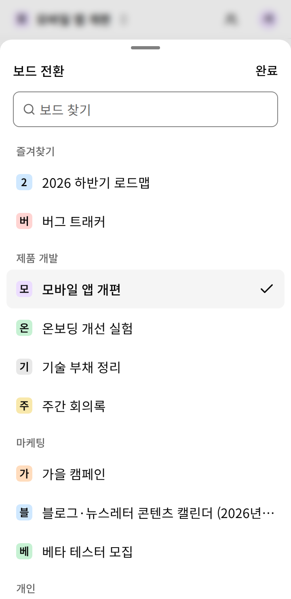   |
|  | 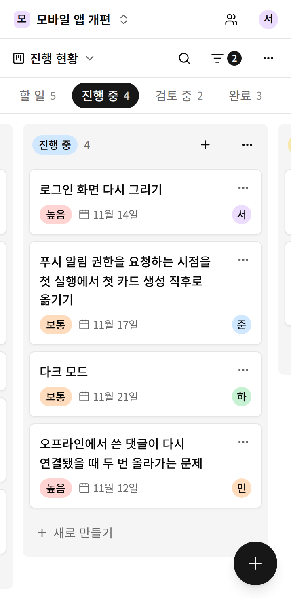 |
|   |   |

- **안 A.** 위쪽 막대 왼쪽의 단추(☰)가 넓은 화면의 사이드바를 그대로 왼쪽에서 밀어 넣는다(너비 288px, 뒤는 어두워진다). 바깥을 누르거나, 보드를 고르거나, 뒤로 가면 닫힌다. 한 줄의 높이는 44px. 넓은 화면은 고정 사이드바다.
- **안 B.** 좁은 화면에는 서랍이 없다. 위쪽 막대의 보드 이름이 단추이고, 누르면 아래에서 "보드 전환" 시트가 올라온다: 검색 칸, 카테고리별 보드 목록, "보드 추가". 설정과 계정은 위쪽 막대 오른쪽의 내 사진으로 간다. 넓은 화면은 A와 같은 고정 사이드바이고, 같은 목록이 명령 팔레트(Ctrl K)로 뜬다.

|      | 안 A                                                                                                                                           | 안 B                                                                                                                                                              |
| ---- | ---------------------------------------------------------------------------------------------------------------------------------------------- | ----------------------------------------------------------------------------------------------------------------------------------------------------------------- |
| 장점 | 넓은 화면과 같은 것이라 배울 것이 없다. 카테고리 접기·메뉴·순서 변경, 보드의 "…", 설정이 한자리에 있다. 생성된 사이드바가 이미 이렇게 동작한다 | 목록이 엄지 가까이(화면 아래쪽)에 온다. 검색이 먼저 보인다. 위쪽 막대에 단추 하나가 준다                                                                          |
| 단점 | 여는 단추가 화면 왼쪽 위라 한 손으로는 가장 먼 자리다. 가장자리에서 미는 제스처는 iOS의 뒤로 가기와 겹쳐서 넣지 않았다                         | 카테고리를 접고 옮기고 이름을 바꾸는 자리가 없어진다(시트 안에 다시 만들어야 한다). 넓은 화면과 구조가 달라 두 벌을 만든다. 보드 이름이 길면 단추가 막대를 채운다 |

**권고: 안 A.** 사이드바가 하는 일(카테고리 관리, 보드의 메뉴, 드래그로 순서 변경)을 한 벌로 두 크기에 쓸 수 있고, W3의 범위가 늘지 않는다. 안 B의 시트는 버리지 않고 W5의 "보드 전환(검색)"을 좁은 화면에 그릴 때의 모습으로 쓴다(서랍의 "보드 찾기" 칸이 이 시트를 연다. 스파이크에서도 그렇게 이어져 있다).

## 2. 칸반

| 안 A: 한 열씩 넘기기                                                  | 안 B: 좁은 열을 자유롭게 스크롤                                       |
| --------------------------------------------------------------------- | --------------------------------------------------------------------- |
|  | 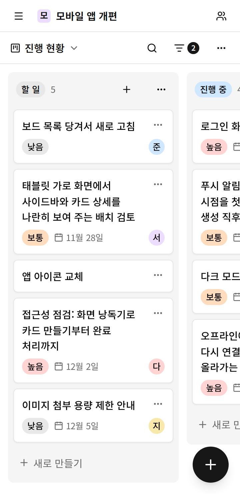 |

넓은 화면은 두 안이 같다(`kanban-a-1280.png`와 `kanban-b-1280.png`는 같은 그림이다).


- **안 A.** 열 하나가 화면 너비에서 양쪽 28px씩을 뺀 만큼(360px 화면에서 304px)이고, 가로로 넘기면 열 하나에 멈춘다(CSS scroll snap). 양옆에 이웃 열이 16px씩 비친다. 머리글 아래의 탭 줄이 열 이름과 카드 수를 보여 주고, 지금 보이는 열을 표시하고, 누르면 그 열로 간다. 열이 많으면 탭 줄이 가로로 스크롤된다.
- **안 B.** 열이 256px(넓은 화면은 272px)이고 멈추는 자리 없이 스크롤된다. 한 열과 다음 열의 3분의 1이 보인다. 탭 줄은 없다.

|      | 안 A                                                                                                                                                 | 안 B                                                                                                                          |
| ---- | ---------------------------------------------------------------------------------------------------------------------------------------------------- | ----------------------------------------------------------------------------------------------------------------------------- |
| 장점 | 카드가 넓어(304px 대 256px) 긴 제목이 덜 접힌다. 지금 어느 열인지, 열이 몇 개인지 늘 보인다. 탭으로 먼 열에 한 번에 간다                             | 넓은 화면과 같은 동작이라 따로 만들 것이 없다. 두 열이 함께 보여 옮길 곳을 보면서 끌 수 있다. 머리글 아래에 줄이 하나 덜 든다 |
| 단점 | 탭 줄이 세로 44px를 쓴다. 두 열을 나란히 보지 못한다. 드래그 중 가장자리 자동 스크롤과 snap이 부딪히므로 끄는 동안 snap을 꺼야 한다(확인하지 못했다) | 열이 어중간한 자리에 멈춘다. 카드가 좁다. 열이 여럿이면 지금 어디쯤인지 알 길이 없다                                          |

**권고: 안 A.** 휴대폰에서 칸반은 "한 열을 훑어본다"가 대부분이고, 그때 필요한 것은 넓은 카드와 지금 위치다. 다른 열로 옮기는 일은 A에서 불편해지므로 두 가지로 받친다(Q4): 끄는 중에 탭 위에 올리면 그 열로 넘어가게 하고, 카드의 "…"에 "다른 열로 이동"을 둔다(그림의 메뉴에 넣어 두었다).

두 안 모두 카드 위에서 시작한 쓸기는 스크롤이고, 카드를 집는 것은 300ms 길게 누르기다(`docs/spike-drag.md`의 "드래그의 시작"). 이 화면에는 드래그가 들어 있지 않다.

## 3. 테이블

| 안 A: 고정 열과 가로 스크롤                                          | 안 B: 행을 카드처럼 쌓기                                             |
| -------------------------------------------------------------------- | -------------------------------------------------------------------- |
|  | 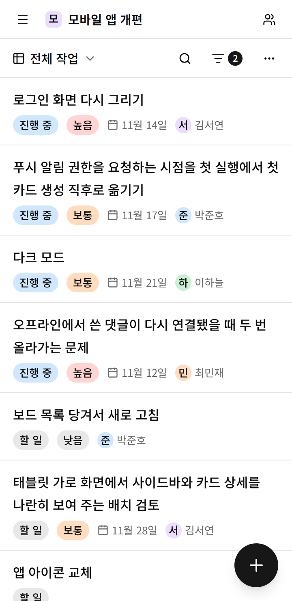 |

넓은 화면은 두 안이 같다(`table-a-1280.png`와 `table-b-1280.png`는 같은 그림이다).

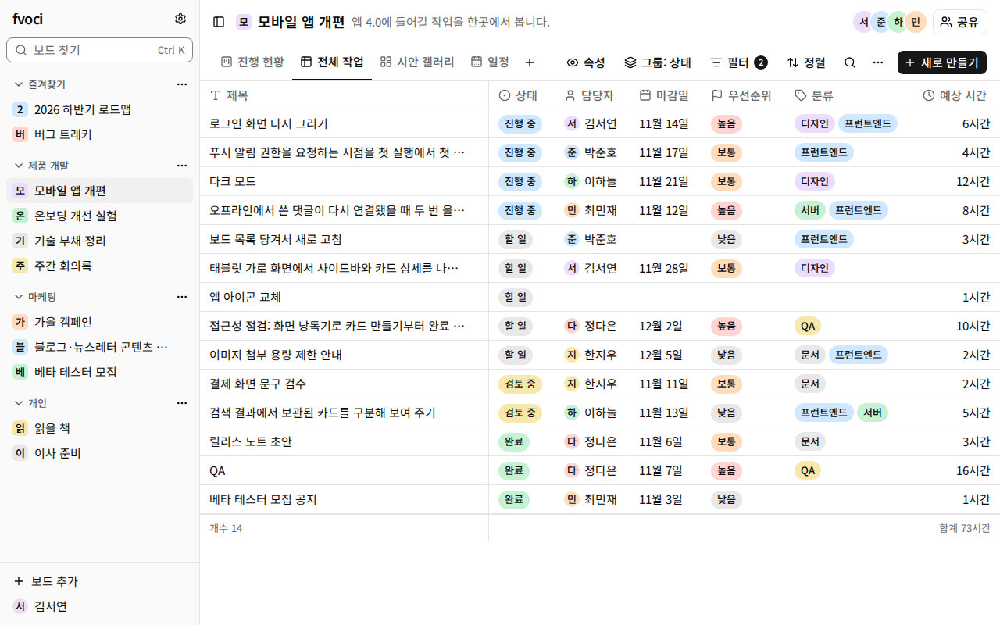

- **안 A.** 좁아도 표다. 제목 열(160px)이 왼쪽에 고정되고 나머지 열이 그 밑으로 가로로 지나간다. 머리 행은 위에, 계산 행은 아래에 고정된다. 한 행의 높이는 44px. 그림은 오른쪽으로 82px 민 상태다(상태 열이 제목 열 밑으로 들어갔고, 제목 열 오른쪽에 그림자가 생겼다).
- **안 B.** 좁은 화면에서는 열이 없다. 행마다 제목 전체와, 뷰에 보이도록 켠 속성을 그 아래 한 줄로 쌓는다. 가로 스크롤이 없다.

|      | 안 A                                                                                                               | 안 B                                                                                                                                                                   |
| ---- | ------------------------------------------------------------------------------------------------------------------ | ---------------------------------------------------------------------------------------------------------------------------------------------------------------------- |
| 장점 | 표가 하는 일이 남는다: 같은 속성을 위아래로 견주기, 열 머리글의 메뉴(정렬, 숨기기), 계산 행. 넓은 화면과 한 벌이다 | 제목이 잘리지 않는다. 한 화면에 한 카드의 정보가 다 보인다. 가로 스크롤이 없어 세로로만 민다                                                                           |
| 단점 | 제목이 열 자쯤에서 잘린다. 한 번에 보이는 속성이 두 개 남짓이다. 가로와 세로 두 방향 스크롤이 한 손가락에 걸린다   | 표가 아니게 된다: 열 머리글이 없어 그 메뉴와 열 너비·순서 조절, 계산 행을 다른 데로 옮겨야 한다. 속성이 많으면 한 행이 길어진다. 좁은 화면 전용 화면을 한 벌 더 만든다 |

**권고: 안 A.** 테이블 뷰를 고른 사람은 표를 보려는 것이고, 한 장씩 읽으려면 칸반이나 갤러리가 있다. A는 넓은 화면의 표에 `position: sticky` 두 줄을 더한 것이라 W3의 범위 안이다. 안 B는 "좁은 화면의 테이블"이 아니라 새 뷰(목록)에 가깝다. 필요하면 W6에서 테이블 뷰의 표시 방식으로 더하는 것을 따로 정한다(Q6).

## 4. 카드 상세

| 안 A: 전체 화면 페이지                                               | 안 B: 거의 전체 높이의 바닥 시트                                     |
| -------------------------------------------------------------------- | -------------------------------------------------------------------- |
| 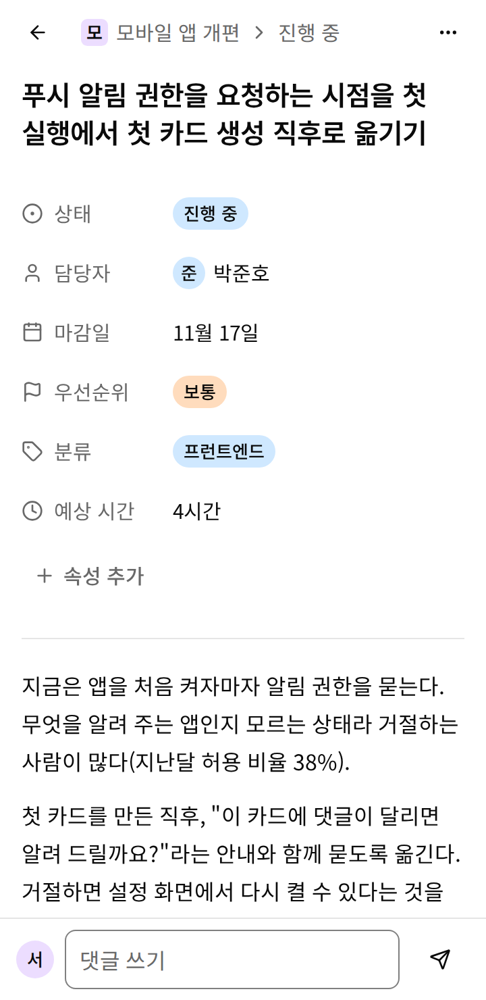  | 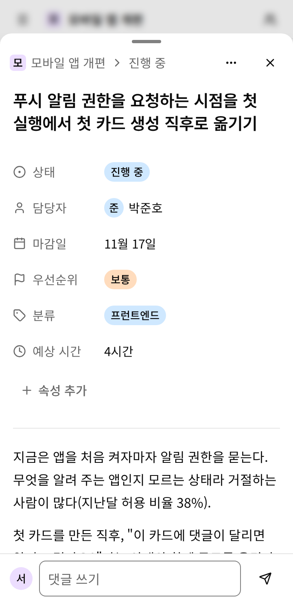  |
|  |  |

- **안 A.** 좁은 화면에서 카드는 화면 전체를 차지하는 페이지다. 왼쪽 위에 뒤로 화살표, 그 옆에 어느 보드의 어느 열인지, 오른쪽에 "…". 넓은 화면에서는 가운데의 대화상자(너비 768px)이고 뒤의 보드는 흐려진다.
- **안 B.** 좁은 화면에서 아래에서 올라오는 시트이고 위로 40px만큼 보드가 비친다. 위에 손잡이 표시, 오른쪽에 닫기(X). 넓은 화면에서는 오른쪽 가장자리의 패널(너비 640px)이고 보드는 흐려지지 않은 채 옆에 남는다.
- **두 안에 공통.** 위에서부터 제목, 속성 목록, 본문, 첨부, 댓글. 속성은 한 줄에 이름과 값이고, 값 전체가 누르는 대상이다(높이 44px). 댓글 입력 칸은 바닥에 고정된다.

|      | 안 A                                                                                                                                                             | 안 B                                                                                                                                                                                                                      |
| ---- | ---------------------------------------------------------------------------------------------------------------------------------------------------------------- | ------------------------------------------------------------------------------------------------------------------------------------------------------------------------------------------------------------------------- |
| 장점 | 카드가 곧 주소이고 뒤로 가기가 곧 닫기다(모바일 브라우저의 기본 동작과 같다). 세로 공간을 다 쓴다. 속성 편집 시트가 그 위에 뜰 때 층이 둘뿐이다. 스크롤이 하나다 | 보드 위에 떠 있다는 것이 보인다. 아래로 끌어 닫는 동작을 기대할 수 있다. 넓은 화면의 패널은 보드를 보면서 카드를 읽게 해 준다(카드를 바꿔 가며 보기 좋다)                                                                 |
| 단점 | 어느 보드에서 왔는지가 맨 윗줄의 글자로만 남는다                                                                                                                 | 시트(카드) 위에 시트(속성 편집)가 겹친다. 시트를 끌어 닫는 제스처와 본문 스크롤이 같은 손가락에 걸린다. 비치는 40px는 정보가 없다(흐려져 있다). 넓은 화면의 패널은 생성된 시트가 늘 뒤를 가려서 부품을 새로 만들어야 한다 |

**권고: 안 A.** 좁은 화면에서 카드는 가장 오래 머무는 화면이고 키보드가 올라오는 화면이다. 세로 공간과 단순한 층이 이긴다. 넓은 화면은 원본과 같은 가운데 대화상자다. 안 B의 넓은 화면(옆 패널)은 따로 떼어 볼 만하지만 모바일과는 다른 결정이므로 Q8로 뺐다.

노치와 홈 인디케이터가 있는 기기에서의 안 A와, 어두운 화면:

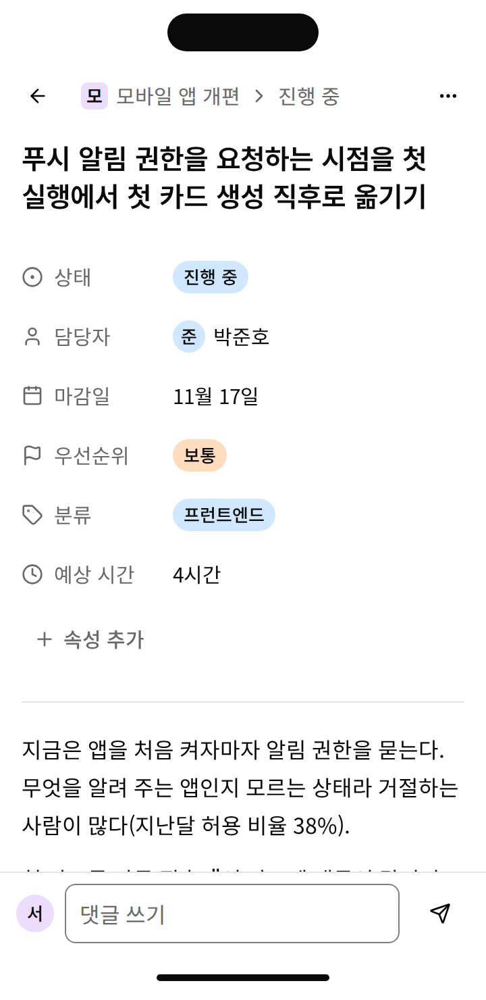 

## 5. 메뉴

네 가지를 그렸다: 보기 설정(필터·정렬·그룹), 카드의 "…" 메뉴, **선택 속성의 선택지 고르기**, **날짜 선택기**. 뒤의 둘은 속성 편집기를 만드는 작업이 이 안에 맞춘다.

갈림길은 네 가지에 공통이다. **안 A: 좁은 화면에서는 바닥 시트, 넓은 화면에서는 팝오버. 안 B: 좁은 화면에서도 누른 자리 옆의 팝오버 그대로.** 공정하게 견주려고 B의 팝오버도 손가락 화면에서는 줄 높이를 44px로 키웠다. 넓은 화면은 두 안이 같다(`menu-*-a-1280.png`와 `menu-*-b-1280.png`는 같은 그림이다).

### 보기 설정 (필터·정렬·그룹)

| 안 A                                                                     | 안 B                                                                     | 넓은 화면                                                           |
| ------------------------------------------------------------------------ | ------------------------------------------------------------------------ | ------------------------------------------------------------------- |
| 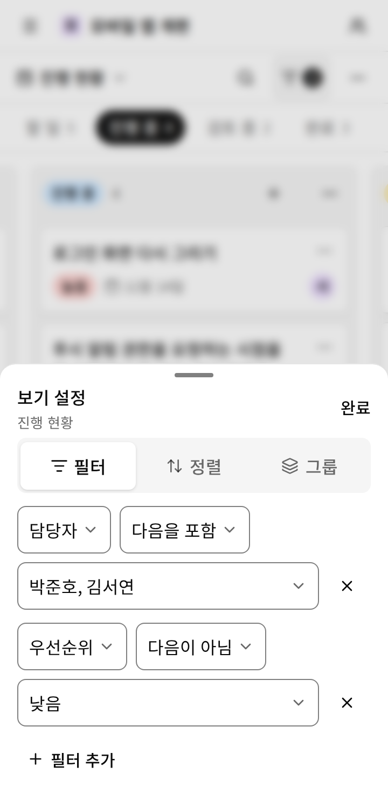 |  |  |

넓은 화면에서는 필터, 정렬, 그룹이 저마다의 단추와 팝오버다. 안 A의 좁은 화면에서는 머리글에 단추 하나의 자리만 있으므로 셋을 탭으로 나눈 시트 하나("보기 설정")로 모았다. 필터 한 줄(속성, 조건, 값)은 좁으면 두 줄로 접힌다. 안 B는 넓은 화면의 필터 팝오버를 화면 너비에 맞춰 줄인 것이다.

### 카드의 "…" 메뉴

| 안 A                                                                     | 안 B                                                                     | 넓은 화면                                                           |
| ------------------------------------------------------------------------ | ------------------------------------------------------------------------ | ------------------------------------------------------------------- |
|  |  |  |

시트의 제목 아래에 어느 카드의 메뉴인지 카드 제목을 적는다(시트는 누른 자리와 떨어져 뜨므로). 한 줄은 48px, 삭제는 선으로 갈라 맨 아래에 둔다. 홈 인디케이터가 있는 기기에서는 `menu-card-a-360-safe.png`.

### 선택 속성의 선택지 고르기

| 안 A                                                                       | 안 B                                                                       | 넓은 화면                                                             |
| -------------------------------------------------------------------------- | -------------------------------------------------------------------------- | --------------------------------------------------------------------- |
| 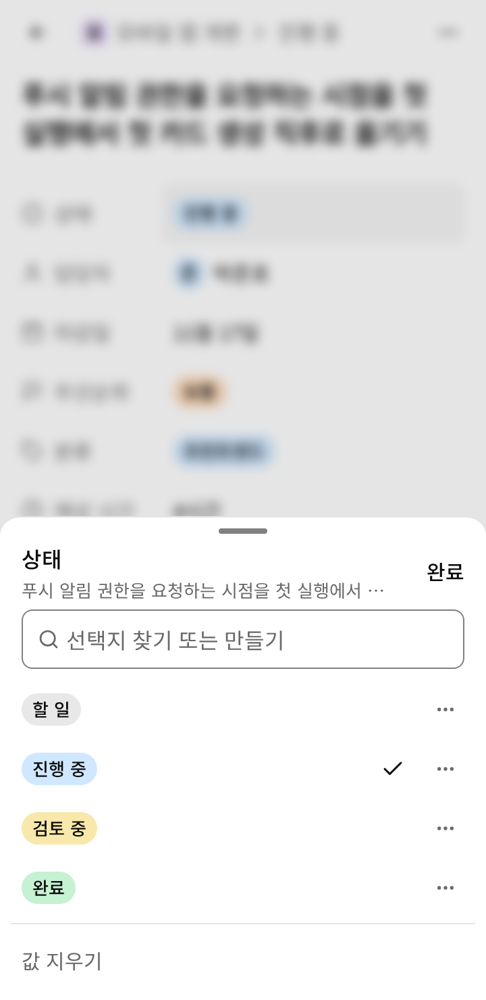 | 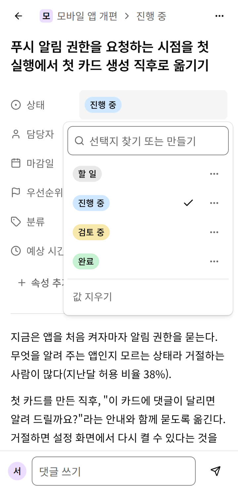 |  |

속성 값을 누르면 뜬다. 위에서부터: 속성 이름(시트에서는 그 아래에 카드 제목), 선택지를 찾거나 새로 만드는 입력 칸, 선택지 목록(고른 것에 체크, 오른쪽의 "…"는 그 선택지의 이름·색 고치기), "값 지우기". 하나를 고르면 닫힌다. 스파이크에서는 좁은 화면과 넓은 화면이 같은 내용 컴포넌트(`SelectPicker.svelte`)를 쓰고 겉(`Surface.svelte`: 시트 또는 팝오버)만 바뀐다.

가상 키보드가 올라왔을 때(키보드는 가짜로 그렸다):

| 안 A                                                                             | 안 B                                                                             |
| -------------------------------------------------------------------------------- | -------------------------------------------------------------------------------- |
|  | 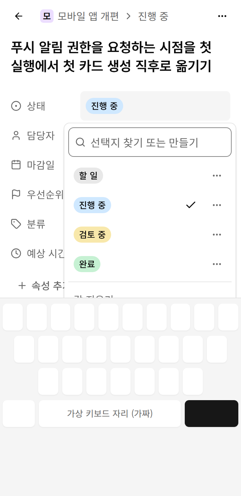 |

시트는 키보드 위에 올라앉고 남은 높이 안에서 목록이 스크롤된다. 팝오버는 누른 자리에 묶여 있어서 아래쪽 줄("값 지우기")이 키보드에 가려진다. 속성이 목록의 아래쪽에 있을수록 더 가려진다.

### 날짜 선택기

| 안 A                                                                     | 안 B                                                                     | 넓은 화면                                                           |
| ------------------------------------------------------------------------ | ------------------------------------------------------------------------ | ------------------------------------------------------------------- |
| 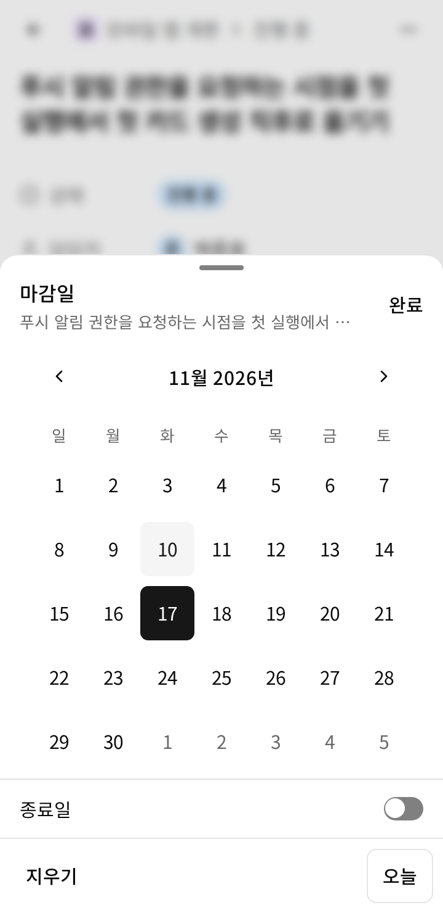 |  |  |

달력 한 달, "종료일" 스위치(켜면 기간), "지우기"와 "오늘". 날짜 한 칸은 마우스에서 32px, 손가락에서 44px이다. 일곱 칸이 308px이라 360px 화면에 여백과 함께 들어간다. 어두운 화면은 `menu-date-a-360-dark.png`.

### 장점과 단점, 권고

|      | 안 A (바닥 시트)                                                                                                                                                               | 안 B (팝오버 그대로)                                                                                                                                             |
| ---- | ------------------------------------------------------------------------------------------------------------------------------------------------------------------------------ | ---------------------------------------------------------------------------------------------------------------------------------------------------------------- |
| 장점 | 늘 같은 자리(엄지가 닿는 아래쪽)에 같은 너비로 뜬다. 키보드와 함께 움직인다. 화면 너비를 다 쓴다(필터 한 줄, 달력). 뒤로 가기로 닫힌다. 손가락이 고르는 것을 가리지 않는다     | 누른 것 바로 옆에 떠서 무엇의 메뉴인지 분명하다. 넓은 화면과 한 벌이다. 뒤의 화면이 흐려지지 않는다                                                              |
| 단점 | 누른 자리와 떨어져 뜬다(그래서 제목 아래에 대상을 적는다). 겉을 고르는 부품이 하나 더 필요하다(스파이크의 `Surface`, `ActionMenu`). 줄이 두셋뿐인 메뉴에는 과하게 보일 수 있다 | 뜨는 자리가 누른 자리마다 다르고, 화면 위쪽에서 뜨면 엄지가 닿지 않는다. 키보드에 가려진다. 손가락 크기로 키우면 달력과 필터는 어차피 화면 너비를 거의 다 채운다 |

**권고: 안 A.** 규칙은 하나다: **좁은 화면(768px 미만)이면 바닥 시트, 아니면 팝오버.** 포인터가 아니라 너비로 가른다. 태블릿은 넓으므로 팝오버이고 줄만 44px로 커진다(`menu-select-a-820.png`). 줄이 두셋뿐인 메뉴도 예외 없이 시트로 한다(규칙이 하나여야 어디서 뜰지 예상할 수 있다).

속성 편집기 작업이 맞출 것:

- 편집기의 **내용**(선택지 목록, 달력, 사람 목록)은 겉을 모르는 컴포넌트로 만든다. 겉은 "좁으면 시트, 아니면 팝오버"를 정하는 부품 하나가 맡는다.
- 한 줄의 높이는 `min-h-8 pointer-coarse:min-h-touch`(시트 안에서는 48px), 달력의 칸은 `--cell-size`를 `pointer-coarse:`에서 `--spacing-touch`로.
- 입력 칸은 생성된 `Input`(`text-base md:text-sm`)에 `pointer-coarse:h-touch`. 열릴 때 자동으로 초점을 주는 것은 포인터가 손가락이 아닐 때만.
- 시트의 높이는 `100dvh - 안전 영역(위) - 키보드 - 3rem`을 넘지 않고, 내용이 그 안에서 스크롤된다.

## 6. 뷰 머리글의 축약

넓은 화면(1024px 이상)의 머리글은 한 줄이다: 뷰 탭 넷과 "+", 속성, 그룹, 필터, 정렬, 검색, "…", "새로 만들기". 두 안이 같다(`header-a-1280.png`와 `header-b-1280.png`는 같은 그림이다).


| 안 A: 한 줄과 "…"                                                     | 안 B: 두 줄                                                           |
| --------------------------------------------------------------------- | --------------------------------------------------------------------- |
| 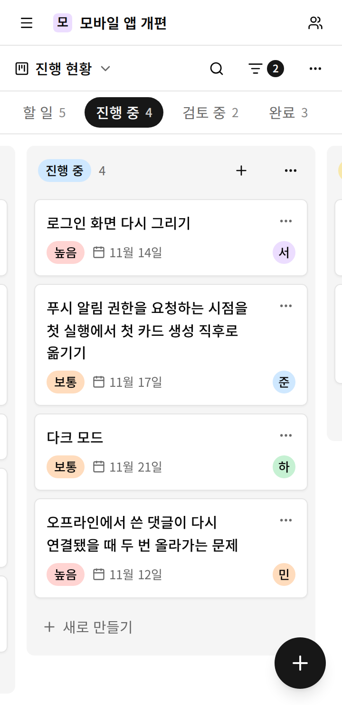 |  |

- **안 A.** 한 줄(48px). 뷰 탭은 지금 뷰의 이름을 적은 단추 하나가 되고, 누르면 뷰 목록이 시트로 뜬다. 검색과 필터(걸린 필터의 수)는 아이콘으로 남는다. 정렬, 그룹 기준, 속성과 뷰의 이름 바꾸기·복제·내보내기·삭제는 "…" 뒤로 간다. "새로 만들기"는 머리글에서 빠져 화면 오른쪽 아래의 둥근 단추(56px)가 된다.
- **안 B.** 두 줄(93px). 첫 줄은 뷰 탭이 그대로이고 가로로 스크롤된다. 둘째 줄은 검색, 필터, 정렬, 그룹, "…"가 아이콘으로, "새로 만들기"가 글자 있는 단추로 들어간다.

안 A에서 접힌 것이 들어 있는 두 시트:

 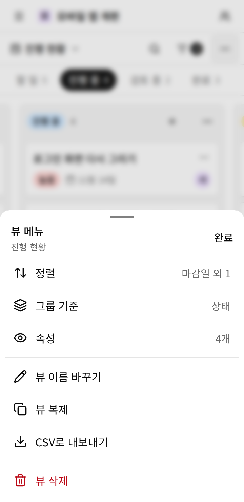

|      | 안 A                                                                                                                                          | 안 B                                                                                                                                                                                                                                    |
| ---- | --------------------------------------------------------------------------------------------------------------------------------------------- | --------------------------------------------------------------------------------------------------------------------------------------------------------------------------------------------------------------------------------------- |
| 장점 | 내용이 45px 위에서 시작한다. 칸반(안 A)의 열 탭까지 합쳐도 위쪽이 세 줄이다. "새로 만들기"가 엄지 자리에 있다. 뷰가 열 개여도 모양이 같다     | 뷰 전환과 정렬·그룹이 한 번에 눌린다. 넓은 화면의 머리글과 닮았다                                                                                                                                                                       |
| 단점 | 뷰 전환이 두 번 누르기다. 정렬과 그룹이 한 단계 안에 있다. 둥근 단추가 내용의 오른쪽 아래를 가린다(테이블의 마지막 열, 칸반 카드의 사람 표시) | 위쪽이 네 줄이 된다(위쪽 막대, 뷰 탭, 도구, 칸반의 열 탭: 740px 가운데 186px. 안 A는 141px). 360px에서 도구 다섯과 "새로 만들기"가 한 줄에 들어가지 않아 문구를 "새 카드"로 줄여야 했다. 가로로 스크롤되는 줄이 둘 겹친다(뷰 탭, 열 탭) |

**권고: 안 A.** 휴대폰에서 모자란 것은 세로 공간이고, 자주 누르는 것은 뷰 전환이 아니라 카드다. "새로 만들기"의 자리(둥근 단추인지 머리글인지)는 접는 방식과 따로 정할 수 있어서 Q16으로 뺐다.

768–1023px(세로로 든 태블릿)에서도 사이드바 옆에 머리글 전체가 들어가지 않으므로 접힌 머리글을 쓴다:

 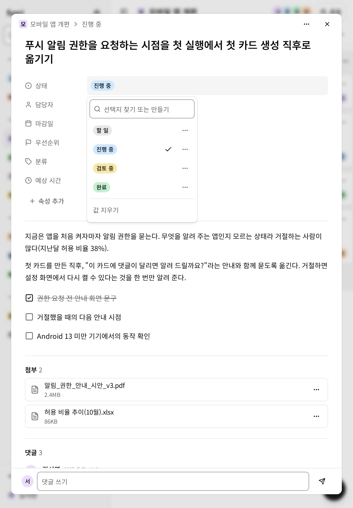

## 질문 목록

제품 책임자가 답할 것이다. 질문마다 선택지, 권고, 그 답이 정하는 것을 적었다.

### 화면별 안

**Q1. 사이드바: 좁은 화면에서 서랍인가, 보드 전환 시트인가.**
선택지: (A) 왼쪽에서 미는 서랍 / (B) 서랍 없이 보드 이름을 누르면 뜨는 바닥 시트. 권고: A. 정하는 것: W3의 작업 공간 레이아웃과 위쪽 막대.

**Q2. 보드 전환 시트를 서랍에 더해 "보드 찾기"로 쓸 것인가.**
선택지: (가) 서랍의 "보드 찾기"가 좁은 화면에서는 바닥 시트를, 넓은 화면에서는 명령 팔레트를 연다 / (나) 좁은 화면에서는 서랍 안의 검색 칸으로만 찾는다. 권고: 가. 정하는 것: W5의 보드 전환(검색).

**Q3. 칸반: 한 열씩 넘기는가, 자유롭게 스크롤하는가.**
선택지: (A) 화면 너비의 열 하나에 멈추고 위에 열 탭 / (B) 256px 열을 자유롭게. 권고: A. 정하는 것: W3의 칸반.

**Q4. 한 열씩 넘길 때 카드를 다른 열로 옮기는 방법.**
선택지(여럿을 고를 수 있다): (가) 끄는 중 화면 가장자리에서 옆 열로 넘어간다 / (나) 끄는 중 열 탭 위에 올리면 그 열로 넘어간다 / (다) 카드의 "…"에 "다른 열로 이동". 권고: 가와 다를 W3에, 나는 W6에. 정하는 것: W3의 칸반 드래그와 카드 메뉴, W6의 터치 드래그.

**Q5. 테이블: 고정 열과 가로 스크롤인가, 행을 쌓는가.**
선택지: (A) 제목 열 고정 + 가로 스크롤 / (B) 좁은 화면에서는 행을 카드처럼 쌓는다. 권고: A. 정하는 것: W3의 테이블.

**Q6. 테이블의 고정 열과 터치.**
선택지: 고정 열의 너비를 (가) 좁은 화면에서 160px로 고정 / (나) 넓은 화면에서 정한 너비를 따르되 화면의 절반을 넘지 않게. 열 너비 조절과 열 순서 변경을 터치에서 (가) 지원한다 / (나) 넓은 화면에서만 한다. 쌓은 모양(안 B)을 뒤에 테이블 뷰의 표시 방식으로 더할지. 권고: 너비는 나, 터치의 너비 조절·순서 변경은 W6에서 열 머리글 메뉴의 항목으로, 쌓은 모양은 지금 정하지 않는다. 정하는 것: W3의 테이블, W6.

**Q7. 카드 상세: 좁은 화면에서 전체 화면인가, 바닥 시트인가.**
선택지: (A) 전체 화면 페이지, 뒤로 화살표 / (B) 위로 40px를 남긴 바닥 시트. 권고: A. 정하는 것: W4의 카드 대화상자와 라우터의 카드 주소.

**Q8. 카드 상세: 넓은 화면에서 가운데 대화상자인가, 오른쪽 패널인가.**
선택지: (A) 가운데 대화상자(원본과 같다) / (B) 오른쪽 패널, 보드는 옆에 남는다. 권고: A로 시작한다. B는 부품(뒤를 가리지 않는 패널)을 새로 만들어야 하므로 쓰임을 본 뒤에 정한다. 정하는 것: W4.

**Q9. 카드 안의 순서와 댓글 입력 칸.**
선택지: 순서는 (가) 제목, 속성, 본문, 첨부, 댓글(그림의 순서) / (나) 원본처럼 댓글이 본문보다 먼저. 댓글 입력 칸은 (가) 바닥에 고정 / (나) 댓글 목록의 끝에. 권고: 둘 다 가. 긴 본문 아래의 댓글에 닿으려면 스크롤이 길어지지만 입력 칸이 늘 보인다. 정하는 것: W4의 카드 상세.

**Q10. 메뉴와 편집기: 좁은 화면에서 바닥 시트인가, 팝오버 그대로인가.**
선택지: (A) 좁으면 바닥 시트, 아니면 팝오버 / (B) 늘 팝오버. 권고: A, 예외 없이. 정하는 것: W4의 속성 편집기 15종 전부, W5의 뷰 머리글 메뉴, 그 밖의 모든 "…" 메뉴.

**Q11. 바닥 시트를 닫는 방법.**
선택지: "완료" 단추, 바깥 누르기, 뒤로 가기는 그림에 있다. 여기에 (가) 아래로 끌어 닫기를 더한다 / (나) 더하지 않는다. 권고: W4에서는 나, W6에서 다시 본다. 끌어 닫기는 시트 안의 스크롤과 구분해야 하고(맨 위에 닿았을 때만), 손잡이 표시는 그때까지 장식이다. 정하는 것: W4의 시트 부품, W6.

**Q12. 날짜를 무엇으로 고르는가.**
선택지: (가) 직접 그린 달력(그림) / (나) 좁은 화면에서는 기기의 날짜 입력(`<input type="date">`). 권고: 가. 기기의 입력은 기간(종료일)과 "지우기"를 받지 못하고 로케일·주의 시작 요일이 앱의 설정과 따로 논다. 정하는 것: W4의 날짜 속성 편집기.

**Q13. 고르면 닫히는가.**
선택지: 하나만 고르는 속성(선택, 사람)은 (가) 고르는 즉시 닫힌다 / (나) "완료"를 눌러야 닫힌다. 여러 개를 고르는 속성은 "완료"까지 열려 있다. 권고: 가. 정하는 것: W4의 선택·사람 편집기.

**Q14. 편집기가 열릴 때 검색 칸의 초점.**
선택지: (가) 손가락 화면에서는 초점을 주지 않는다(키보드는 칸을 눌러야 올라온다), 마우스 화면에서는 준다 / (나) 늘 준다. 권고: 가. 선택지가 많은 속성에서는 한 번 더 눌러야 한다. 정하는 것: W4의 편집기, W5의 보드 전환.

**Q15. 뷰 머리글: 한 줄인가, 두 줄인가.**
선택지: (A) 한 줄, 뷰 전환은 단추 하나, 나머지는 "…" / (B) 두 줄, 뷰 탭과 도구. 권고: A. 정하는 것: W3의 뷰 머리글 기본, W5의 뷰 머리글 메뉴.

**Q16. "새로 만들기"의 자리.**
선택지: (가) 오른쪽 아래의 둥근 단추 / (나) 머리글 안 / (다) 좁은 화면에서는 칸반 열의 "+"와 테이블 마지막 행의 "+"만. 권고: 가. 칸반에서는 지금 보이는 열에, 테이블에서는 마지막 행에 만든다. 원본의 "새로 만들기" 옆 화살표(템플릿 고르기)는 둥근 단추에 자리가 없으므로 뷰의 "…" 메뉴에 "템플릿으로 만들기"를 둔다. 정하는 것: W3의 뷰 머리글과 카드 만들기, W5의 템플릿 선택기.

**Q17. 좁은 화면의 검색.**
선택지: (가) 돋보기를 누르면 머리글 한 줄이 검색 칸으로 바뀐다(왼쪽에 닫기) / (나) 검색 칸이 시트로 뜬다 / (다) 머리글 아래에 한 줄이 더 생긴다. 권고: 가. 정하는 것: W5의 검색.

### 화면에 걸치는 것

**Q18. 전환 기준 너비.**
선택지: (가) 768px 미만이 좁은 화면, 1024px부터 뷰 머리글 전체 / (나) 다른 값. 권고: 가. 768은 생성된 사이드바의 기준과 같아 손댈 것이 없다. 뷰 머리글은 뷰포트가 아니라 **중앙 패널의 너비**(컨테이너 쿼리)로 접는 것이 맞다: 사이드바를 접으면 768px에서도 자리가 난다. 스파이크는 뷰포트 너비로 했다. 정하는 것: W3의 레이아웃.

**Q19. 태블릿 너비(768–1023px, 손가락)에서 어느 쪽인가.**
선택지: (가) 넓은 화면의 배치(고정 사이드바, 팝오버, 대화상자)에 손가락 크기, 뷰 머리글만 접는다(`kanban-a-820.png`) / (나) 좁은 화면의 배치(서랍, 시트, 전체 화면). 권고: 가. 다만 세로로 든 태블릿에서 사이드바가 화면의 31%를 차지하므로 처음에는 접힌 채로 시작하게 할지를 함께 정한다. 정하는 것: W3, W6.

**Q20. 가로로 눕힌 휴대폰.**
너비는 넓고(예: 844px) 높이는 낮다(390px). 너비만 보면 태블릿의 배치가 된다: 고정 사이드바가 화면의 30%를 차지하고 대화상자의 높이가 326px이다. 선택지: (가) 높이가 500px 미만이고 포인터가 손가락이면 좁은 화면의 배치를 쓴다(서랍, 전체 화면 카드, 시트는 전체 높이) / (나) 너비만 본다 / (다) 지원 범위에서 뺀다. 권고: 가. 그리지 않았고 확인하지 못했다. 정하는 것: W3의 판별 함수, W6.

**Q21. 뒤로 가기.**
선택지: (가) 카드, 서랍, 모든 시트가 뒤로 가기로 닫힌다. 카드만 주소가 있고 나머지는 방문 기록의 칸만 쓴다 / (나) 카드만 닫힌다(서랍과 시트가 열린 채 뒤로 가면 페이지를 떠난다) / (다) 좁은 화면에서만 가. 권고: 가, 넓은 화면의 팝오버와 메뉴는 빼고. Android의 뒤로 단추와 iOS의 가장자리 쓸기가 같은 일을 하게 된다. 스파이크에서 Chromium의 `history.back()`으로 동작을 확인했다(테스트 3건). 정하는 것: W2의 라우터, W3, W4.

**Q22. 터치에서 hover로만 보이던 것.**
대상: 칸반 카드의 "…", 사이드바 보드 항목과 카테고리의 "…", 테이블 행의 "열기", 열 머리글의 메뉴 단추, 카드 내용 블록의 손잡이와 "+", 댓글의 "…", 툴팁. 선택지: (가) hover가 없는 기기(`hover: none` 또는 `pointer: coarse`)에서는 늘 보인다 / (나) 숨기고 길게 누르기로 메뉴를 연다. 권고: 가. 길게 누르기는 드래그가 이미 쓴다. 툴팁은 손가락 화면에서 뜨지 않으므로 아이콘만 있는 단추에는 화면 낭독기용 이름을 빠짐없이 단다. 생성된 사이드바의 `showOnHover`는 너비(`md`)로 숨기므로 태블릿에서 "…"가 보이지 않는다: 포인터 기준으로 고쳐야 한다. 정하는 것: W3, W4.

**Q23. 누르는 대상을 언제 키우는가.**
선택지: (가) 포인터가 손가락일 때만 44px(그림) / (나) 좁은 화면이면 마우스여도 키운다 / (다) 늘 키운다. 권고: 가. 터치 화면이 달린 노트북은 주 포인터가 마우스라 작은 크기가 된다(확인하지 못했다). 정하는 것: W3부터 모든 화면의 크기 규칙.

**Q24. 터치 드래그의 범위.**
선택지: 카드는 300ms 길게 누르기로 집는다(스파이크의 결론). 그 밖에 좁은 화면에서 드래그로 할 것: (가) 칸반 카드만 / (나) 칸반 열 순서, 사이드바의 보드, 테이블 열 순서, 카드 내용 블록까지. 권고: W3에서는 가, 나머지는 메뉴 항목("왼쪽으로", "오른쪽으로", "카테고리로 이동")을 먼저 두고 드래그는 W6에서. 정하는 것: W3, W6의 터치 드래그.

**Q25. 안전 영역과 `viewport-fit=cover`.**
선택지: (가) `index.html`의 뷰포트 메타에 `viewport-fit=cover`를 넣고 가장자리에 붙는 것마다 `env(safe-area-inset-*)`를 쓴다 / (나) 넣지 않는다(브라우저가 안전 영역 안에만 그린다. 가로로 눕히면 양옆에 띠가 생긴다). 권고: 가. 홈 화면에 추가해 전체 화면으로 쓰는 것(PWA)을 지원할지는 따로 정한다. 정하는 것: W2의 `index.html`, W3.

**Q26. 가상 키보드.**
선택지: (가) 뷰포트 메타의 `interactive-widget=resizes-content`로 레이아웃이 줄어들게 하고(Android Chrome), 줄어들지 않는 브라우저(iOS Safari)에서는 `visualViewport`로 시트와 댓글 입력 줄을 키보드 위로 올린다 / (나) 브라우저에 맡긴다(초점이 간 칸이 보이도록 스크롤만 된다). 권고: 가. 스파이크에는 메타만 넣었고 `visualViewport` 보정은 없다. 정하는 것: W4의 시트 부품과 카드 상세.

**Q27. 시트와 서랍 뒤의 흐림.**
생성된 시트는 뒤를 10% 어둡게 하고 흐리게 한다(`backdrop-blur`). 그림에서 뒤가 뿌옇게 보이는 까닭이다. 선택지: (가) 그대로 / (나) 흐림을 빼고 더 어둡게(예: 40%) / (다) 좁은 화면에서만 나. 권고: 나. 흐림은 저사양 기기에서 스크롤과 애니메이션을 느리게 할 수 있고(재지 않았다), 어두운 화면에서는 시트의 윗변이 뒤와 잘 구분되지 않는다(`menu-date-a-360-dark.png`). 정하는 것: 디자인 토큰과 생성 UI의 수정.

**Q28. 갤러리와 캘린더.**
이번 자료에 없다. 선택지: (가) W5에서 두 뷰를 만들기 전에 같은 방식으로 안을 낸다 / (나) 이번 답을 따라 구현하면서 정한다(갤러리는 1열 또는 2열, 캘린더는 월 격자를 줄이거나 일정 목록으로). 권고: 가, 캘린더만. 갤러리는 열 수만 정하면 된다. 정하는 것: W5.

질문은 모두 **28개**다.

## 스파이크에 있는 것

| 파일                                                        | 내용                                                                              |
| ----------------------------------------------------------- | --------------------------------------------------------------------------------- |
| `spikes/mobile/index.html`, `main.ts`, `mobile.css`         | 진입점. `lang="ko"`, 뷰포트 메타, 안전 영역·키보드 변수, 선택지 색 일곱 가지      |
| `params.ts`, `current.ts`                                   | 화면과 안의 목록, 주소 읽기                                                       |
| `data.ts`, `text.ts`                                        | 가짜 데이터(카테고리 4, 보드 11, 뷰 4, 카드 14, 사람 6), 화면의 문구(한국어 상수) |
| `layout.svelte.ts`                                          | 좁은 화면·넓은 화면·손가락 판별(미디어 쿼리 셋)                                   |
| `history.svelte.ts`                                         | 뒤로 가기로 닫기                                                                  |
| `Shell.svelte`, `AppBar.svelte`, `Index.svelte`             | 화면 조립, 위쪽 막대, 고르는 화면                                                 |
| `AppSidebar.svelte`, `BoardSwitcher.svelte`                 | 사이드바(생성된 `sidebar`), 보드 전환(시트 / 생성된 `command`)                    |
| `ViewHeader.svelte`, `ViewSettings.svelte`                  | 뷰 머리글의 세 모양, 필터·정렬·그룹(생성된 `tabs`)                                |
| `Kanban.svelte`, `Table.svelte`                             | 두 뷰                                                                             |
| `CardDetail.svelte`, `CardBody.svelte`                      | 카드의 틀 넷(페이지, 대화상자, 바닥 시트, 옆 패널)과 내용                         |
| `BottomSheet.svelte`, `Surface.svelte`, `ActionMenu.svelte` | 바닥 시트, "시트 또는 팝오버", "시트 또는 드롭다운 메뉴"                          |
| `SelectPicker.svelte`, `DatePicker.svelte`                  | 선택지 고르기, 날짜 선택기(생성된 `calendar`, `switch`)                           |
| `DeviceChrome.svelte`                                       | 가짜 노치·홈 인디케이터·키보드                                                    |
| `mobile.spec.ts`, `shots.spec.ts`, `support.ts`             | 브라우저 테스트, 스크린샷                                                         |

제품 코드(`src/`)는 고치지 않았다. 의존성도 더하지 않았다.

### 브라우저 테스트로 확인한 것 (Chromium, 기기 흉내)

`pnpm --filter web run spikes:e2e mobile.spec`: 62건 통과, 24건은 다른 쪽 프로젝트의 것이라 건너뜀(2026-11-10 20:29 KST). `touch` 프로젝트는 360×740 손가락, `desktop` 프로젝트는 1280×800 마우스로 본다.

- 화면·안 18가지와 고르는 화면이 오류 없이 뜨고, 문서가 가로로 넘치지 않는다(두 크기 모두).
- 좁은 화면: 서랍이 왼쪽에 뜨고 뒤로 가기로 닫힌다. 보드 전환 시트가 보드 이름에서 열린다. 칸반(A)은 누른 탭의 열이 화면 가운데에 멈추고 이웃 열이 비친다. 칸반(B)에는 탭이 없고 다음 열이 화면 끝에 걸친다. 테이블(A)은 200px를 밀어도 제목 열이 x=0에 있다. 테이블(B)에는 가로로 밀 것이 없다. 카드(A)는 화면을 정확히 채우고 뒤로 가기와 화살표로 닫힌다. 카드(B)는 위로 40px를 남긴다. 네 메뉴는 A에서 화면 너비의 바닥 시트, B에서 화면 안에 들어오는 팝오버다. 카드 위의 시트는 뒤로 가기 한 번에 시트만 닫히고 한 번 더에 카드가 닫힌다.
- 좁은 화면의 크기: 위쪽 막대, 뷰 머리글(두 안), 열 탭, 칸반, 카드 페이지, 네 시트의 모든 단추가 44×44px 이상이다(스위치는 그것을 감싼 줄 전체가 대상이다). 입력 칸의 글자가 16px 이상이다. 머리글의 단추가 화면 밖으로 잘리지 않는다.
- 넓은 화면: 사이드바가 고정이고 보드 전환이 명령 팔레트다. 머리글이 한 줄이고 넘치지 않는다. 카드가 가운데 대화상자(A) 또는 오른쪽 패널(B)이다. 네 메뉴가 두 안 모두 팝오버다. 마우스로 창만 360px로 줄이면 배치는 좁은 화면, 단추는 32px다.

이 테스트가 그림을 그리다 잡은 것: 시트 안의 탭이 37px였던 것, 안 B 머리글의 뷰 탭이 43px였던 것, 카드와 시트가 함께 열린 채 시작하면 뒤로 가기가 카드부터 닫던 것, 안 B 머리글의 "새로 만들기"가 화면 밖으로 나가던 것.

## 생성 UI에서 눈에 띈 것 (고치지 않았다)

모바일 안을 구현할 때 `src/lib/ui`에서 손봐야 할 곳이다. 이번 작업의 범위가 아니라 적어만 둔다.

| 부품                               | 본 것                                                                                                                                                                  |
| ---------------------------------- | ---------------------------------------------------------------------------------------------------------------------------------------------------------------------- |
| `calendar/calendar-caption`        | 달력의 머리가 "11월 2026년"으로 나온다(달과 해를 따로 포맷해 영어 순서로 잇는다). 한국어는 "2026년 11월"이어야 한다. 날짜 그림 네 장에 그대로 찍혀 있다                |
| `command/command-input`            | 입력 줄의 높이가 `h-8!`로 고정이라 손가락 화면에서 44px로 키울 수 없다. 그래서 좁은 화면의 검색 칸은 `Input`으로 그렸다                                                |
| `sidebar/sidebar-menu-action`      | `showOnHover`가 포인터가 아니라 너비(`md`)로 숨긴다. 태블릿에서 보드의 "…"가 보이지 않는다(`kanban-a-820.png`). 단추 자체는 20px이고 좁은 화면에서만 주변 8px를 받는다 |
| `sidebar/sidebar`                  | 서랍(시트)이 열리면 첫 단추(설정)에 초점이 간다. 바꿀 인자가 없다                                                                                                      |
| `sheet/sheet-content`              | 뒤를 가리는 층과 흐림이 늘 그려진다. 뒤를 가리지 않는 옆 패널(카드 안 B의 넓은 화면)에는 쓸 수 없어 스파이크의 CSS에서 그 층을 투명하게 덮어썼다                       |
| `input/input`                      | 글자 크기가 `text-base md:text-sm`, 곧 너비 기준이다. 태블릿(768px 이상, 손가락)에서는 15px가 된다. iPadOS가 이때 확대하는지는 확인하지 못했다                         |
| `switch/switch`                    | 18×32px. 주변으로 넓힌 영역을 더해도 높이가 34px이다. 줄 전체를 `label`로 감싸야 44px가 된다                                                                           |
| `tabs/tabs-trigger`                | 목록 높이에서 7px를 뺀 높이라, 44px 탭을 얻으려면 목록을 51px로 줘야 한다                                                                                              |
| bits-ui의 `child` 스니펫의 `props` | 팝오버와 드롭다운의 트리거에서, 자기 `class` 뒤에 `props`를 펼쳤더니 클래스가 사라졌다. 먼저 펼치고 자기 속성을 뒤에 적으니 남았다(까닭은 파 보지 않았다)              |

## 확인하지 못한 것

이 기기에는 Chromium headless shell 하나뿐이다. 아래는 모두 확인하지 못했다.

- **실제 기기 전부.** 그림은 Chromium의 기기 흉내(뷰포트, 터치, 기기 픽셀 비율)다. 손가락으로 눌러 본 적이 없다: 44px가 실제로 충분한지, 한 손으로 닿는 범위, 열 넘김의 손맛.
- **Safari(iOS, iPadOS)와 Firefox.** `env(safe-area-inset-*)`의 실제 값, `100dvh`와 주소 표시줄, 16px 미만 입력 칸의 확대, 가장자리 쓸기로 뒤로 갈 때 서랍과 시트가 닫히는지와 그때의 화면 전환, `pointer-coarse:`가 기기별로 어떻게 판정되는지(터치 노트북, 펜, 마우스를 붙인 태블릿).
- **가상 키보드.** 그림의 키보드는 가짜이고 높이(296px)도 어림이다. `interactive-widget=resizes-content`가 실제로 레이아웃을 줄이는지, iOS에서 시트가 키보드 뒤에 남는지, 한글 조합 중에 선택지 목록이 어떻게 걸러지는지.
- **노치와 홈 인디케이터.** 그림은 고정값(위 47px, 아래 34px)으로 그렸다. 가로로 눕혔을 때의 왼쪽·오른쪽 안전 영역은 다루지 않았다.
- **scroll snap과 드래그.** 칸반(A)에서 카드를 끄는 동안의 자동 스크롤과 snap의 충돌, 길게 누르기와 가로 넘김의 구분. 이 스파이크에는 드래그가 없다.
- **시트를 아래로 끌어 닫기, 당겨서 새로 고침과의 충돌**(`overscroll-behavior`는 넣었으나 기기에서 보지 못했다).
- **가로로 눕힌 휴대폰, 접는 기기, 분할 화면.** 그리지 않았다.
- **화면 낭독기**(TalkBack, VoiceOver)에서 시트·서랍·전체 화면 카드의 초점 이동과 읽는 순서. 좁은 화면의 카드 페이지는 스파이크에서 대화상자가 아니라 겹쳐 그린 영역이라 뒤의 보드가 읽힌다(제품에서는 페이지 전환이다).
- **브라우저의 글자 크기를 키웠을 때**(200%)와 **움직임 줄이기** 설정에서의 배치.
- **뒤를 흐리는 효과의 비용**(저사양 Android).
- **보드 아이콘.** 원본은 이모지인데 이 기기에 이모지 글꼴이 없어 색 네모와 이름의 첫 글자로 그렸다. 이모지의 크기와 줄 맞춤은 보지 못했다.
- **글꼴.** 그림은 결정된 글꼴 설정(한국어는 Noto Sans KR이 스택 맨 앞, 영문·숫자·문장부호도 그 글꼴)으로 2026-11-10 20:33 KST에 다시 찍은 것이다. 처음 찍은 것(라틴 글꼴 먼저)과 견주어 줄 수와 잘리는 자리가 달라진 곳을 하나하나 대조하지는 않았다. 다시 찍은 50장 가운데 세 장(`kanban-a-360`, `menu-date-a-360`, `table-a-1280`)을 열어 봤다.

## 그림에서 어색한 채로 둔 곳

- 서랍과 시트 뒤가 뿌옇다(생성 UI의 흐림. Q27).
- 날짜 그림의 "11월 2026년"(위 표).
- 테이블(A)에서 둥근 "새로 만들기" 단추가 마지막 행들의 오른쪽 값을 가린다(Q16의 단점 그대로).
- 테이블의 마지막 행과 계산 행 사이에 선이 두 줄 겹친다.
- 넓은 화면의 칸반에서 넷째 열이 오른쪽에서 잘린다(1280px에 사이드바와 272px 열 넷이 들어가지 않는다. 가로 스크롤이 있다는 뜻이고 잘못은 아니다).
- 안 B 카드의 넓은 화면(옆 패널)은 패널과 보드의 경계가 옅다.
- 가짜 키보드는 자리만 맞고 생김새는 대충이다.
