# 모바일 화면 안

작성: 2026-11-10 20:24 KST(기준 커밋 `ce3ba0bd`). 중간 단계를 더해 고침: 2026-11-10 21:37 KST(기준 커밋 `3fb77298`, "Porting notes for the parts built while waiting for the server's contract").

보드 페이지를 좁은 화면에서 어떻게 그릴지 **구현하기 전에 고르기 위한 자료**다. 플랜의 W6("화면별 안을 먼저 합의한다. 합의는 W3 착수 전에 한다")에 해당한다. 완성된 화면이 아니다. 가짜 데이터로 그린 정적인 화면이고, 열리고 닫히는 것과 탭 전환 정도만 움직인다. 서버, API, 라우터, 상태 모듈, 드래그는 들어 있지 않다.

두 번째 판에서 더한 것: 좁은 화면과 넓은 화면 사이의 **중간 단계**(폴더블, 태블릿), 단계의 **경계 값**, 부품이 창이 아니라 **자기가 놓인 칸의 너비**를 보는 구현, 쓰는 도중에 **창 크기가 바뀔 때**의 동작, **접히는 자리**와 **좌우가 다른 안전 영역**의 점검.

**결정이 났다(2026-11-10 22:00 KST).** 바로 아래 "결정" 절에 질문 36개의 답과, 답마다 바꾸려면 어디를 고치는지가 있다. 그 아래의 글은 결정 전에 쓴 안과 권고 그대로다.

읽는 순서: 결정 → 크기와 단계 → 경계 값 → 화면별 전환 표 → 화면별 안과 권고(여섯 절) → 질문 목록(Q1–Q36) → 한가운데 세로선 → 안전 영역 → 창 크기가 바뀔 때 → 확인하지 못한 것. 답이 필요한 것은 질문 목록에 모았다.

## 결정 (2026-11-10 22:00 KST에 받음, 2026-11-11 00:30 KST에 만든 화면에 맞춰 적음)

질문 36개의 답이다. 제품 책임자의 결정: **모두 권고대로 만들고, 돌아가는 화면을 써 보며 고친다.** 권고가 없거나 거둔 둘은 따로 정했다: **Q8은 A(가운데 대화상자)**, **Q35는 나(받아들이고 실제 기기에서 본 뒤 다시 정한다)**. Q10(좁은 화면의 메뉴가 시트인가 팝오버인가)은 권고대로 만들었지만 **아직 정하지 못한 것으로 두고 한 곳에서 바꿀 수 있게** 했다. Q27은 이번 지시("시트 뒤의 흐림은 기기의 투명도 줄이기 설정을 따른다")가 권고를 대신한다.

아래 본문의 "권고"는 결정 전에 쓴 글 그대로다. 이 절이 그것을 결정으로 바꾼다. 답마다 **바꾸려면 어디를 고치는지**를 적었다. 여러 답이 한 곳에 모여 있다: 단계와 경계는 `src/styles/app.css`의 `@theme static`과 `src/lib/layout/room.svelte.ts`, "무엇이 어떤 모양으로 뜨는가"는 `src/lib/layout/presentation.ts`의 세 함수.

| 질문                            | 결정                                                                                                                         | 만든 모습                                                                                                                                                                                                                                                                                                                         | 바꾸려면                                                                                                                                                                                                                                                                                           |
| ------------------------------- | ---------------------------------------------------------------------------------------------------------------------------- | --------------------------------------------------------------------------------------------------------------------------------------------------------------------------------------------------------------------------------------------------------------------------------------------------------------------------------- | -------------------------------------------------------------------------------------------------------------------------------------------------------------------------------------------------------------------------------------------------------------------------------------------------- |
| Q1 사이드바(좁음)               | A: 왼쪽에서 미는 서랍                                                                                                        | 좁은 단계에서 위쪽 막대의 ☰가 서랍을 연다                                                                                                                                                                                                                                                                                        | 모양의 규칙은 `lib/layout/presentation.ts`의 `sidebarShape`, 서랍 자체는 `features/shell/`(서랍의 상자와 닫는 길은 `AppShell.svelte`, 열림 상태는 `sidebar-state.svelte.ts`)                                                                                                                       |
| Q2 보드 찾기                    | 가: 좁으면 시트, 넓으면 명령 팔레트                                                                                          | **이번에는 만들지 않았다**(보드 전환은 W5). 사이드바 안의 검색 칸으로 제목을 거르는 것만 있다                                                                                                                                                                                                                                     | W5에서 `features/shell/`에 더한다                                                                                                                                                                                                                                                                  |
| Q3 칸반(좁은 칸)                | A: 한 열씩 넘기기와 열 탭                                                                                                    | 칸이 544px 미만이면 한 열에 멈추고 위에 탭 줄                                                                                                                                                                                                                                                                                     | `features/views/kanban/`(`Kanban.svelte`의 스크롤 상자의 `snap-x snap-mandatory`, 탭 줄은 `ColumnTabs.svelte`). 경계는 `app.css`의 `--container-columns`                                                                                                                                           |
| Q4 다른 열로 옮기기             | 가와 다를 지금, 나는 W6                                                                                                      | 끄는 중 가장자리에서 옆 열로 넘어가고, 카드 메뉴에 "다른 열로 이동"이 있다. 탭 위에 올려 넘기기(나)는 없다                                                                                                                                                                                                                        | 같은 폴더(끄는 동안 멈춤을 푸는 것은 `Kanban.svelte`의 `snap-none`과 `data-drag-scroll="x"`, 메뉴는 `CardMenu.svelte`)                                                                                                                                                                             |
| Q5 테이블(좁은 칸)              | A: 제목 열 고정과 가로 스크롤                                                                                                | 좁아도 표다                                                                                                                                                                                                                                                                                                                       | `features/views/table/`(고정은 `Table.svelte`의 `data-sticky` 두 묶음과 `host.ts`의 `PINNED`)                                                                                                                                                                                                      |
| Q6 테이블의 고정 열과 터치      | 너비는 나(정한 너비를 따르되 칸의 절반까지), 터치의 너비·순서는 열 머리글 메뉴로, 쌓은 모양은 정하지 않음                    | 기본 너비 160/224/352px, 메뉴에 "더 넓게·더 좁게·왼쪽으로·오른쪽으로"                                                                                                                                                                                                                                                             | 같은 폴더(절반 제한은 `columns.ts`의 `gridTemplate`, 기본 세 값은 `Table.svelte`의 `[--table-title:…]` 클래스, 메뉴는 `menus.ts`의 `headerMenu`, 한 번에 바뀌는 양은 `columns.ts`의 `TABLE_SETTINGS`)                                                                                              |
| Q7 카드(좁음)                   | A: 전체 화면                                                                                                                 | 뒤로 화살표가 있는 전체 화면                                                                                                                                                                                                                                                                                                      | `presentation.ts`의 `cardFrame`, 틀은 `features/card/`(`frame.ts`의 `full`, 뒤로 화살표는 `CardHeader.svelte`)                                                                                                                                                                                     |
| Q8 카드(넓음)                   | **A: 가운데 대화상자** (따로 받은 결정)                                                                                      | 768px의 대화상자. 설정 "카드를 여는 방식"에 옆 칸과 전체 화면의 자리만 있다                                                                                                                                                                                                                                                       | `lib/logic/display.ts`의 `CARD_OPEN_BUILT`에 값을 더하고 `cardFrame`이 그 값을 돌려주게 한 뒤 틀에 그 모양을 더한다                                                                                                                                                                                |
| Q9 카드 안의 순서               | 둘 다 가                                                                                                                     | 제목, 속성, 본문, 첨부, 댓글. 댓글 입력 칸은 바닥에 고정                                                                                                                                                                                                                                                                          | `features/card/`(순서는 `CardContent.svelte`의 `<article>` 안의 줄, 입력 칸은 `CommentComposer.svelte`)                                                                                                                                                                                            |
| Q10 메뉴와 편집기(좁음)         | A: 좁은 단계면 바닥 시트, 아니면 팝오버. **아직 확정하지 않음**                                                              | 규칙이 함수 하나에 있다. 모든 메뉴(`ActionMenu`)와 속성 편집기(`PickerSurface`)가 그 함수를 거친다                                                                                                                                                                                                                                | **`lib/layout/presentation.ts`의 `overlayPresentation` 한 함수.** 늘 팝오버로 하려면 `return 'popover'` 한 줄. 포인터로 가르려면 인자를 더한다                                                                                                                                                     |
| Q11 시트를 닫는 방법            | 나: 끌어 닫기 없음(W6에서 다시)                                                                                              | "완료", 바깥 누르기, Escape, 뒤로 가기                                                                                                                                                                                                                                                                                            | `lib/components/sheet/BottomSheet.svelte`                                                                                                                                                                                                                                                          |
| Q12 날짜 고르기                 | 가: 직접 그린 달력                                                                                                           | 속성 편집기의 달력                                                                                                                                                                                                                                                                                                                | `lib/components/properties/kinds/DateProperty.svelte`                                                                                                                                                                                                                                              |
| Q13 고르면 닫히는가             | 가: 하나만 고르는 것은 바로 닫힌다                                                                                           | 선택·사람 속성, 그룹 기준, 뷰 고르기                                                                                                                                                                                                                                                                                              | 속성은 `lib/components/properties/kinds/SelectProperty.svelte`·`PersonProperty.svelte`, 머리글의 메뉴는 `features/view-header/`(`ViewSwitcher.svelte`, 날짜는 `FilterDate.svelte`의 `pick`)                                                                                                        |
| Q14 열릴 때의 초점              | 가: 손가락이면 입력 칸에 초점을 주지 않는다                                                                                  | 시트는 시트 자신에, 팝오버는 주 포인터가 손가락이면 팝오버 자신에 초점                                                                                                                                                                                                                                                            | `lib/components/sheet/BottomSheet.svelte`, `lib/components/picker-surface/PickerSurface.svelte`의 `focusMarked`, 판별은 `lib/layout/room.svelte.ts`의 `fingerPointer`                                                                                                                              |
| Q15 뷰 머리글(좁은 칸)          | A: 한 줄과 "…"                                                                                                               | 칸이 704px 미만이면 접힌 한 줄                                                                                                                                                                                                                                                                                                    | `features/view-header/`(`ViewHeader.svelte`의 `row`(= `pane.tabs`)). 경계는 `--container-tabs`                                                                                                                                                                                                     |
| Q16 "새로 만들기"               | 가: 오른쪽 아래의 둥근 단추                                                                                                  | 접힌 머리글일 때 칸의 오른쪽 아래 56px. 칸반에서 "지금 보이는 열에" 만드는 것은 **만들지 않았다**(칸반이 보던 열을 머리글에 알릴 길이 없다. 뷰의 첫 열에 만든다). 표는 그룹마다 맨 아래의 "+ 새로 만들기"                                                                                                                         | 같은 폴더(`ViewHeader.svelte` 맨 아래의 `Button`)                                                                                                                                                                                                                                                  |
| Q17 좁은 화면의 검색            | 가: 머리글 한 줄이 검색 칸으로                                                                                               | 돋보기를 누르면 바뀌고 닫으면 검색어가 비워진다                                                                                                                                                                                                                                                                                   | 같은 폴더(`ViewHeader.svelte`의 `searchBar`와 `data-testid="view-search"` 상자)                                                                                                                                                                                                                    |
| Q18 경계 값                     | 가: 600·840(페이지), 544·704·992(칸), 576(카드), rem으로, 상자의 너비로, 안전 영역을 뺀 뒤에                                 | 그대로                                                                                                                                                                                                                                                                                                                            | `src/styles/app.css`의 `@theme static` 여섯 줄. 재는 것은 `lib/layout/room.svelte.ts`                                                                                                                                                                                                              |
| Q19 중간 단계의 배치            | 가: 띠, 열 둘 이상, 옆 판, 팝오버, 접힌 머리글                                                                               | 그대로                                                                                                                                                                                                                                                                                                                            | `presentation.ts`의 세 함수(단계 → 모양)                                                                                                                                                                                                                                                           |
| Q20 낮은 화면                   | 가: 높이 500px 미만이면 좁은 단계의 배치                                                                                     | `page.stage`가 좁음으로 답한다                                                                                                                                                                                                                                                                                                    | `app.css`의 `--stage-min-height`, `room.svelte.ts`의 `PageRoom.stage`                                                                                                                                                                                                                              |
| Q21 뒤로 가기                   | 가: 카드·서랍·시트가 닫힌다(넓은 화면의 팝오버·메뉴는 빼고)                                                                  | 카드는 주소, 서랍과 시트는 주소 없는 기록 칸                                                                                                                                                                                                                                                                                      | 카드는 `src/app/router.svelte.ts`, 나머지는 `lib/layout/back.svelte.ts`의 `closeOnBack`을 부르는 곳(`BottomSheet`, 서랍)                                                                                                                                                                           |
| Q22 hover로만 보이던 것         | 가: hover가 되는 기기에서만 숨긴다                                                                                           | 변형 `can-hover:`. **표의 행만 다르다**: hover가 없는 기기에서는 "열기"를 따로 그리지 않고 늘 보이는 "…" 메뉴의 첫 항목으로 두었다(좁은 제목 열에 44px 단추 둘이면 제목이 서너 글자만 남는다)                                                                                                                                     | `app.css`의 `@custom-variant can-hover`와 그것을 쓰는 클래스들. 표의 "열기"를 늘 보이게 하려면 `features/views/table/Row.svelte`의 `hidden can-hover:flex`를 `flex`로                                                                                                                              |
| Q23 누르는 대상의 크기          | 가: 주 포인터가 손가락이면 44px. **여기에 밀도 설정이 더해졌다**(자동은 포인터를 따르고, 촘촘하게·넉넉하게로 고정할 수 있다) | 변형 `roomy:`                                                                                                                                                                                                                                                                                                                     | `app.css`의 `@custom-variant roomy`, `lib/logic/display.ts`의 `resolveDisplay`, 크기 자체는 `--spacing-touch`                                                                                                                                                                                      |
| Q24 터치 드래그의 범위          | 지금은 가(칸반 카드), 나머지는 메뉴 항목을 먼저                                                                              | 메뉴 항목은 권고대로 있다(다른 열로, 카테고리로, 왼쪽·오른쪽으로). **드래그도 손가락에서 된다**: 열, 사이드바의 보드, 표의 행·열 순서가 같은 기반(`lib/drag`)을 쓰고 그 기반이 누를 때마다 포인터 종류로 시작 방식을 가른다                                                                                                       | 손가락에서 끄려면 그 화면이 `Sortable`에 주는 `pointer` 옵션(칸반은 `Kanban.svelte`의 두 `Sortable`, 사이드바는 `SidebarList.svelte`, 표는 `table-controller.svelte.ts`의 `rows`·열 Sortable. 손가락으로 못 끌게 하려면 `pointer: { touchDelay: Infinity }`). 기반의 수치는 `lib/drag/settings.ts` |
| Q25 안전 영역                   | 가: `viewport-fit=cover`와 가장자리마다 `env()`                                                                              | `index.html`에 넣었고 `--safe-*` 네 변수로 쓴다                                                                                                                                                                                                                                                                                   | `index.html`의 뷰포트 메타, `app.css`의 `--safe-*`                                                                                                                                                                                                                                                 |
| Q26 가상 키보드                 | 가: `interactive-widget=resizes-content`와 `visualViewport` 보정                                                             | 가려진 높이를 `--keyboard`에 넣고, 시트·댓글 줄·팝오버가 그만큼 올라온다                                                                                                                                                                                                                                                          | `lib/layout/keyboard.ts`(판정 `coveredHeight`), 쓰는 곳은 `BottomSheet`, 카드의 댓글 줄, `room.svelte.ts`의 `insets.collisionPadding`                                                                                                                                                              |
| Q27 시트 뒤의 흐림              | 권고(흐림을 뺀다) 대신 **기기의 "투명도 줄이기"를 따른다**(이번 지시)                                                        | 평소 옅은 흐림, 그 설정에서는 흐림 없이 더 어둡게                                                                                                                                                                                                                                                                                 | `app.css`의 `--scrim`, `--scrim-blur`와 `prefers-reduced-transparency` 블록                                                                                                                                                                                                                        |
| Q28 갤러리와 캘린더             | 가: 캘린더만 같은 방식으로 안을 낸다                                                                                         | 갤러리는 열 수가 칸을 따른다. 캘린더는 `docs/calendar-proposal.md`(안과 질문)                                                                                                                                                                                                                                                     | 갤러리는 `features/views/gallery/`(`Gallery.svelte`의 격자 클래스(카드의 최소 너비 14rem))                                                                                                                                                                                                         |
| Q29 중간 단계의 사이드바        | A: 56px의 띠, 펼치면 겹쳐 뜨는 서랍                                                                                          | 그대로                                                                                                                                                                                                                                                                                                                            | `presentation.ts`의 `sidebarShape`, `features/shell/`(`SidebarStrip.svelte`, 배치는 `layout.ts`의 `shellLayout`)                                                                                                                                                                                   |
| Q30 중간 단계의 카드            | 가: 판 뒤의 보드를 가리고 누르면 닫힌다. 판은 480px                                                                          | 그대로                                                                                                                                                                                                                                                                                                                            | `features/card/`(`frame.ts`의 `panel`(너비 30rem))                                                                                                                                                                                                                                                 |
| Q31 열이 둘 이상일 때의 멈춤    | 가: 자유 스크롤                                                                                                              | 그대로                                                                                                                                                                                                                                                                                                                            | `features/views/kanban/`(`KanbanColumn.svelte`의 `@columns/pane:w-64 @header/pane:w-68`)                                                                                                                                                                                                           |
| Q32 넓은 단계에서 좁아진 칸     | 해당 없음(Q8이 A다)                                                                                                          |                                                                                                                                                                                                                                                                                                                                   | 옆 칸을 만들 때 다시 본다                                                                                                                                                                                                                                                                          |
| Q33 창 크기가 바뀔 때 남는 것   | 방침 그대로. 초점·커서·조합 중인 글자도 남아야 한다. 스크롤은 칸반은 보던 열, 카드와 테이블은 픽셀                           | 카드의 세 모양이 대화상자 하나다. 종단 테스트가 창을 바꿔 가며 글·커서·초점을 본다                                                                                                                                                                                                                                                | 단계마다 부품을 갈아 끼우지 않는 구조 자체다. 틀은 `features/card/`(`CardDialog.svelte`와 `frame.ts`), 테스트는 `e2e/card.spec.ts`                                                                                                                                                                 |
| Q34 단계가 바뀔 때 열려 있던 것 | 가: 열린 채로 새 단계의 모양이 된다                                                                                          | 시트 ↔ 팝오버가 열린 채 바뀐다. 그 안에 치던 검색어는 **칸의 너비만 바뀔 때는 남고, 단계가 바뀌어 시트↔팝오버로 다시 지어질 때는 남지 않는다**(초점과 커서도 남지 않는다. 뷰 머리글의 종단 테스트가 확인한다). 이름 바꾸기처럼 글을 겉 밖에 둔 것은 남는다. 남기려면 두 공용 부품이 두 모양에서 내용을 한 번만 그리게 고쳐야 한다 | `lib/components/menu/ActionMenu.svelte`, `picker-surface/PickerSurface.svelte`                                                                                                                                                                                                                     |
| Q35 접히는 자리                 | **나: 받아들인다.** 실제 기기에서 본 뒤 다시 정한다 (따로 받은 결정)                                                         | 가운데 대화상자를 그대로 둔다                                                                                                                                                                                                                                                                                                     | Q8과 같은 곳                                                                                                                                                                                                                                                                                       |
| Q36 좌우 안전 영역              | 가: 페이지 전체를 안쪽으로 들인다                                                                                            | `#app`에 위·좌·우의 여백. 단계도 들인 뒤의 너비로 센다                                                                                                                                                                                                                                                                            | `app.css`의 `#app` 규칙. 바탕을 화면 끝까지 칠하려면(나) 그 여백을 틀의 각 줄로 옮긴다                                                                                                                                                                                                             |

설정으로 둔 것은 셋이다(기준: 두 사람이 서로 다른 답을 고르고 둘 다 옳을 수 있는 것만). 카드를 여는 방식(Q8), 밀도(Q23), 진동(드래그의 결정 11). 자리는 `src/lib/logic/display.ts`이고 화면은 설정 대화상자다. 기기의 설정을 따르는 것은 둘이다: 흐림(Q27)과 애니메이션("동작 줄이기").

## 보는 법

화면은 스파이크 `spikes/mobile/`에 있다.

```bash
pnpm --filter web run spikes        # 개발 서버. 포트를 바꾸려면 뒤에 -- --port <번호>
# http://127.0.0.1:5173/spikes/mobile/                           고르는 화면: 화면과 크기를 고르면 두 안이 그 크기의 틀에 나란히 뜬다
# http://127.0.0.1:5173/spikes/mobile/?screen=kanban&variant=a   한 화면만
```

주소의 인자:

| 인자            | 값                                                                                                   |
| --------------- | ---------------------------------------------------------------------------------------------------- |
| `screen`        | `sidebar`, `kanban`, `table`, `card`, `menu-view`, `menu-card`, `menu-select`, `menu-date`, `header` |
| `variant`       | `a`, `b`                                                                                             |
| `open`          | `0`이면 닫힌 상태로 뜬다. `header` 화면에서는 `more`("…" 메뉴), `views`(뷰 고르기)                   |
| `theme`         | `dark`, `light`. 없으면 기기 설정                                                                    |
| `safe=1`        | 노치와 홈 인디케이터의 자리를 가짜로 그린다(headless 브라우저에는 없다)                              |
| `safe=right`    | 오른쪽 가장자리에만 84px를 기기가 쓰는 것으로 그린다(좌우가 다른 안전 영역)                          |
| `keyboard=1`    | 가상 키보드의 자리를 가짜로 그린다                                                                   |
| `fold=1`        | 화면 한가운데에 세로로 접히는 자리를 그린다(가정이다. 어디서 접히는지 알려 주는 브라우저가 없다)     |
| `sidebar=strip` | 넓은 단계의 고정 사이드바를 띠로 접은 채 시작한다                                                    |
| `column`, `x`   | 칸반에서 처음 보이는 열의 번호, 테이블을 가로로 민 거리(px)                                          |

배치는 창의 종류가 아니라 **쓸 수 있는 너비**를 따른다(아래 "경계 값"). 손가락용 크기(누르는 대상 44px)는 너비와 무관하게 포인터가 손가락일 때(`pointer: coarse`)만 적용된다. 데스크톱에서 창만 좁히면 배치는 좁은 단계, 크기는 마우스용이다. 휴대폰과 같은 그림을 보려면 개발자 도구의 기기 흉내를 켠다.

### 스크린샷을 다시 찍는 명령

```bash
FVOCI_MOBILE_SHOTS=1 pnpm --filter web run spikes:e2e shots --project desktop
```

- `spikes/mobile/shots.spec.ts`가 PNG 64장을 쓴다(약 1분 10초). 이 문서의 그림은 `docs/mobile/`에 있고, 2026-11-11부터 다시 찍으면 커밋하지 않는 `target/screens/spikes/mobile/`(저장소의 맨 위)에 생긴다. 환경 변수가 없으면 건너뛴다. 포트가 겹치면 앞에 `FVOCI_SPIKES_PORT=<번호>`를 붙인다. 같은 명령이 끝에 "한가운데 세로선에 무엇이 오는가"를 화면·안마다 한 줄씩 찍어 낸다(아래 "한가운데 세로선"의 표가 그 출력이다).
- 360×740과 중간의 네 크기는 터치 기기 설정(`hasTouch`, `isMobile`, 기기 픽셀 비율 2: 그림의 픽셀은 CSS 크기의 두 배), 1280×800은 데스크톱(마우스)이다.
- 시계를 2026-11-10 09:00 KST로 고정하고(달력의 "오늘"), 한글 글꼴이 실리고 애니메이션이 끝난 뒤에 찍는다. 두 번 찍어 64장의 SHA-256이 모두 같은 것을 확인했다(2026-11-10 21:32 KST).
- 페이지와 함께 열린 것은 초점을 가져가고, 아무도 건드리지 않은 페이지는 그 둘레에 키보드용 초점 고리를 그린다. 손가락이나 마우스로 연 사람은 보지 않는 고리라서 찍기 직전에 초점을 뗀다.

파일 이름은 `<화면>-<안>-<너비>.png`이고 너비는 360, 466, 626, 820, 890, 1280이다. 360과 1280은 화면·안마다 모두 있고, 가운데 네 너비는 **배치가 달라지는 곳만** 찍었다. 꼬리가 붙은 것은 다음과 같다: `-closed`(닫힌 상태), `-more`·`-views`(머리글의 메뉴), `-dark`(어두운 화면), `-safe`(360에서는 노치·홈 인디케이터, 466에서는 오른쪽 84px), `-keyboard`(가상 키보드), `-strip`(고정 사이드바를 띠로 접은 상태), `-fold`(접히는 자리를 표시).

두 번째 판에서 그림이 바뀐 것: 새로 찍은 14장 말고, 있던 50장 가운데 6장이 달라졌다. `card-b-1280`(옆 패널이 보드 옆의 칸으로), `kanban-a-820`·`menu-select-a-820`(태블릿이 중간 단계의 배치로), `menu-select-a-360`·`menu-select-a-360-keyboard`(시트의 선택지 한 줄이 44px에서 문서에 적은 대로 48px로)는 뜻한 변화다. `kanban-a-1280-dark`는 사이드바의 경계선 한 줄(1px)이 255단계 가운데 1단계 달라졌을 뿐이고 눈에 보이지 않는다(사이드바의 틀을 직접 짜면서 그 선이 그려지는 층이 달라졌다). 나머지 44장은 바이트까지 그대로다.

## 크기와 단계

여섯 크기에서 그렸다. 가운데 네 크기는 **어림값이고 실제 기기에서 확인해야 한다.**

| 크기(CSS 픽셀) | 무엇을 흉내 냈나         | 단계 | 수치의 출처                       |
| -------------- | ------------------------ | ---- | --------------------------------- |
| 360×740        | 휴대폰                   | 좁음 | 첫 판에서 정한 크기               |
| 466×678        | 폴더블의 바깥 화면       | 좁음 | 제품 책임자가 찾아본 수치. 어림값 |
| 626×890        | 폴더블의 안쪽 화면, 세로 | 중간 | 같다. 어림값                      |
| 820×1180       | 태블릿, 세로             | 중간 | 확인하지 않은 어림값              |
| 890×626        | 폴더블의 안쪽 화면, 가로 | 넓음 | 626×890을 돌린 것. 어림값         |
| 1280×800       | 데스크톱                 | 넓음 | 첫 판에서 정한 크기               |

수치에 붙은 단서(플랜의 "화면 크기의 세 단계" 문단을 그대로 옮긴다):

- 2026-11-10에 찾아본 iPhone Duo(애플의 첫 폴더블)의 수치: 안쪽 화면 1878×2670픽셀(7.6인치), 바깥 화면 1398×2034픽셀(5.4인치). 3배율이면 안쪽 626×890, 바깥 466×678 포인트이고 화면비가 1.42–1.45로 정사각형에 가깝다. 한 측정 보고는 바깥 화면에서 오른쪽 84포인트가 예약돼 Safari의 페이지 너비가 382라고 한다. **출처가 고르지 않고 서로 어긋나는 수치가 있어(안쪽 화면을 669×951로 적은 측정도 있다) 실제 기기에서 확인하기 전에는 확정값으로 쓰지 않는다.**
- 태블릿 수치는 확인하지 않은 어림값이다.
- 이 문서의 어느 경계도 위 수치에 맞춰 정하지 않았다. 경계는 내용이 들어가는 너비에서 나왔고(아래), 위 크기들은 그 경계의 어느 쪽에 떨어지는지 보려고 그린 것이다. 안쪽 화면이 626이 아니라 669여도 같은 단계(중간)다. 바깥 화면은 466이든 382든 좁은 단계다.

## 경계 값의 안

단계는 기기가 아니라 **쓸 수 있는 너비**로 나눈다. 너비를 재는 상자는 둘이다.

- **페이지**: 창에서 기기가 좌우에 쓰는 자리(안전 영역)를 뺀 것. 페이지를 **무엇으로 짜는지**를 정한다(사이드바의 모양, 카드의 틀, 메뉴가 시트인지 팝오버인지).
- **칸**: 페이지에서 사이드바와 (한 안에서는) 옆에 열린 카드를 뺀, 보드가 놓이는 자리. 그 안의 것이 **어떻게 보이는지**를 정한다(칸반의 열, 뷰 머리글, 테이블의 고정 열, 위쪽 막대).

| 상자   | 경계            | 이름         | 그 너비에서 바뀌는 것                                                                 | 이 값인 까닭                                                                                                                    |
| ------ | --------------- | ------------ | ------------------------------------------------------------------------------------- | ------------------------------------------------------------------------------------------------------------------------------- |
| 페이지 | 37.5rem (600px) | `medium`     | 좁음 → 중간: 서랍이 띠로, 전체 화면 카드가 옆 판으로, 바닥 시트가 팝오버로            | 띠(56px)를 두고도 256px 열 둘이 들어가는 가장 작은 너비가 604px이다. 플랜의 출발점(약 600)과 같다                               |
| 페이지 | 52.5rem (840px) | `expanded`   | 중간 → 넓음: 띠가 고정 사이드바로, 옆 판이 대화상자(또는 보드 옆의 칸)로              | 고정 사이드바(256px) 옆에 열 둘(548px)이 들어가는 너비가 804px이고, 플랜의 출발점(약 840)이 그보다 조금 넉넉하다                |
| 칸     | 34rem (544px)   | `columns`    | 칸반이 한 열에서 여러 열로, 테이블의 고정 열이 160px에서 224px로                      | 256px 열 둘과 그 사이·양옆의 여백이 548px이다. 4px 모자란 544로 둔 것은 페이지가 꼭 600일 때(띠를 빼면 544) 열 둘이 되게 하려고 |
| 칸     | 44rem (704px)   | `tabs`       | 뷰 머리글이 한 줄로: 뷰 탭, 아이콘 도구, "새로 만들기"가 머리글 안으로                | 도구가 아이콘이면 머리글 한 줄이 이 너비에 든다                                                                                 |
| 칸     | 62rem (992px)   | `header`     | 칸반 열이 256px에서 272px로, 테이블 제목 열이 224px에서 352px로, "공유" 글자가 붙는다 | 넓은 칸의 열과 글자의 경계다. 머리글의 경계는 `tabs`로 옮겼다                                                                   |
| 카드   | 36rem (576px)   | `card-roomy` | 카드 안의 여백과 속성 이름 열(104px → 144px), 제목 크기                               | 옆 판(480px)과 좁은 화면은 좁은 쪽, 대화상자(768px)와 넓은 칸(640px)은 넓은 쪽                                                  |

- **한 곳에 적는다.** 여섯 값은 `src/styles/app.css`의 `@theme static` 한 곳에 있다. 클래스는 그것을 Tailwind v4의 컨테이너 변형으로 쓴다(`@columns/pane:w-64`, `@header/pane:block`, `@card-roomy/card:px-8`). 클래스로는 정할 수 없는 것(어느 부품이 카드를 그리는가, "…" 뒤에 무엇을 넣는가)은 스크립트가 같은 변수를 읽어 정한다(`layout.svelte.ts`: 상자를 `ResizeObserver`로 재고, 비교하는 순간에 rem을 픽셀로 바꾼다).
- **rem으로 적는다.** 브라우저의 글자 크기를 키운 사람은 같은 창에서 더 일찍 좁은 배치로 간다(글자가 커진 만큼 들어가는 양이 준다). 글자를 25% 키우면 600px 경계가 750px가 되는 것을 테스트로 확인했다.
- **뷰포트가 아니라 상자를 본다.** 첫 판은 뷰포트 너비(768, 1024)를 봤다. 달라지는 것: (1) 같은 890px 창에서 사이드바가 펼쳐져 있으면 칸이 634px라 열이 둘, 띠로 접으면 834px라 열이 셋이다(`kanban-a-890.png`, `kanban-a-890-strip.png`). (2) 1100px 창에서 사이드바를 접으면 칸이 844px에서 1044px가 되어 뷰 머리글이 펴진다(테스트). (3) 1280px 창에서 카드를 보드 옆에 열면 칸이 384px가 되어 보드가 휴대폰의 배치(한 열, 접힌 머리글)가 된다(`card-b-1280.png`). (4) 640px 창에서 기기가 오른쪽 84px를 쓰면 쓸 수 있는 너비는 556px이고 좁은 단계다(테스트). 뷰포트를 보면 넷 다 틀린다.
- **첫 판의 세 번째 구간(768–1023px)과 합친 방법.** 그 구간은 "사이드바는 고정인데 뷰 머리글 전체가 들어가지 않는 너비"였다. 둘로 갈라졌다. "뷰 머리글이 들어가는가"는 뷰포트 1024가 아니라 칸 992로 옮겼다(같은 것을 사이드바가 있든 없든 맞게 잰다). "사이드바가 고정인가"는 768에서 840으로 올렸다. 768은 생성된 사이드바의 코드에 박힌 값일 뿐이었고, 768–839px에서 고정 사이드바는 칸에 열 둘(548px)을 남기지 못한다. 그래서 600–767px는 좁음에서 중간으로(시트·전체 화면 대신 띠·옆 판·팝오버), 768–839px는 "고정 사이드바"에서 중간으로(띠) 바뀌었다. 840–1023px는 전과 같다(고정 사이드바와 접힌 머리글).
- **높이는 단계를 정하지 않는다.** 890×626은 넓은 단계다. 낮은 화면에서 어색한 것은 Q20에 있다.

## 모든 화면에 깔린 규칙

안을 고르기 전에, 두 안이 함께 따르는 규칙이다. 이것도 질문 목록에서 확인을 받는다.

1. **배치는 너비로, 크기는 포인터로, 숨김은 hover로 정한다.** User-Agent는 보지 않고, 너비로 입력 방식을 짐작하지 않는다(태블릿은 넓고 손가락을 쓰며 마우스도 붙인다). 주 포인터가 손가락이면(`pointer: coarse`, Tailwind의 `pointer-coarse:`) 누르는 대상의 변이 `--spacing-touch`(2.75rem, 44px) 이상이 된다. 가리키기만 할 수 있는 기기에서만(`hover: hover`, 스파이크의 `can-hover:`) 무엇을 hover 때까지 숨긴다.
2. **세 단계.** 좁음(페이지 600px 미만): 서랍, 시트, 전체 화면. 중간(600–839px): 띠, 옆 판, 팝오버. 넓음(840px 이상): 고정 사이드바, 대화상자 또는 보드 옆의 칸. 그 안의 보드는 단계가 아니라 칸의 너비를 따른다.
3. **입력 칸의 글자는 손가락 화면에서 16px 이상.** 작으면 iOS가 초점 때 화면을 확대한다. 생성된 `Input`은 좁은 뷰포트에서만 `text-base`이므로(너비 기준) 손가락을 쓰는 넓은 화면에서는 `pointer-coarse:text-base`를 더한다.
4. **가장자리에 붙는 것은 안전 영역을 비운다. 네 방향이 따로다.** 위쪽 막대는 `env(safe-area-inset-top)`만큼 내려오고, 바닥 시트·댓글 입력 줄·떠 있는 단추는 `env(safe-area-inset-bottom)`만큼 올라온다(`card-a-360-safe.png`, `menu-card-a-360-safe.png`). 왼쪽과 오른쪽은 서로 다른 값일 수 있어 한 값으로 주지 않는다(`kanban-a-466-safe.png`, 아래 "안전 영역"). `viewport-fit=cover`가 있어야 값이 나온다.
5. **시트·서랍·카드는 뒤로 가기로 닫힌다.** 열 때 방문 기록에 한 칸을 넣고, 뒤로 가면 닫는다. 다른 방법으로 닫으면 그 칸을 도로 뺀다. 겹쳐 열린 것은 위에서부터 닫힌다. 스파이크에서는 `history.svelte.ts`(50줄 남짓)가 하고, 제품에서는 라우터의 일이다(카드는 주소가 있다).
6. **시트를 열 때 입력 칸에 초점을 주지 않는다.** 초점이 가면 선택지를 보기도 전에 키보드가 절반을 가린다. 초점은 시트 자체에 둔다.
7. **hover로만 보이던 것은 hover가 없는 기기에서 늘 보인다.** 카드의 "…"와 사이드바 보드 항목의 "…"가 그렇다. 너비도 포인터의 굵기도 아니라 hover가 되는지를 묻는다.
8. **창 크기는 쓰는 도중에 바뀐다.** 한 번 읽어 둔 크기에 기대지 않는다. 높이는 `dvh`, 너비는 상자를 잴 때마다 다시 본다. 단계가 바뀌어도 열려 있던 것은 열려 있다(아래 "창 크기가 바뀔 때").
9. **어두운 화면**은 토큰만으로 따라온다(`kanban-a-360-dark.png`, `card-a-360-dark.png`, `menu-date-a-360-dark.png`, `kanban-a-1280-dark.png`). 선택지와 사람 표시의 바탕색 일곱 가지는 스파이크의 CSS에 임시로 두었다(그사이 앱의 토큰에 선택지 색 `--option-*`이 생겼다. 스파이크는 옮기지 않았다).

## 화면별로 어느 너비에서 배치가 바뀌는가

| 화면               | 보는 상자 | 좁은 쪽                                                      | 경계 | 그다음                                                       | 경계 | 넓은 쪽                                                            |
| ------------------ | --------- | ------------------------------------------------------------ | ---- | ------------------------------------------------------------ | ---- | ------------------------------------------------------------------ |
| 사이드바           | 페이지    | 겹쳐 뜨는 서랍(안 A) 또는 보드 전환 시트(안 B)               | 600  | 띠 56px, 펼치면 겹쳐 뜨는 서랍(안 A) 또는 띠 없이 서랍(안 B) | 840  | 고정 256px. 접으면 띠                                              |
| 카드 상세          | 페이지    | 전체 화면(안 A) 또는 바닥 시트(안 B)                         | 600  | 오른쪽에서 나오는 판 480px, 보드는 흐려진다(두 안이 같다)    | 840  | 가운데 대화상자 768px(안 A) 또는 보드 옆의 칸, 페이지의 절반(안 B) |
| 메뉴와 속성 편집기 | 페이지    | 바닥 시트(안 A) 또는 팝오버(안 B)                            | 600  | 팝오버                                                       |      | 팝오버                                                             |
| 보드 전환          | 페이지    | 바닥 시트                                                    | 600  | 가운데 명령 팔레트                                           |      | 가운데 명령 팔레트                                                 |
| 칸반               | 칸        | 한 열씩 넘기기와 열 탭(안 A) 또는 256px 열 자유 스크롤(안 B) | 544  | 256px 열 둘 이상, 자유 스크롤                                | 992  | 272px 열                                                           |
| 테이블             | 칸        | 제목 열 160px 고정(안 A) 또는 행을 쌓은 목록(안 B)           | 544  | 제목 열 224px 고정                                           | 992  | 제목 열 352px                                                      |
| 뷰 머리글          | 칸        | 접힘: 한 줄과 "…"(안 A) 또는 두 줄(안 B)                     |      | 접힘                                                         | 704  | 전체 한 줄                                                         |
| "새로 만들기"      | 칸        | 칸의 오른쪽 아래 둥근 단추(머리글 안 A일 때)                 |      | 둥근 단추                                                    | 704  | 머리글 안의 단추                                                   |
| 위쪽 막대          | 칸        | 보드 이름과 공유 아이콘                                      | 544  | 구성원의 얼굴과 ⓘ 설명 단추                                  | 992  | "공유" 글자                                                        |

그린 여섯 크기가 표의 어디에 떨어지는가(권고안 기준. 칸의 너비는 테스트가 잰 값이다):

| 크기     | 페이지 | 사이드바        | 칸                                  | 칸반                   | 카드 상세                 | 뷰 머리글            | 그림                                                       |
| -------- | ------ | --------------- | ----------------------------------- | ---------------------- | ------------------------- | -------------------- | ---------------------------------------------------------- |
| 360×740  | 좁음   | 서랍            | 360                                 | 한 열(304px)           | 전체 화면                 | 접힘                 | `*-360.png` 전부                                           |
| 466×678  | 좁음   | 서랍            | 466. 오른쪽 84px를 빼면 382         | 한 열(384px, 가운데)   | 전체 화면                 | 접힘                 | `kanban-a-466.png`, `kanban-a-466-safe.png`                |
| 626×890  | 중간   | 띠              | 570                                 | 열 둘                  | 옆 판 480px               | 접힘                 | `kanban-a-626.png`, `sidebar-*-626*.png`, `card-a-626.png` |
| 820×1180 | 중간   | 띠              | 764                                 | 열 둘과 셋째의 일부    | 옆 판 480px               | 접힘                 | `kanban-a-820.png`, `menu-select-a-820.png`                |
| 890×626  | 넓음   | 고정, 접으면 띠 | 634, 띠로 접으면 834, 카드 옆은 389 | 둘, 셋, 하나           | 대화상자 또는 옆 칸 445px | 접힘                 | `kanban-a-890*.png`, `card-*-890*.png`                     |
| 1280×800 | 넓음   | 고정            | 1024, 카드 옆은 384                 | 셋과 넷째의 일부, 하나 | 대화상자 또는 옆 칸 640px | 전체, 카드 옆은 접힘 | `*-1280.png` 전부                                          |

466×678에서는 360×740과 배치가 같다(같은 단계, 칸도 544px 미만). 그래서 그림은 칸반 한 장과 안전 영역 한 장뿐이다. 다른 화면은 360의 그림에서 너비만 늘어난다.

## 1. 사이드바

카테고리와 그 안의 보드 목록이다. 넓은 단계에서는 왼쪽에 고정된다. 좁은 단계의 갈림길과 중간 단계의 갈림길은 서로 다른 것이라 따로 적는다.

### 좁은 단계

| 안 A: 왼쪽에서 미는 서랍                                                 | 안 B: 보드 전환 시트                                                     |
| ------------------------------------------------------------------------ | ------------------------------------------------------------------------ |
| 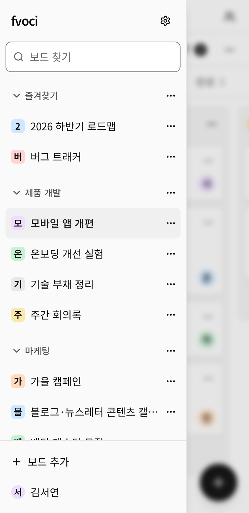   |    |
|  |  |
|   | 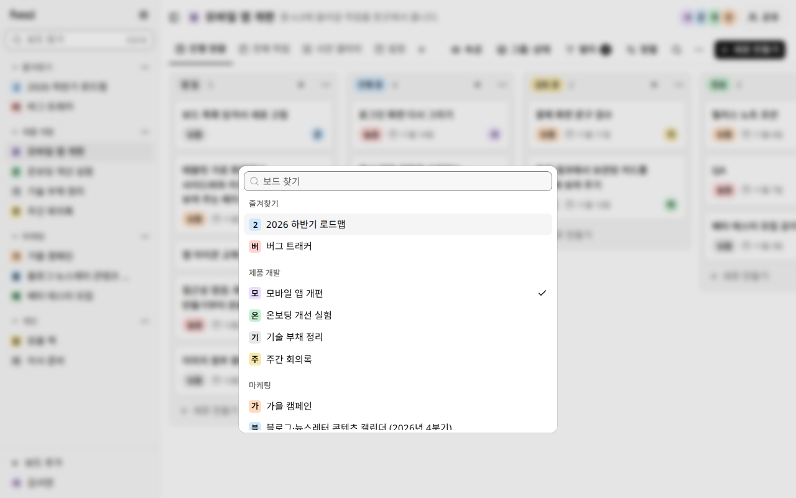  |

- **안 A.** 위쪽 막대 왼쪽의 단추(☰)가 넓은 화면의 사이드바를 그대로 왼쪽에서 밀어 넣는다(너비는 창의 4분의 3, 많아야 288px. 360px 창에서 270px이고 뒤는 어두워진다). 바깥을 누르거나, 보드를 고르거나, 뒤로 가면 닫힌다. 한 줄의 높이는 44px. 넓은 화면은 고정 사이드바다.
- **안 B.** 좁은 화면에는 서랍이 없다. 위쪽 막대의 보드 이름이 단추이고, 누르면 아래에서 "보드 전환" 시트가 올라온다: 검색 칸, 카테고리별 보드 목록, "보드 추가". 설정과 계정은 위쪽 막대 오른쪽의 내 사진으로 간다. 넓은 화면은 A와 같은 고정 사이드바이고, 같은 목록이 명령 팔레트(Ctrl K)로 뜬다.

|      | 안 A                                                                                                                                                  | 안 B                                                                                                                                                              |
| ---- | ----------------------------------------------------------------------------------------------------------------------------------------------------- | ----------------------------------------------------------------------------------------------------------------------------------------------------------------- |
| 장점 | 넓은 화면과 같은 것이라 배울 것이 없다. 카테고리 접기·메뉴·순서 변경, 보드의 "…", 설정이 한자리에 있다. 생성된 사이드바가 좁은 창에서 이렇게 동작한다 | 목록이 엄지 가까이(화면 아래쪽)에 온다. 검색이 먼저 보인다. 위쪽 막대에 단추 하나가 준다                                                                          |
| 단점 | 여는 단추가 화면 왼쪽 위라 한 손으로는 가장 먼 자리다. 가장자리에서 미는 제스처는 iOS의 뒤로 가기와 겹쳐서 넣지 않았다                                | 카테고리를 접고 옮기고 이름을 바꾸는 자리가 없어진다(시트 안에 다시 만들어야 한다). 넓은 화면과 구조가 달라 두 벌을 만든다. 보드 이름이 길면 단추가 막대를 채운다 |

**권고: 안 A.** 사이드바가 하는 일(카테고리 관리, 보드의 메뉴, 드래그로 순서 변경)을 한 벌로 모든 크기에 쓸 수 있고, W3의 범위가 늘지 않는다. 안 B의 시트는 버리지 않고 W5의 "보드 전환(검색)"을 좁은 화면에 그릴 때의 모습으로 쓴다(서랍의 "보드 찾기" 칸이 이 시트를 연다. 스파이크에서도 그렇게 이어져 있다).

### 중간 단계 (페이지 600–839px)

| 안 A: 띠, 펼치면 겹쳐 뜨는 서랍                                             | 안 B: 띠 없이 겹쳐 뜨는 서랍                                                  |
| --------------------------------------------------------------------------- | ----------------------------------------------------------------------------- |
| 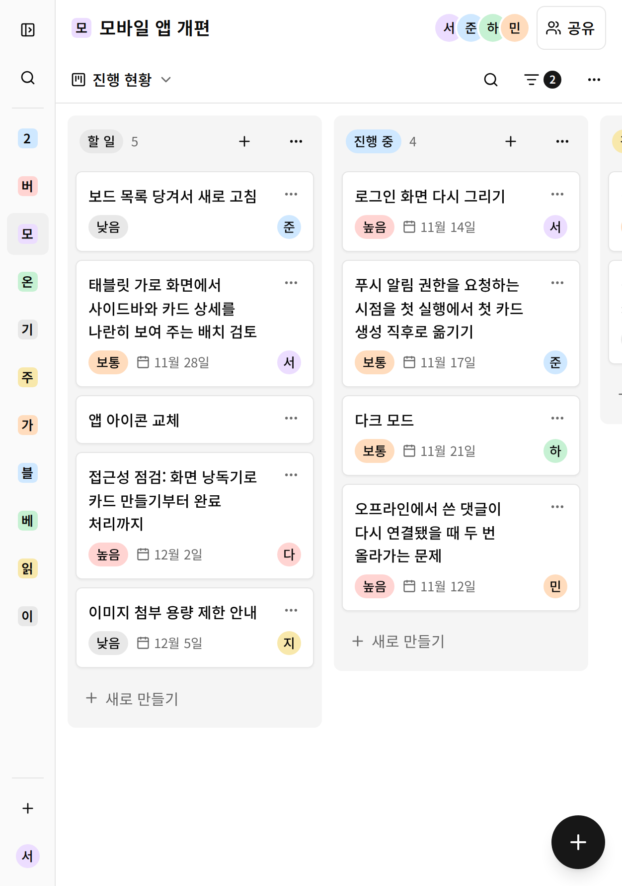  | 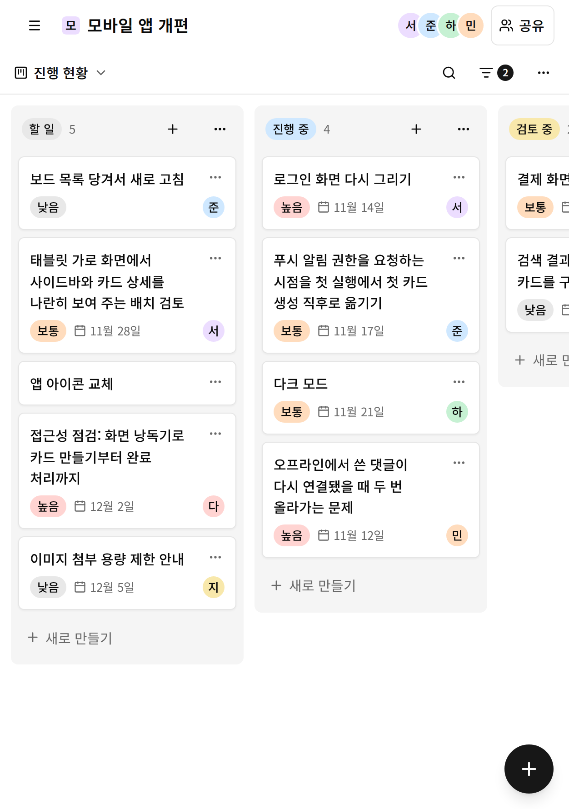 |
| 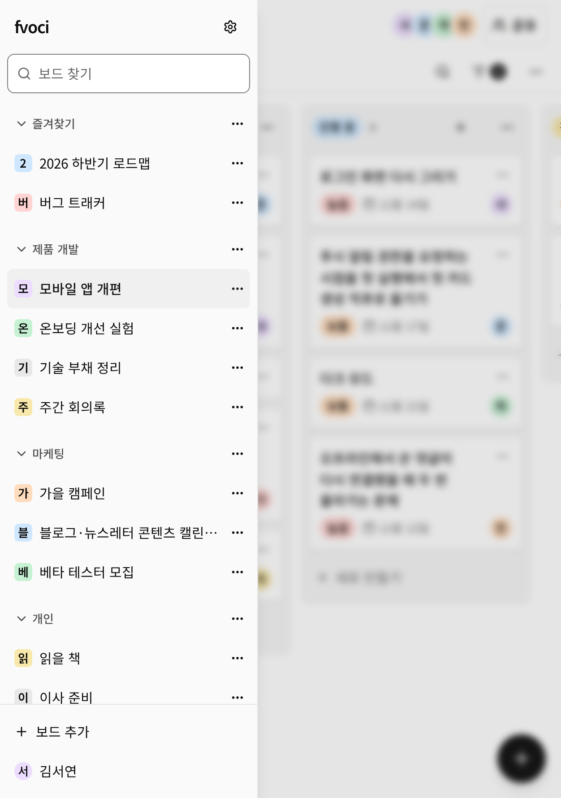 | 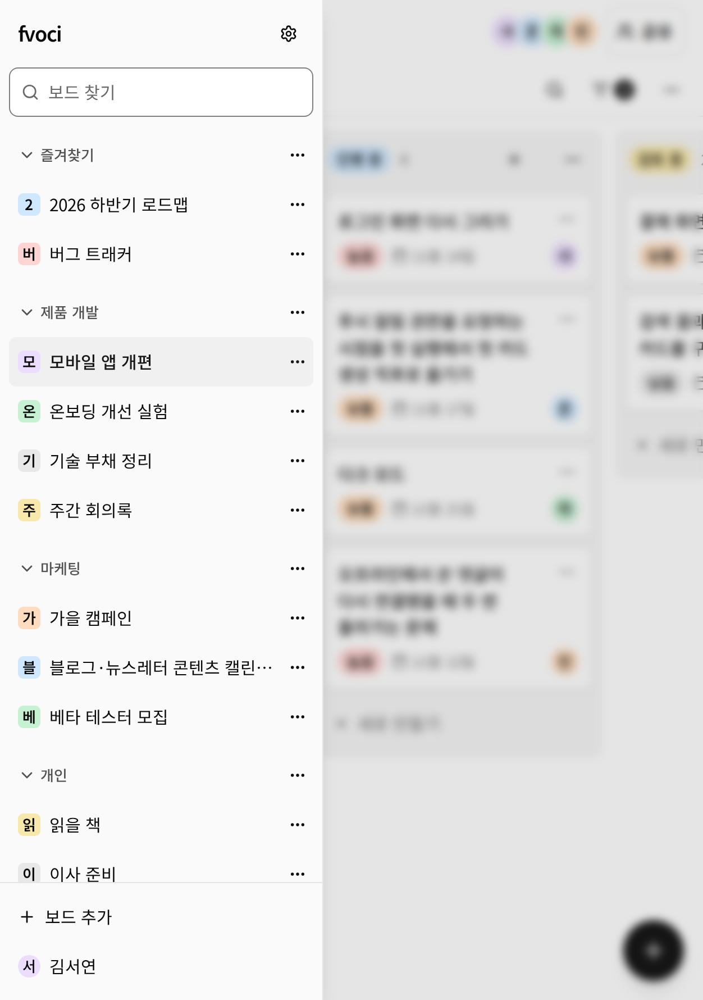   |

- **안 A.** 왼쪽에 56px의 띠가 늘 있다. 위에서부터 펼치기, 보드 찾기, 보드마다 단추 하나(지금 보드는 바탕이 칠해진다), 보드 추가, 내 계정. 펼치면 좁은 단계와 같은 서랍(288px)이 띠 위로 겹쳐 뜬다. 보드를 밀어내지 않는다.
- **안 B.** 띠가 없다. 위쪽 막대 왼쪽의 단추(☰)가 같은 서랍을 연다. 좁은 단계의 모습이 839px까지 이어지는 셈이다.

|      | 안 A (띠)                                                                                                                                                                             | 안 B (서랍만)                                                                                                        |
| ---- | ------------------------------------------------------------------------------------------------------------------------------------------------------------------------------------- | -------------------------------------------------------------------------------------------------------------------- |
| 장점 | 다른 보드로 가는 데 한 번 누른다. 지금 어느 보드인지 늘 보인다. 왼쪽 가장자리 전체가 누를 자리라 손에 든 태블릿에서 엄지가 닿는다. 넓은 단계에서 사이드바를 접은 모습과 같은 부품이다 | 칸이 56px 넓다(626px에서 570 대 626). 좁은 단계와 한 벌이라 만들 것이 없다                                           |
| 단점 | 56px를 늘 쓴다(626px의 9%). 보드를 아이콘만으로 알아봐야 한다(보드 아이콘이 없거나 같으면 구분이 안 된다). 보드가 많으면 띠가 스크롤된다                                              | 보드를 바꿀 때마다 두 번 누른다. 여는 단추가 왼쪽 위 구석이라 큰 화면일수록 멀다. 지금 보드는 위쪽 막대의 이름뿐이다 |

**권고: 안 A.** 중간 단계의 기기는 두 손으로 들거나 세워 놓고 쓰고, 너비에 56px의 여유가 있다(띠를 두고도 열 둘이 들어간다). 띠는 넓은 단계의 "접은 사이드바"와 같은 것이라 부품이 하나 는다기보다 고정 사이드바의 두 번째 상태가 하나 생기는 것이다. 다만 생성된 사이드바는 전환 너비(768px)가 코드에 박혀 있고 "띠를 펼치면 겹쳐 뜬다"는 상태가 없어, 틀은 스파이크처럼 직접 짜야 한다(안쪽 부품은 그대로 쓴다).

### 넓은 단계 (페이지 840px 이상)

고정 사이드바(256px)다. 접으면 중간 단계와 같은 띠가 되고, 이번에는 보드를 밀어낸다(칸이 200px 넓어진다). 두 안이 같다. 펼친 모습과 접은 모습은 "2. 칸반"의 `kanban-a-890.png`, `kanban-a-890-strip.png`에 있다.

## 2. 칸반

| 안 A: 한 열씩 넘기기                                                  | 안 B: 좁은 열을 자유롭게 스크롤                                       |
| --------------------------------------------------------------------- | --------------------------------------------------------------------- |
|  |  |

갈림길은 칸이 544px보다 좁을 때의 것이다. 그보다 넓은 칸에서는 두 안이 같다(`kanban-a-1280.png`와 `kanban-b-1280.png`는 같은 그림이다).


- **안 A.** 열 하나가 화면 너비에서 양쪽 28px씩을 뺀 만큼(360px 화면에서 304px)이고, 가로로 넘기면 열 하나에 멈춘다(CSS scroll snap). 양옆에 이웃 열이 16px씩 비친다. 머리글 아래의 탭 줄이 열 이름과 카드 수를 보여 주고, 지금 보이는 열을 표시하고, 누르면 그 열로 간다. 열이 많으면 탭 줄이 가로로 스크롤된다.
- **안 B.** 열이 256px(넓은 화면은 272px)이고 멈추는 자리 없이 스크롤된다. 한 열과 다음 열의 3분의 1이 보인다. 탭 줄은 없다.

|      | 안 A                                                                                                                                                 | 안 B                                                                                                                          |
| ---- | ---------------------------------------------------------------------------------------------------------------------------------------------------- | ----------------------------------------------------------------------------------------------------------------------------- |
| 장점 | 카드가 넓어(304px 대 256px) 긴 제목이 덜 접힌다. 지금 어느 열인지, 열이 몇 개인지 늘 보인다. 탭으로 먼 열에 한 번에 간다                             | 넓은 화면과 같은 동작이라 따로 만들 것이 없다. 두 열이 함께 보여 옮길 곳을 보면서 끌 수 있다. 머리글 아래에 줄이 하나 덜 든다 |
| 단점 | 탭 줄이 세로 44px를 쓴다. 두 열을 나란히 보지 못한다. 드래그 중 가장자리 자동 스크롤과 snap이 부딪히므로 끄는 동안 snap을 꺼야 한다(확인하지 못했다) | 열이 어중간한 자리에 멈춘다. 카드가 좁다. 열이 여럿이면 지금 어디쯤인지 알 길이 없다                                          |

**권고: 안 A.** 휴대폰에서 칸반은 "한 열을 훑어본다"가 대부분이고, 그때 필요한 것은 넓은 카드와 지금 위치다. 다른 열로 옮기는 일은 A에서 불편해지므로 두 가지로 받친다(Q4): 끄는 중에 탭 위에 올리면 그 열로 넘어가게 하고, 카드의 "…"에 "다른 열로 이동"을 둔다(그림의 메뉴에 넣어 두었다).

두 안 모두 카드 위에서 시작한 쓸기는 스크롤이고, 카드를 집는 것은 손가락과 펜에서 300ms 길게 누르기, 마우스에서 4px 움직이기다(`src/lib/drag/`: 화면 너비가 아니라 포인터의 종류로 가른다). 이 화면에는 드래그가 들어 있지 않다.

### 열 둘 이상 (칸 544px 이상)

칸에 256px 열 둘이 들어가면 한 열씩 넘기기를 그만두고, 넓은 화면과 같은 자유 스크롤이 된다. 열 탭은 사라진다. 칸이 992px 이상이면 열이 272px가 된다. 안은 하나다.

| 626×890: 띠와 열 둘                                                  | 820×1180: 띠와 열 둘, 셋째의 일부                                    |
| -------------------------------------------------------------------- | -------------------------------------------------------------------- |
|  | 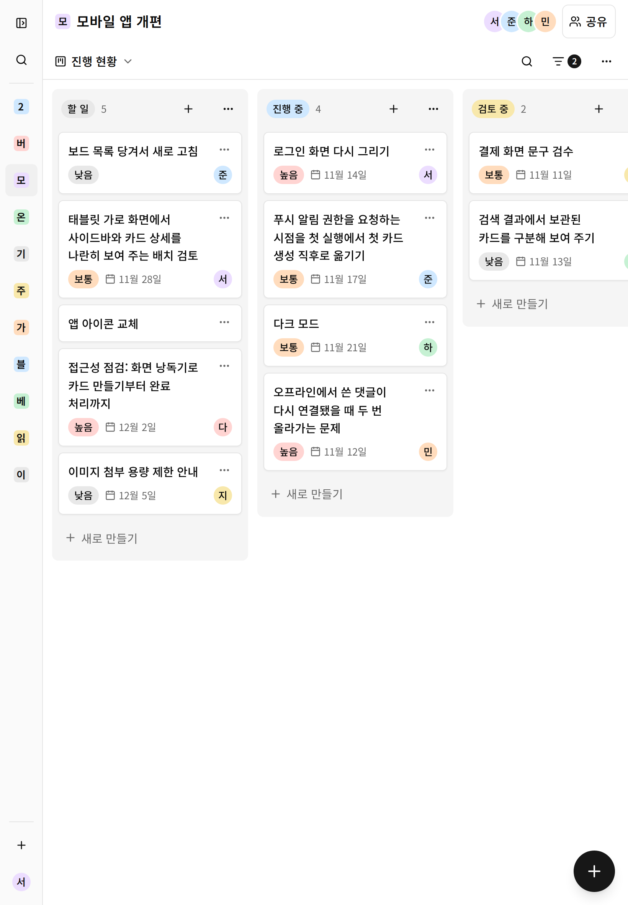 |

같은 창에서도 칸이 달라지면 열의 수가 달라진다. 890×626에서 사이드바를 펼친 채로는 칸이 634px라 열이 둘, 띠로 접으면 834px라 열이 셋이다. 창의 너비를 봤다면 둘은 같은 배치였을 것이다.

| 890×626, 사이드바를 펼침: 칸 634px                                       | 890×626, 사이드바를 띠로: 칸 834px                                           |
| ------------------------------------------------------------------------ | ---------------------------------------------------------------------------- |
| 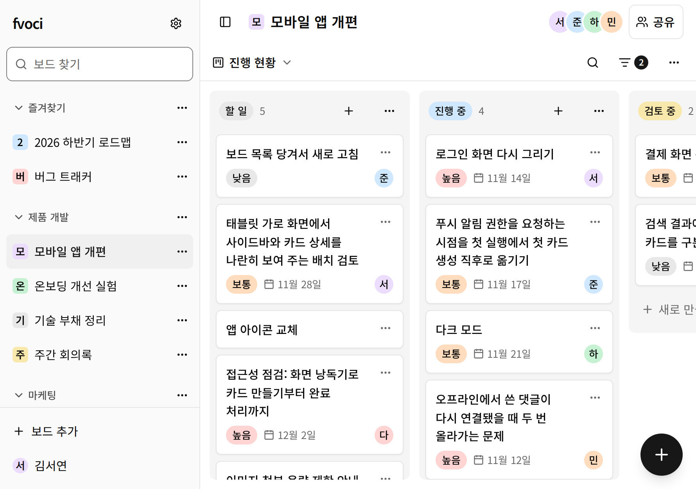 | 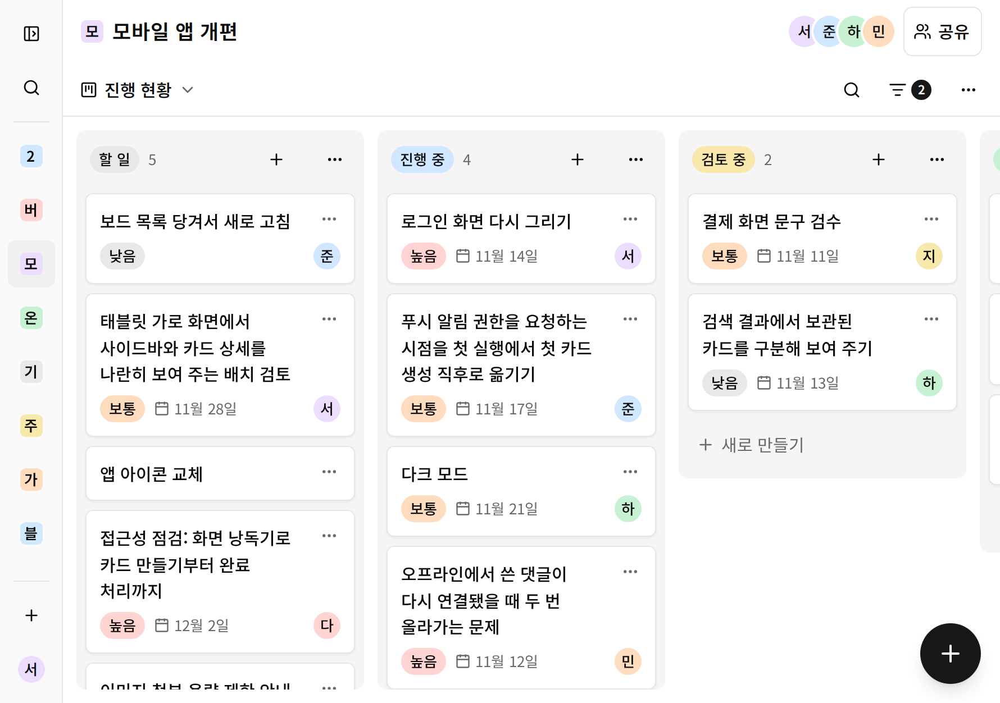 |

폴더블의 바깥 화면(466×678)은 좁은 단계이고 칸도 544px에 못 미친다. 한 열씩 넘기되 열은 384px에서 더 커지지 않고 가운데에 놓인다. 오른쪽 그림은 기기가 오른쪽 84px를 쓰는 경우다(쓸 수 있는 너비 382px).

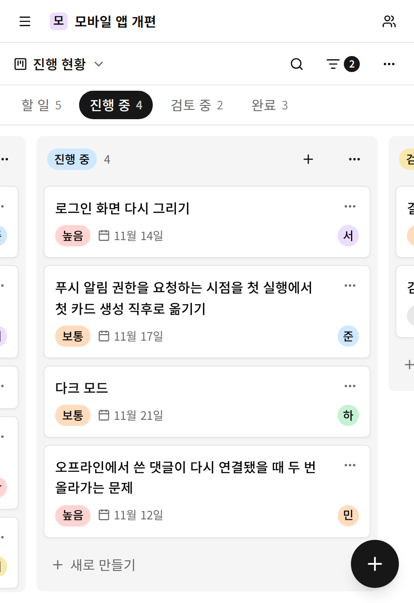 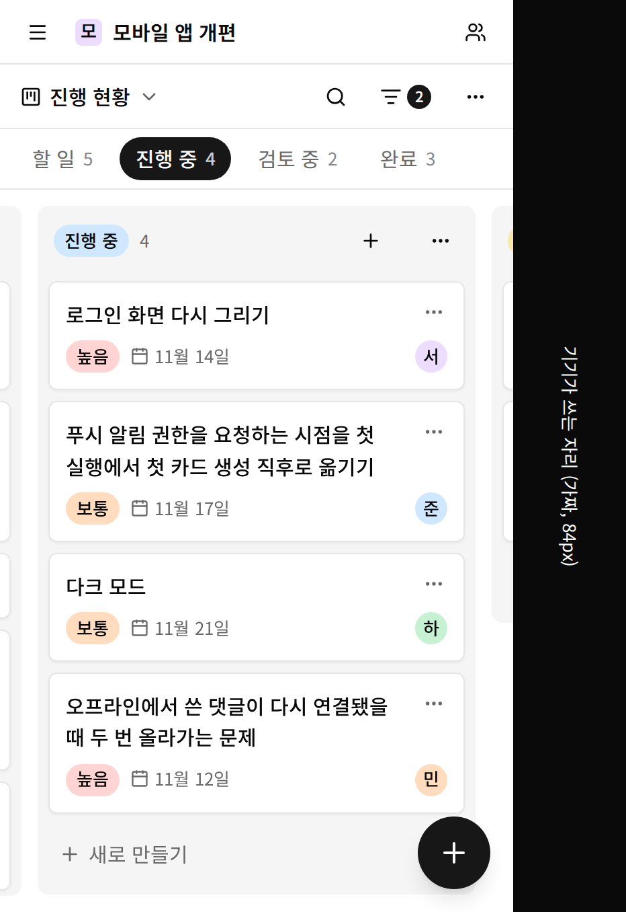

살펴봤지만 안으로 만들지 않은 것: 중간 단계에서도 멈추는 자리를 두는 것(칸에 꼭 맞는 너비의 열 N개씩 넘기기). 열 너비가 칸마다 달라지고 열 탭의 뜻("지금 보이는 열")이 흐려져서 그리지 않았다. Q31로 남긴다.

## 3. 테이블

| 안 A: 고정 열과 가로 스크롤                                          | 안 B: 행을 카드처럼 쌓기                                             |
| -------------------------------------------------------------------- | -------------------------------------------------------------------- |
| 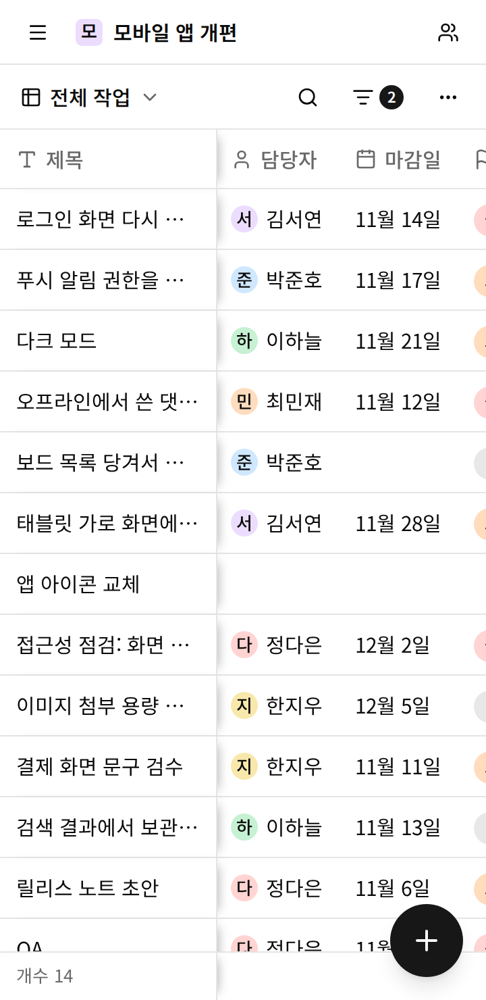 |  |

갈림길은 칸이 544px보다 좁을 때의 것이다. 그보다 넓은 칸에서는 두 안이 같다(`table-a-1280.png`와 `table-b-1280.png`는 같은 그림이다).


- **안 A.** 좁아도 표다. 제목 열(160px)이 왼쪽에 고정되고 나머지 열이 그 밑으로 가로로 지나간다. 머리 행은 위에, 계산 행은 아래에 고정된다. 한 행의 높이는 44px. 그림은 오른쪽으로 82px 민 상태다(상태 열이 제목 열 밑으로 들어갔고, 제목 열 오른쪽에 그림자가 생겼다).
- **안 B.** 좁은 화면에서는 열이 없다. 행마다 제목 전체와, 뷰에 보이도록 켠 속성을 그 아래 한 줄로 쌓는다. 가로 스크롤이 없다.

|      | 안 A                                                                                                               | 안 B                                                                                                                                                                   |
| ---- | ------------------------------------------------------------------------------------------------------------------ | ---------------------------------------------------------------------------------------------------------------------------------------------------------------------- |
| 장점 | 표가 하는 일이 남는다: 같은 속성을 위아래로 견주기, 열 머리글의 메뉴(정렬, 숨기기), 계산 행. 넓은 화면과 한 벌이다 | 제목이 잘리지 않는다. 한 화면에 한 카드의 정보가 다 보인다. 가로 스크롤이 없어 세로로만 민다                                                                           |
| 단점 | 제목이 열 자쯤에서 잘린다. 한 번에 보이는 속성이 두 개 남짓이다. 가로와 세로 두 방향 스크롤이 한 손가락에 걸린다   | 표가 아니게 된다: 열 머리글이 없어 그 메뉴와 열 너비·순서 조절, 계산 행을 다른 데로 옮겨야 한다. 속성이 많으면 한 행이 길어진다. 좁은 화면 전용 화면을 한 벌 더 만든다 |

**권고: 안 A.** 테이블 뷰를 고른 사람은 표를 보려는 것이고, 한 장씩 읽으려면 칸반이나 갤러리가 있다. A는 넓은 화면의 표에 `position: sticky` 두 줄을 더한 것이라 W3의 범위 안이다. 안 B는 "좁은 화면의 테이블"이 아니라 새 뷰(목록)에 가깝다. 필요하면 W6에서 테이블 뷰의 표시 방식으로 더하는 것을 따로 정한다(Q6).

**중간 단계.** 배치가 바뀌는 것은 없다. 칸이 544px 이상이면 제목 열이 160px에서 224px로, 992px 이상이면 352px로 넓어지고 보이는 열이 늘 뿐이다. 그래서 가운데 크기의 그림은 찍지 않았다. 안 B(쌓기)도 칸이 544px 이상이면 표로 돌아온다.

## 4. 카드 상세

| 안 A: 보드 위에 뜬다                                                 | 안 B: 보드 곁에 놓인다                                               |
| -------------------------------------------------------------------- | -------------------------------------------------------------------- |
|   |   |
| 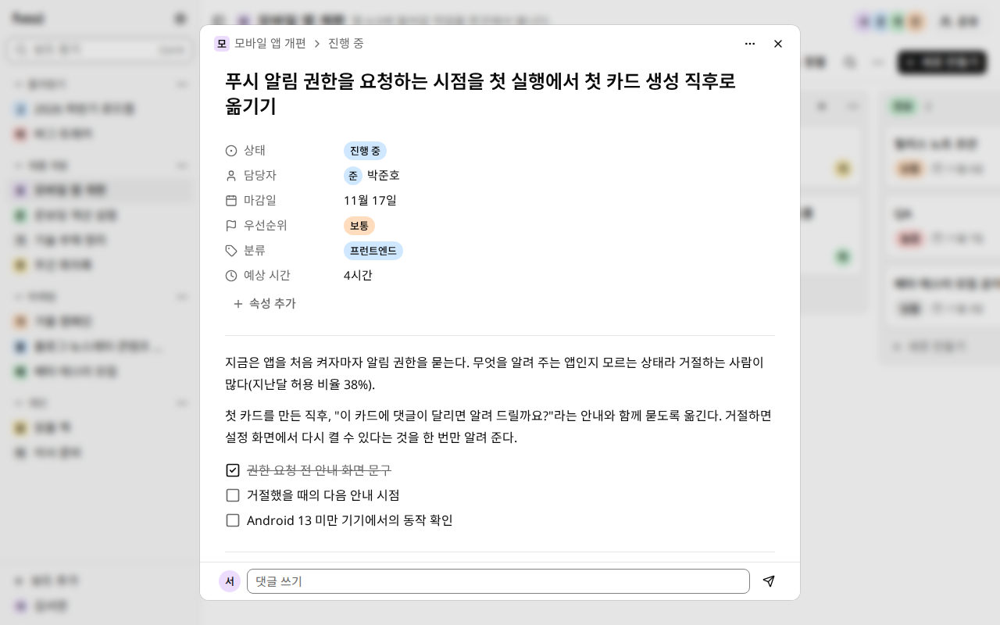 | 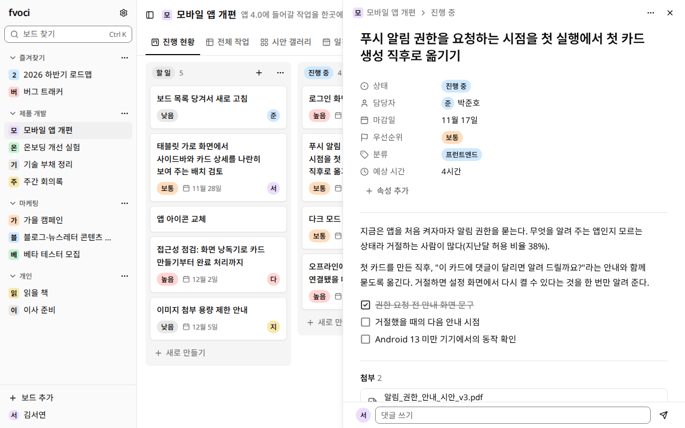 |

- **안 A.** 카드가 보드 위에 뜨고 보드는 기다린다. 좁은 단계에서는 화면 전체를 차지하는 페이지다: 왼쪽 위에 뒤로 화살표, 그 옆에 어느 보드의 어느 열인지, 오른쪽에 "…". 넓은 단계에서는 가운데의 대화상자(너비 768px)이고 뒤의 보드는 흐려진다.
- **안 B.** 좁은 단계에서는 아래에서 올라오는 시트이고 위로 40px만큼 보드가 비친다. 위에 손잡이 표시, 오른쪽에 닫기(X). 넓은 단계에서는 **보드 옆의 칸**이다: 페이지의 오른쪽 절반(적어도 360px, 많아야 640px)을 카드가 차지하고, 보드는 남은 왼쪽에서 그 너비에 맞게 다시 그려져 계속 쓸 수 있다. 1280px에서는 보드의 칸이 384px가 되어 휴대폰의 배치(한 열, 접힌 머리글)가 된다.
- **중간 단계에서는 두 안이 같다**(아래).
- **두 안에 공통.** 위에서부터 제목, 속성 목록, 본문, 첨부, 댓글. 속성은 한 줄에 이름과 값이고, 값 전체가 누르는 대상이다(높이 44px). 댓글 입력 칸은 바닥에 고정된다.

|      | 안 A                                                                                                                                                                                                                                                                | 안 B                                                                                                                                                                                                                                                                                                                                            |
| ---- | ------------------------------------------------------------------------------------------------------------------------------------------------------------------------------------------------------------------------------------------------------------------- | ----------------------------------------------------------------------------------------------------------------------------------------------------------------------------------------------------------------------------------------------------------------------------------------------------------------------------------------------- |
| 장점 | 카드가 곧 주소이고 뒤로 가기가 곧 닫기다(모바일 브라우저의 기본 동작과 같다). 세로 공간을 다 쓴다. 속성 편집 시트가 그 위에 뜰 때 층이 둘뿐이다. 스크롤이 하나다. 세 단계의 모습이 한 부품(대화상자 하나의 자리만 바뀐다)이라 창 크기가 바뀌어도 쓰던 것이 그대로다 | 보드 위에 떠 있다는 것이 보인다. 아래로 끌어 닫는 동작을 기대할 수 있다. 넓은 단계의 옆 칸은 보드를 보면서 카드를 읽게 해 준다(카드를 바꿔 가며 보기 좋다). 옆 칸의 왼쪽 변이 화면 한가운데라 접히는 자리에 아무것도 걸치지 않는다                                                                                                              |
| 단점 | 어느 보드에서 왔는지가 맨 윗줄의 글자로만 남는다. 넓은 단계의 대화상자는 화면 한가운데에 놓여, 접히는 자리일 수 있는 선에 속성 값과 댓글 입력 칸이 걸친다                                                                                                           | 시트(카드) 위에 시트(속성 편집)가 겹친다. 시트를 끌어 닫는 제스처와 본문 스크롤이 같은 손가락에 걸린다. 비치는 40px는 정보가 없다(흐려져 있다). 넓은 단계에서 보드에 남는 칸이 좁다(1280px에서 384px. 890px에서는 사이드바를 띠로 접어야 389px가 남는다). 시트, 옆 판, 옆 칸이 서로 다른 부품이라 창 크기가 그 사이를 넘으면 카드를 다시 짓는다 |

**권고: 좁은 단계는 안 A.** 좁은 화면에서 카드는 가장 오래 머무는 화면이고 키보드가 올라오는 화면이다. 세로 공간과 단순한 층이 이긴다. **넓은 단계는 고르지 않았다(Q8).** 첫 판에서는 원본과 같은 가운데 대화상자를 권했다. 그 뒤에 "넓은 화면의 한가운데 세로선에 중요한 단추와 입력을 두지 않는다"는 방침이 생겼고, 가운데 대화상자는 댓글 입력 칸과 속성 값 여섯이 모두 그 선에 걸친다(아래 그림과 "한가운데 세로선" 절). 안 B의 옆 칸은 걸치는 것이 없다. 대신 보드의 칸이 좁아지는 값을 치른다.

### 중간 단계 (페이지 600–839px): 옆에서 나오는 판

전체 화면도 가운데 대화상자도 아니고, 오른쪽에서 나오는 판이다. 너비는 480px이고 높이는 화면 전체다. 왼쪽에 남은 보드는 흐려지고, 그 자리를 누르면 닫힌다. 안의 배치는 좁은 화면의 카드와 같다.

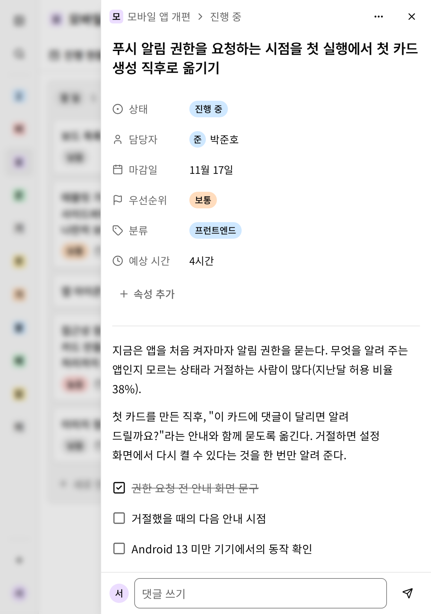

두 안이 여기서 같은 까닭: 안 B처럼 보드 옆에 칸으로 놓으려면 띠(56px), 보드의 최소 칸(320px), 카드의 최소 칸(360px)을 더해 736px가 필요하다. 중간 단계의 아래쪽(626px)에서는 들어가지 않는다. 경계를 하나 더 두는 대신 중간 단계 전체를 겹쳐 뜨는 판으로 했다.

### 넓은 단계의 두 안과 접히는 자리 (890×626)

| 안 A: 가운데 대화상자                                                           | 안 B: 보드 옆의 칸                                                              |
| ------------------------------------------------------------------------------- | ------------------------------------------------------------------------------- |
| 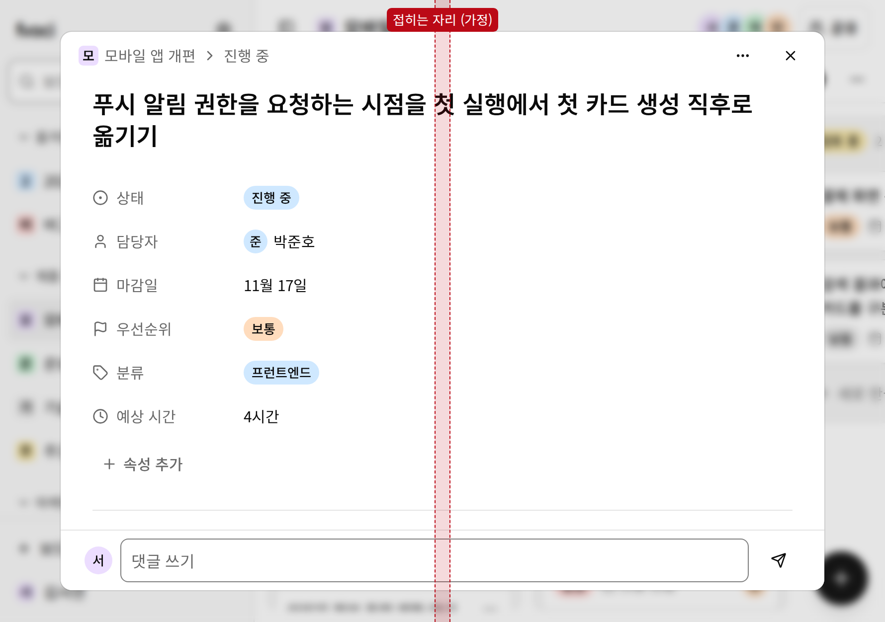 | 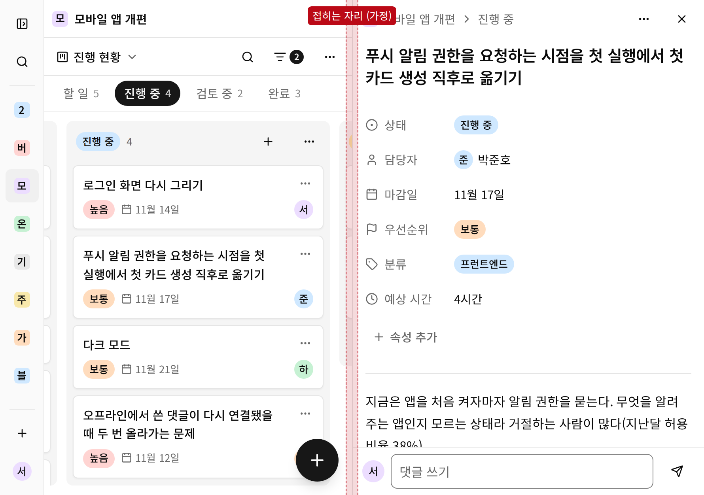 |

빨간 띠는 화면이 한가운데에서 세로로 접힌다고 **가정**하고 그린 것이다(어디서 접히는지 알려 주는 브라우저가 없다). 안 A는 제목, 속성 값, 댓글 입력 칸이 모두 그 위에 있다. 안 B는 카드가 오른쪽 절반(445px)을 정확히 차지하고, 사이드바는 보드에 320px를 남기려고 띠로 접힌다(카드를 닫으면 돌아온다). 표시가 없는 그림은 `card-a-890.png`, `card-b-890.png`.

### 좁은 단계의 안 A: 안전 영역과 어두운 화면

 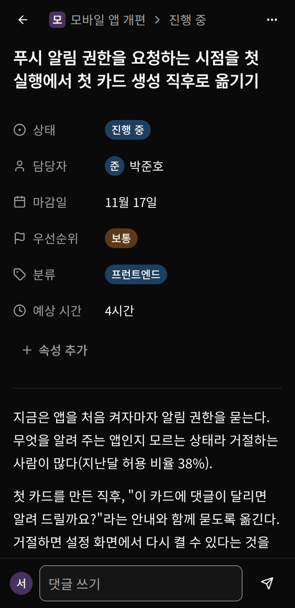

## 5. 메뉴

네 가지를 그렸다: 보기 설정(필터·정렬·그룹), 카드의 "…" 메뉴, **선택 속성의 선택지 고르기**, **날짜 선택기**. 뒤의 둘은 속성 편집기를 만드는 작업이 이 안에 맞춘다.

갈림길은 네 가지에 공통이고 좁은 단계의 것이다. **안 A: 좁은 단계에서는 바닥 시트, 그 밖에서는 팝오버. 안 B: 좁은 단계에서도 누른 자리 옆의 팝오버 그대로.** 공정하게 견주려고 B의 팝오버도 손가락 화면에서는 줄 높이를 44px로 키웠다. 중간과 넓은 단계는 두 안이 같다(`menu-*-a-1280.png`와 `menu-*-b-1280.png`는 같은 그림이다).

### 보기 설정 (필터·정렬·그룹)

| 안 A                                                                     | 안 B                                                                     | 넓은 화면                                                           |
| ------------------------------------------------------------------------ | ------------------------------------------------------------------------ | ------------------------------------------------------------------- |
|  | 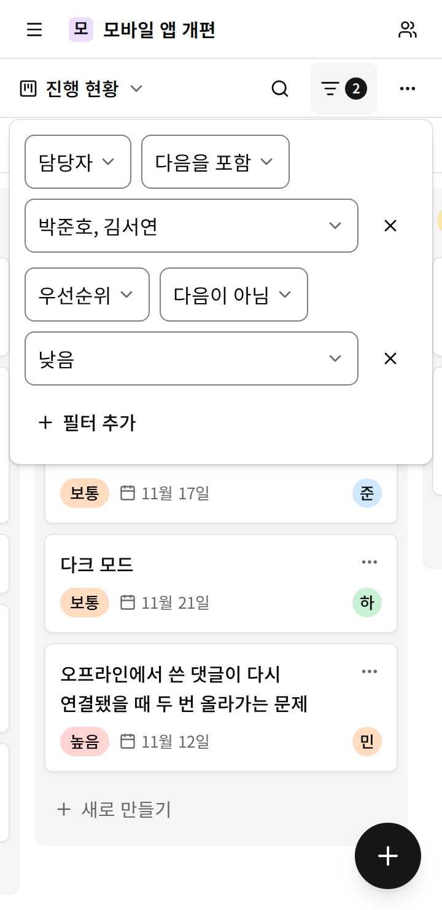 | 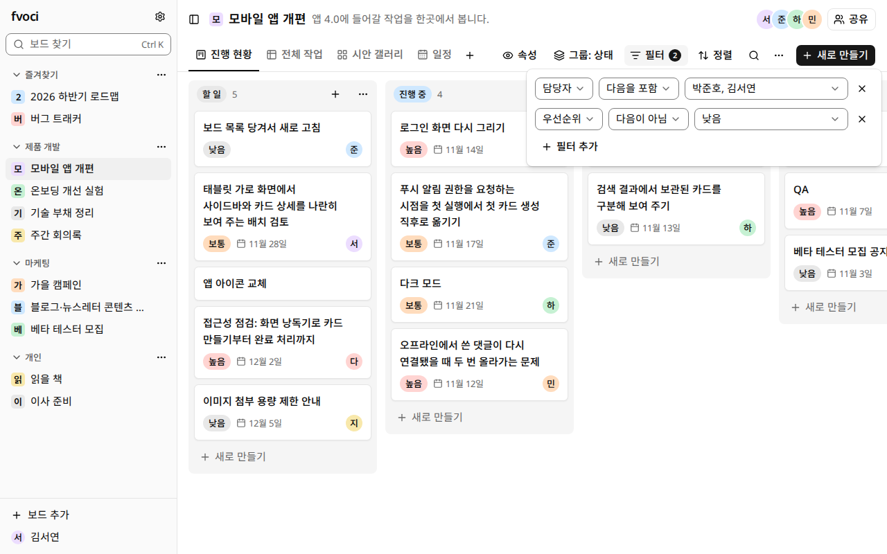 |

넓은 화면에서는 필터, 정렬, 그룹이 저마다의 단추와 팝오버다. 안 A의 좁은 화면에서는 머리글에 단추 하나의 자리만 있으므로 셋을 탭으로 나눈 시트 하나("보기 설정")로 모았다. 필터 한 줄(속성, 조건, 값)은 좁으면 두 줄로 접힌다. 안 B는 넓은 화면의 필터 팝오버를 화면 너비에 맞춰 줄인 것이다.

### 카드의 "…" 메뉴

| 안 A                                                                     | 안 B                                                                     | 넓은 화면                                                           |
| ------------------------------------------------------------------------ | ------------------------------------------------------------------------ | ------------------------------------------------------------------- |
| 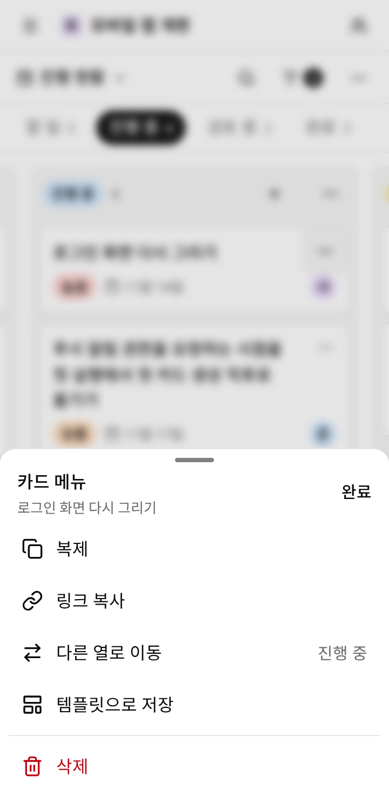 | 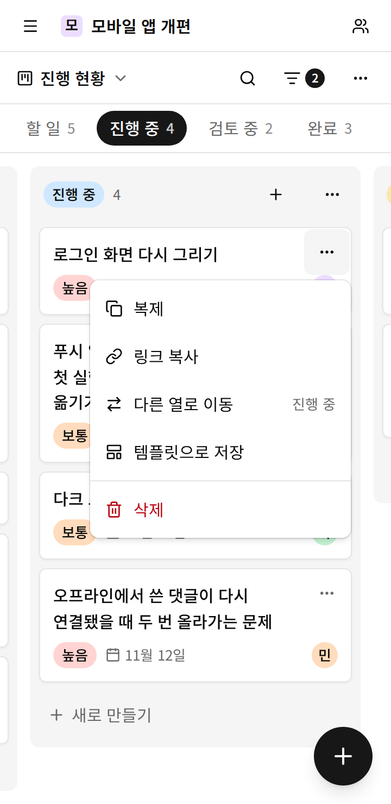 | 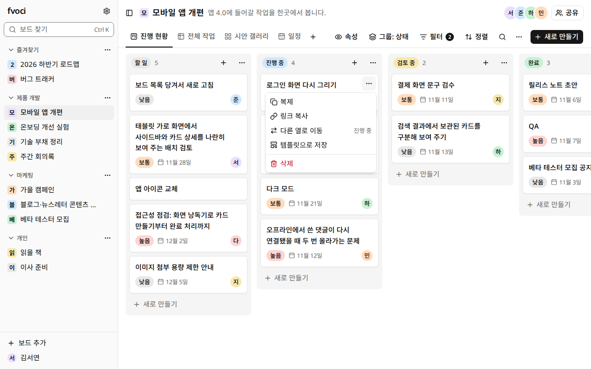 |

시트의 제목 아래에 어느 카드의 메뉴인지 카드 제목을 적는다(시트는 누른 자리와 떨어져 뜨므로). 한 줄은 48px, 삭제는 선으로 갈라 맨 아래에 둔다. 홈 인디케이터가 있는 기기에서는 `menu-card-a-360-safe.png`.

### 선택 속성의 선택지 고르기

| 안 A                                                                       | 안 B                                                                       | 넓은 화면                                                             |
| -------------------------------------------------------------------------- | -------------------------------------------------------------------------- | --------------------------------------------------------------------- |
|  |  | 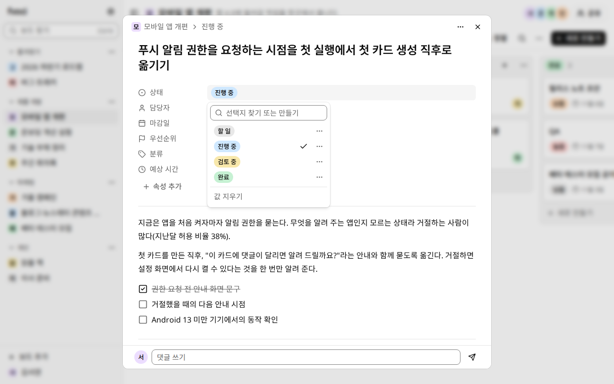 |

속성 값을 누르면 뜬다. 위에서부터: 속성 이름(시트에서는 그 아래에 카드 제목), 선택지를 찾거나 새로 만드는 입력 칸, 선택지 목록(고른 것에 체크, 오른쪽의 "…"는 그 선택지의 이름·색 고치기), "값 지우기". 하나를 고르면 닫힌다. 스파이크에서는 좁은 화면과 넓은 화면이 같은 내용 컴포넌트(`SelectPicker.svelte`)를 쓰고 겉(`Surface.svelte`: 시트 또는 팝오버)만 바뀐다.

가상 키보드가 올라왔을 때(키보드는 가짜로 그렸다):

| 안 A                                                                             | 안 B                                                                             |
| -------------------------------------------------------------------------------- | -------------------------------------------------------------------------------- |
| 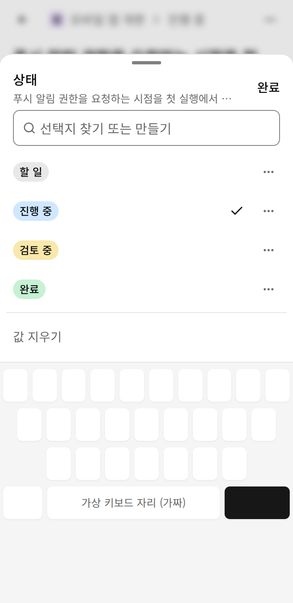 |  |

시트는 키보드 위에 올라앉고 남은 높이 안에서 목록이 스크롤된다. 팝오버는 누른 자리에 묶여 있어서 아래쪽 줄("값 지우기")이 키보드에 가려진다. 속성이 목록의 아래쪽에 있을수록 더 가려진다.

### 날짜 선택기

| 안 A                                                                     | 안 B                                                                     | 넓은 화면                                                           |
| ------------------------------------------------------------------------ | ------------------------------------------------------------------------ | ------------------------------------------------------------------- |
|  | 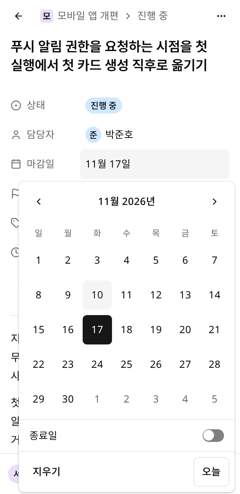 | 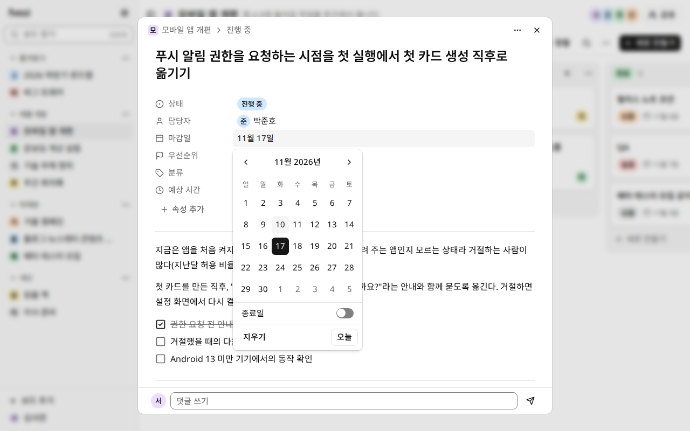 |

달력 한 달, "종료일" 스위치(켜면 기간), "지우기"와 "오늘". 날짜 한 칸은 마우스에서 32px, 손가락에서 44px이다. 일곱 칸이 308px이라 360px 화면에 여백과 함께 들어간다. 어두운 화면은 `menu-date-a-360-dark.png`.

### 장점과 단점, 권고

|      | 안 A (바닥 시트)                                                                                                                                                               | 안 B (팝오버 그대로)                                                                                                                                             |
| ---- | ------------------------------------------------------------------------------------------------------------------------------------------------------------------------------ | ---------------------------------------------------------------------------------------------------------------------------------------------------------------- |
| 장점 | 늘 같은 자리(엄지가 닿는 아래쪽)에 같은 너비로 뜬다. 키보드와 함께 움직인다. 화면 너비를 다 쓴다(필터 한 줄, 달력). 뒤로 가기로 닫힌다. 손가락이 고르는 것을 가리지 않는다     | 누른 것 바로 옆에 떠서 무엇의 메뉴인지 분명하다. 넓은 화면과 한 벌이다. 뒤의 화면이 흐려지지 않는다                                                              |
| 단점 | 누른 자리와 떨어져 뜬다(그래서 제목 아래에 대상을 적는다). 겉을 고르는 부품이 하나 더 필요하다(스파이크의 `Surface`, `ActionMenu`). 줄이 두셋뿐인 메뉴에는 과하게 보일 수 있다 | 뜨는 자리가 누른 자리마다 다르고, 화면 위쪽에서 뜨면 엄지가 닿지 않는다. 키보드에 가려진다. 손가락 크기로 키우면 달력과 필터는 어차피 화면 너비를 거의 다 채운다 |

**권고: 안 A.** 규칙은 하나다: **좁은 단계(페이지 600px 미만)이면 바닥 시트, 아니면 팝오버.** 포인터가 아니라 너비로 가른다. 줄이 두셋뿐인 메뉴도 예외 없이 시트로 한다(규칙이 하나여야 어디서 뜰지 예상할 수 있다).

**중간 단계.** 팝오버다. 폴더블의 안쪽 화면과 태블릿은 넓으므로 누른 자리 옆에 뜨고, 손가락을 쓰는 기기라 줄만 44px로 커진다. 아래는 820×1180에서 옆 판으로 열린 카드의 선택지 팝오버다. 첫 판은 경계가 768px라 600–767px에서 시트였다. 이제 그 구간도 팝오버다. 중간 단계에서도 가상 키보드는 올라오므로 팝오버가 키보드에 가려지는 문제(위 키보드 그림의 안 B)가 여기에도 있을 수 있다. 확인하지 못했고 Q26에 더했다.


속성 편집기 작업이 맞출 것:

- 편집기의 **내용**(선택지 목록, 달력, 사람 목록)은 겉을 모르는 컴포넌트로 만든다. 겉은 "좁으면 시트, 아니면 팝오버"를 정하는 부품 하나가 맡는다. 그사이 제품 쪽에 그 부품이 생겼다(`src/lib/components/picker-surface/`: `presentation` 인자 하나로 정하고, 기본값은 뷰포트 너비를 본다). 경계를 이 문서의 것(페이지 600px)으로 맞추는 일과 좌우 안전 영역은 아래 "안전 영역" 절에 적었다.
- 한 줄의 높이는 `min-h-8 pointer-coarse:min-h-touch`(시트 안에서는 `pointer-coarse:min-h-12`, 48px). 시트라는 이유만으로 키우지 않는다: 마우스로 쓰는 좁은 창의 시트는 32px 줄이다. 달력의 칸은 `--cell-size`를 `pointer-coarse:`에서 `--spacing-touch`로.
- 입력 칸은 생성된 `Input`(`text-base md:text-sm`)에 `pointer-coarse:h-touch pointer-coarse:text-base`(생성된 클래스는 뷰포트 너비로 글자를 줄이므로 손가락을 쓰는 넓은 화면에서 15px가 된다). 열릴 때 자동으로 초점을 주는 것은 포인터가 손가락이 아닐 때만.
- 시트의 높이는 `100dvh - 안전 영역(위) - 키보드 - 3rem`을 넘지 않고, 내용이 그 안에서 스크롤된다.

## 6. 뷰 머리글의 축약

칸이 704px 이상이면 머리글은 한 줄이다: 뷰 탭 넷과 "+", 속성, 그룹, 필터, 정렬, 검색, "…", "새로 만들기". 두 안이 같다(`header-a-1280.png`와 `header-b-1280.png`는 같은 그림이다). 갈림길은 그보다 좁은 칸에서 어떻게 접는가다.

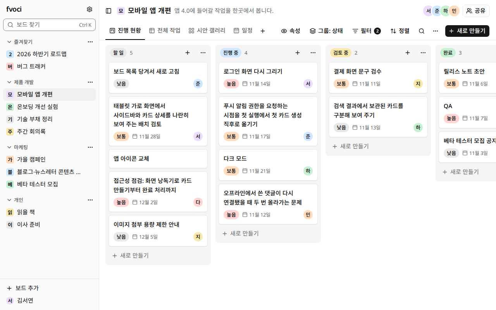

| 안 A: 한 줄과 "…"                                                     | 안 B: 두 줄                                                           |
| --------------------------------------------------------------------- | --------------------------------------------------------------------- |
|  | 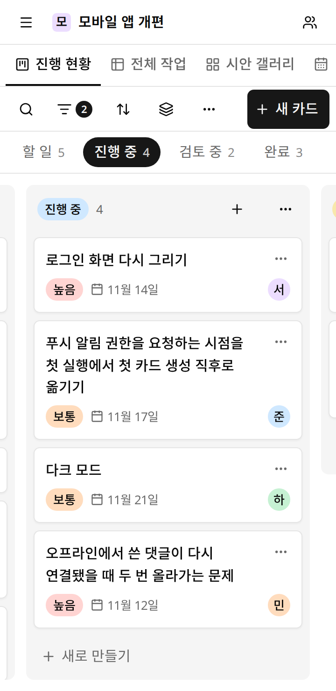 |

- **안 A.** 한 줄(48px). 뷰 탭은 지금 뷰의 이름을 적은 단추 하나가 되고, 누르면 뷰 목록이 시트로 뜬다. 검색과 필터(걸린 필터의 수)는 아이콘으로 남는다. 정렬, 그룹 기준, 속성과 뷰의 이름 바꾸기·복제·내보내기·삭제는 "…" 뒤로 간다. "새로 만들기"는 머리글에서 빠져 화면 오른쪽 아래의 둥근 단추(56px)가 된다.
- **안 B.** 두 줄(93px). 첫 줄은 뷰 탭이 그대로이고 가로로 스크롤된다. 둘째 줄은 검색, 필터, 정렬, 그룹, "…"가 아이콘으로, "새로 만들기"가 글자 있는 단추로 들어간다.

안 A에서 접힌 것이 들어 있는 두 시트:

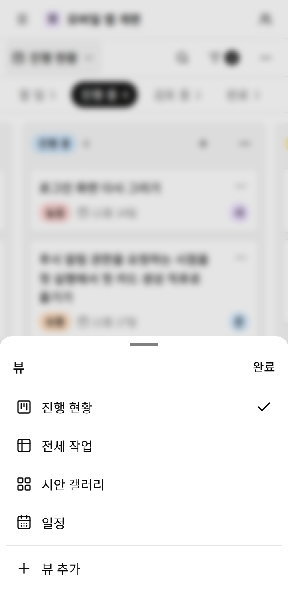 

|      | 안 A                                                                                                                                          | 안 B                                                                                                                                                                                                                                    |
| ---- | --------------------------------------------------------------------------------------------------------------------------------------------- | --------------------------------------------------------------------------------------------------------------------------------------------------------------------------------------------------------------------------------------- |
| 장점 | 내용이 45px 위에서 시작한다. 칸반(안 A)의 열 탭까지 합쳐도 위쪽이 세 줄이다. "새로 만들기"가 엄지 자리에 있다. 뷰가 열 개여도 모양이 같다     | 뷰 전환과 정렬·그룹이 한 번에 눌린다. 넓은 화면의 머리글과 닮았다                                                                                                                                                                       |
| 단점 | 뷰 전환이 두 번 누르기다. 정렬과 그룹이 한 단계 안에 있다. 둥근 단추가 내용의 오른쪽 아래를 가린다(테이블의 마지막 열, 칸반 카드의 사람 표시) | 위쪽이 네 줄이 된다(위쪽 막대, 뷰 탭, 도구, 칸반의 열 탭: 740px 가운데 186px. 안 A는 141px). 360px에서 도구 다섯과 "새로 만들기"가 한 줄에 들어가지 않아 문구를 "새 카드"로 줄여야 했다. 가로로 스크롤되는 줄이 둘 겹친다(뷰 탭, 열 탭) |

**권고: 안 A.** 휴대폰에서 모자란 것은 세로 공간이고, 자주 누르는 것은 뷰 전환이 아니라 카드다. "새로 만들기"의 자리(둥근 단추인지 머리글인지)는 접는 방식과 따로 정할 수 있어서 Q16으로 뺐다.

**중간 단계와, 칸이 좁은 넓은 단계.** 머리글은 창이 아니라 칸의 너비를 본다. 그린 크기 가운데 칸이 992px에 닿는 것은 1280×800에서 사이드바만 열려 있을 때(1024px)뿐이고, 626, 820, 890은 모두 접힌 머리글이다(위 칸반의 그림들). 1280×800에서도 카드를 보드 옆에 열면 칸이 384px가 되어 접힌다(`card-b-1280.png`). 접힌 모양은 좁은 단계의 것 그대로이고, 칸이 544–991px일 때의 세 번째 모양(뷰 탭은 그대로 두고 도구만 아이콘으로)은 처음에는 만들지 않았다. 지금은 704px부터 그 모양의 한 줄이다(`--container-tabs`). 이 절의 992와 "접힌 머리글"의 측정은 그 앞의 것이다. 820px에서 재 보면 뷰 탭 넷과 아이콘 다섯이 겨우 들어가는 너비라 경계가 하나 더 생기는 값에 견주어 얻는 것이 적다고 봤다.

## 질문 목록

제품 책임자가 답할 것이다. 질문마다 선택지, 권고, 그 답이 정하는 것을 적었다.

### 화면별 안

**Q1. 사이드바: 좁은 화면에서 서랍인가, 보드 전환 시트인가.**
선택지: (A) 왼쪽에서 미는 서랍 / (B) 서랍 없이 보드 이름을 누르면 뜨는 바닥 시트. 권고: A. 정하는 것: W3의 작업 공간 레이아웃과 위쪽 막대.

**Q2. 보드 전환 시트를 서랍에 더해 "보드 찾기"로 쓸 것인가.**
선택지: (가) 서랍의 "보드 찾기"가 좁은 화면에서는 바닥 시트를, 넓은 화면에서는 명령 팔레트를 연다 / (나) 좁은 화면에서는 서랍 안의 검색 칸으로만 찾는다. 권고: 가. 정하는 것: W5의 보드 전환(검색).

**Q3. 칸반: 한 열씩 넘기는가, 자유롭게 스크롤하는가.**
선택지: (A) 화면 너비의 열 하나에 멈추고 위에 열 탭 / (B) 256px 열을 자유롭게. 권고: A. 정하는 것: W3의 칸반.

**Q4. 한 열씩 넘길 때 카드를 다른 열로 옮기는 방법.**
선택지(여럿을 고를 수 있다): (가) 끄는 중 화면 가장자리에서 옆 열로 넘어간다 / (나) 끄는 중 열 탭 위에 올리면 그 열로 넘어간다 / (다) 카드의 "…"에 "다른 열로 이동". 권고: 가와 다를 W3에, 나는 W6에. 정하는 것: W3의 칸반 드래그와 카드 메뉴, W6의 터치 드래그.

**Q5. 테이블: 고정 열과 가로 스크롤인가, 행을 쌓는가.**
선택지: (A) 제목 열 고정 + 가로 스크롤 / (B) 좁은 화면에서는 행을 카드처럼 쌓는다. 권고: A. 정하는 것: W3의 테이블.

**Q6. 테이블의 고정 열과 터치.**
선택지: 고정 열의 너비를 (가) 좁은 화면에서 160px로 고정 / (나) 넓은 화면에서 정한 너비를 따르되 화면의 절반을 넘지 않게. 열 너비 조절과 열 순서 변경을 터치에서 (가) 지원한다 / (나) 넓은 화면에서만 한다. 쌓은 모양(안 B)을 뒤에 테이블 뷰의 표시 방식으로 더할지. 권고: 너비는 나, 터치의 너비 조절·순서 변경은 W6에서 열 머리글 메뉴의 항목으로, 쌓은 모양은 지금 정하지 않는다. 정하는 것: W3의 테이블, W6.

**Q7. 카드 상세: 좁은 화면에서 전체 화면인가, 바닥 시트인가.**
선택지: (A) 전체 화면 페이지, 뒤로 화살표 / (B) 위로 40px를 남긴 바닥 시트. 권고: A. 정하는 것: W4의 카드 대화상자와 라우터의 카드 주소.

**Q8. 카드 상세: 넓은 단계에서 가운데 대화상자인가, 보드 옆의 칸인가.**
선택지: (A) 가운데 대화상자(원본과 같다. 보드는 흐려지고 기다린다) / (B) 보드 옆의 칸: 페이지의 오른쪽 절반(360–640px)에 카드, 왼쪽에 계속 쓸 수 있는 보드. 권고: 고르지 않았다. 첫 판은 A를 권했다. A는 한 부품이 세 단계를 다 맡아 창 크기가 바뀌어도 쓰던 것이 남고(Q33), 보드의 칸을 줄이지 않는다. 그러나 속성 값과 댓글 입력 칸이 화면 한가운데 세로선에 걸친다(Q35). B는 걸치는 것이 없고 보드를 보며 카드를 넘겨 볼 수 있지만, 보드의 칸이 384px 안팎으로 줄고(Q32), 좁은 단계·중간 단계와는 다른 부품이라 그 경계를 넘을 때 카드를 다시 짓는다. 정하는 것: W4의 카드 틀, W3의 레이아웃(B라면 페이지의 줄에 칸이 하나 는다).

**Q9. 카드 안의 순서와 댓글 입력 칸.**
선택지: 순서는 (가) 제목, 속성, 본문, 첨부, 댓글(그림의 순서) / (나) 원본처럼 댓글이 본문보다 먼저. 댓글 입력 칸은 (가) 바닥에 고정 / (나) 댓글 목록의 끝에. 권고: 둘 다 가. 긴 본문 아래의 댓글에 닿으려면 스크롤이 길어지지만 입력 칸이 늘 보인다. 정하는 것: W4의 카드 상세.

**Q10. 메뉴와 편집기: 좁은 단계에서 바닥 시트인가, 팝오버 그대로인가.**
선택지: (A) 좁은 단계(페이지 600px 미만)이면 바닥 시트, 아니면 팝오버 / (B) 늘 팝오버. 권고: A, 예외 없이. 정하는 것: W4의 속성 편집기 15종 전부, W5의 뷰 머리글 메뉴, 그 밖의 모든 "…" 메뉴.

**Q11. 바닥 시트를 닫는 방법.**
선택지: "완료" 단추, 바깥 누르기, 뒤로 가기는 그림에 있다. 여기에 (가) 아래로 끌어 닫기를 더한다 / (나) 더하지 않는다. 권고: W4에서는 나, W6에서 다시 본다. 끌어 닫기는 시트 안의 스크롤과 구분해야 하고(맨 위에 닿았을 때만), 손잡이 표시는 그때까지 장식이다. 정하는 것: W4의 시트 부품, W6.

**Q12. 날짜를 무엇으로 고르는가.**
선택지: (가) 직접 그린 달력(그림) / (나) 좁은 화면에서는 기기의 날짜 입력(`<input type="date">`). 권고: 가. 기기의 입력은 기간(종료일)과 "지우기"를 받지 못하고 로케일·주의 시작 요일이 앱의 설정과 따로 논다. 정하는 것: W4의 날짜 속성 편집기.

**Q13. 고르면 닫히는가.**
선택지: 하나만 고르는 속성(선택, 사람)은 (가) 고르는 즉시 닫힌다 / (나) "완료"를 눌러야 닫힌다. 여러 개를 고르는 속성은 "완료"까지 열려 있다. 권고: 가. 정하는 것: W4의 선택·사람 편집기.

**Q14. 편집기가 열릴 때 검색 칸의 초점.**
선택지: (가) 손가락 화면에서는 초점을 주지 않는다(키보드는 칸을 눌러야 올라온다), 마우스 화면에서는 준다 / (나) 늘 준다. 권고: 가. 선택지가 많은 속성에서는 한 번 더 눌러야 한다. 정하는 것: W4의 편집기, W5의 보드 전환.

**Q15. 뷰 머리글: 한 줄인가, 두 줄인가.**
선택지: (A) 한 줄, 뷰 전환은 단추 하나, 나머지는 "…" / (B) 두 줄, 뷰 탭과 도구. 권고: A. 정하는 것: W3의 뷰 머리글 기본, W5의 뷰 머리글 메뉴.

**Q16. "새로 만들기"의 자리.**
선택지: (가) 오른쪽 아래의 둥근 단추 / (나) 머리글 안 / (다) 좁은 화면에서는 칸반 열의 "+"와 테이블 마지막 행의 "+"만. 권고: 가. 칸반에서는 지금 보이는 열에, 테이블에서는 마지막 행에 만든다. 원본의 "새로 만들기" 옆 화살표(템플릿 고르기)는 둥근 단추에 자리가 없으므로 뷰의 "…" 메뉴에 "템플릿으로 만들기"를 둔다. 정하는 것: W3의 뷰 머리글과 카드 만들기, W5의 템플릿 선택기.

**Q17. 좁은 화면의 검색.**
선택지: (가) 돋보기를 누르면 머리글 한 줄이 검색 칸으로 바뀐다(왼쪽에 닫기) / (나) 검색 칸이 시트로 뜬다 / (다) 머리글 아래에 한 줄이 더 생긴다. 권고: 가. 정하는 것: W5의 검색.

### 화면에 걸치는 것

**Q18. 단계의 경계 값.**
안: 페이지(창에서 좌우 안전 영역을 뺀 너비)가 600px 미만이면 좁음, 840px 미만이면 중간, 그 이상이면 넓음. 보드의 칸은 544px부터 열 둘, 704px부터 뷰 머리글 한 줄, 992px부터 넓은 칸의 열과 "공유" 글자. 모두 rem으로 적는다(37.5, 52.5, 34, 44, 62rem). 값의 까닭은 위 "경계 값의 안"에 있다. 선택지: (가) 이 값 / (나) 다른 값. 함께 정할 것: 창이 아니라 상자의 너비를 본다는 것, rem으로 적어 글자 크기를 키운 사람이 더 일찍 좁은 배치로 가게 한다는 것, 페이지의 너비를 안전 영역을 뺀 뒤에 센다는 것. 권고: 가, 실제 기기의 수치가 확인되면 다시 본다(그린 크기들은 경계에서 20px 이상 떨어져 있어, 수치가 조금 달라도 단계는 바뀌지 않는다). 정하는 것: W3의 레이아웃, 제품의 `picker-surface`가 쓰는 기본 판정(지금은 뷰포트 너비).

**Q19. 중간 단계(페이지 600–839px)의 배치.**
폴더블의 안쪽 화면(세로)과 세로로 든 태블릿이 여기에 떨어진다. 안: 사이드바는 띠, 칸반은 열 둘 이상, 카드는 오른쪽에서 나오는 판, 메뉴와 편집기는 팝오버, 뷰 머리글은 접힌 채, 누르는 대상은 포인터가 손가락이면 44px(`kanban-a-626.png`, `card-a-626.png`, `kanban-a-820.png`, `menu-select-a-820.png`). 선택지: (가) 이 배치 / (나) 좁은 단계의 배치를 840px까지 그대로 쓴다(서랍, 한 열, 전체 화면, 시트) / (다) 넓은 단계의 배치를 600px부터 쓴다(고정 사이드바: 칸에 열 하나가 남는다). 권고: 가. 사이드바와 카드의 세부는 Q29, Q30에서 따로 묻는다. 정하는 것: W3, W4, W6.

**Q20. 높이가 낮은 화면.**
단계는 너비만 본다. 그래서 가로로 눕힌 휴대폰(예: 844×390)은 넓은 단계가 되어 고정 사이드바가 화면의 30%를 차지하고 대화상자의 높이가 326px이다. 폴더블의 안쪽 화면을 가로로 든 890×626도 넓은 단계이고 대화상자가 562px이다(`card-a-890.png`: 쓸 만하다). 선택지: (가) 높이가 500px 미만이면 좁은 단계의 배치를 쓴다(서랍, 전체 화면 카드. 포인터는 묻지 않는다) / (나) 너비만 본다 / (다) 지원 범위에서 뺀다. 권고: 가. 844×390은 그리지 않았고 확인하지 못했다. 정하는 것: W3의 판별, W6.

**Q21. 뒤로 가기.**
선택지: (가) 카드, 서랍, 모든 시트가 뒤로 가기로 닫힌다. 카드만 주소가 있고 나머지는 방문 기록의 칸만 쓴다 / (나) 카드만 닫힌다(서랍과 시트가 열린 채 뒤로 가면 페이지를 떠난다) / (다) 좁은 화면에서만 가. 권고: 가, 넓은 화면의 팝오버와 메뉴는 빼고. Android의 뒤로 단추와 iOS의 가장자리 쓸기가 같은 일을 하게 된다. 스파이크에서 Chromium의 `history.back()`으로 동작을 확인했다(테스트 3건). 정하는 것: W2의 라우터, W3, W4.

**Q22. hover로만 보이던 것.**
대상: 칸반 카드의 "…", 사이드바 보드 항목과 카테고리의 "…", 테이블 행의 "열기", 열 머리글의 메뉴 단추, 카드 내용 블록의 손잡이와 "+", 댓글의 "…", 툴팁. 선택지: (가) hover가 되는 기기(`hover: hover`)에서만 숨기고, 그 밖에서는 늘 보인다 / (나) 숨기고 길게 누르기로 메뉴를 연다. 권고: 가. 묻는 것은 너비도 포인터의 굵기도 아니고 hover다(펜은 가늘지만 hover가 없을 수 있다). 길게 누르기는 드래그가 이미 쓴다. 스파이크는 첫 판에서 `pointer: fine`으로 숨겼던 것을 `hover: hover`로 고쳤고, 태블릿 크기에서 "…"가 보이는 것과 데스크톱에서 가리킬 때만 보이는 것을 테스트했다. 손가락과 마우스를 함께 쓰는 태블릿은 주 입력이 손가락이라 늘 보이는 쪽이 된다(확인하지 못했다). 툴팁은 hover가 없으면 뜨지 않으므로 아이콘만 있는 단추에는 화면 낭독기용 이름을 빠짐없이 단다. 생성된 사이드바의 `showOnHover`는 너비(`md`)로 숨기므로 쓰지 않았다. 정하는 것: W3, W4.

**Q23. 누르는 대상을 언제 키우는가.**
선택지: (가) 주 포인터가 손가락일 때(`pointer: coarse`) 44px. 너비와 무관하다(그림) / (나) 손가락을 쓸 수 있는 기기이면(`any-pointer: coarse`) 키운다: 터치 화면이 달린 노트북도 커진다 / (다) 마지막으로 쓴 입력을 따라 바꾼다(손가락으로 누르면 커지고 마우스를 움직이면 작아진다: 쓰는 도중에 배치가 흔들린다) / (라) 늘 키운다. 권고: 가. 태블릿은 넓어도 커지고, 마우스로 쓰는 좁은 창은 작다. 스파이크에서 너비나 모양으로 크기를 정하던 곳을 찾아 고쳤다: 바닥 시트 안의 줄이 포인터와 상관없이 48px이던 것(이제 마우스에서 32–36px, 손가락에서 48px), 열 탭과 "완료" 단추가 늘 44px이던 것, "Ctrl K" 표시를 너비로 숨기던 것. 손가락과 마우스를 함께 쓰는 기기(마우스를 붙인 태블릿, 터치 노트북)에서 가가 어떻게 판정되는지는 확인하지 못했다. 드래그의 시작 방식은 이 질문과 별개로 누를 때마다의 포인터 종류로 갈린다(`src/lib/drag/`). 정하는 것: W3부터 모든 화면의 크기 규칙.

**Q24. 터치 드래그의 범위.**
선택지: 카드는 300ms 길게 누르기로 집는다(스파이크의 결론). 그 밖에 좁은 화면에서 드래그로 할 것: (가) 칸반 카드만 / (나) 칸반 열 순서, 사이드바의 보드, 테이블 열 순서, 카드 내용 블록까지. 권고: W3에서는 가, 나머지는 메뉴 항목("왼쪽으로", "오른쪽으로", "카테고리로 이동")을 먼저 두고 드래그는 W6에서. 정하는 것: W3, W6의 터치 드래그.

**Q25. 안전 영역과 `viewport-fit=cover`.**
선택지: (가) `index.html`의 뷰포트 메타에 `viewport-fit=cover`를 넣고 가장자리에 붙는 것마다 `env(safe-area-inset-*)`를 쓴다 / (나) 넣지 않는다(브라우저가 안전 영역 안에만 그린다. 가로로 눕히면 양옆에 띠가 생긴다). 권고: 가. 홈 화면에 추가해 전체 화면으로 쓰는 것(PWA)을 지원할지는 따로 정한다. 정하는 것: W2의 `index.html`, W3.

**Q26. 가상 키보드.**
선택지: (가) 뷰포트 메타의 `interactive-widget=resizes-content`로 레이아웃이 줄어들게 하고(Android Chrome), 줄어들지 않는 브라우저(iOS Safari)에서는 `visualViewport`로 시트와 댓글 입력 줄을 키보드 위로 올린다 / (나) 브라우저에 맡긴다(초점이 간 칸이 보이도록 스크롤만 된다). 권고: 가. 스파이크에는 메타만 넣었고 `visualViewport` 보정은 없다. 중간 단계에서는 편집기가 시트가 아니라 팝오버이므로(Q10), 키보드가 팝오버를 가릴 때 팝오버를 키보드 위로 옮기는 것까지 같은 보정이 맡아야 한다. 정하는 것: W4의 시트 부품과 카드 상세, 편집기의 겉.

**Q27. 시트와 서랍 뒤의 흐림.**
생성된 시트는 뒤를 10% 어둡게 하고 흐리게 한다(`backdrop-blur`). 그림에서 뒤가 뿌옇게 보이는 까닭이다. 선택지: (가) 그대로 / (나) 흐림을 빼고 더 어둡게(예: 40%) / (다) 좁은 화면에서만 나. 권고: 나. 흐림은 저사양 기기에서 스크롤과 애니메이션을 느리게 할 수 있고(재지 않았다), 어두운 화면에서는 시트의 윗변이 뒤와 잘 구분되지 않는다(`menu-date-a-360-dark.png`). 정하는 것: 디자인 토큰과 생성 UI의 수정.

**Q28. 갤러리와 캘린더.**
이번 자료에 없다. 선택지: (가) W5에서 두 뷰를 만들기 전에 같은 방식으로 안을 낸다 / (나) 이번 답을 따라 구현하면서 정한다(갤러리는 1열 또는 2열, 캘린더는 월 격자를 줄이거나 일정 목록으로). 권고: 가, 캘린더만. 갤러리는 열 수만 정하면 된다. 정하는 것: W5.

### 중간 단계와 바뀌는 창 (두 번째 판에서 더한 질문)

**Q29. 중간 단계의 사이드바: 띠인가, 띠 없이 겹쳐 뜨는 서랍인가.**
선택지: (A) 56px의 띠가 늘 있고 펼치면 서랍이 겹쳐 뜬다 / (B) 띠 없이 ☰ 단추가 서랍을 연다. 권고: A. 띠에 보드를 무엇으로 그릴지(보드 아이콘이 없는 보드는 이름의 첫 글자), 보드가 띠보다 많을 때(스크롤)를 함께 정한다. 정하는 것: W3의 사이드바(고정, 띠, 서랍 세 모양과 그 사이의 전환).

**Q30. 중간 단계의 카드: 옆 판이 보드를 가리는가.**
선택지: (가) 판 뒤의 보드를 흐리게(또는 어둡게) 하고, 누르면 닫힌다(그림) / (나) 보드를 가리지 않고 그대로 쓸 수 있게 둔다(판 왼쪽의 146–340px에서 다른 카드를 누르면 판의 내용이 바뀐다). 권고: 가. 남는 보드가 좁아(626px에서 146px) 쓸 수 있다기보다 잘못 누르기 쉽다. 판의 너비(480px)도 여기서 정한다. 정하는 것: W4의 카드 틀.

**Q31. 열이 둘 이상 보일 때도 멈추는 자리를 두는가.**
선택지: (가) 자유 스크롤, 열 너비 고정(그림) / (나) 칸에 꼭 맞는 너비의 열 N개가 보이고 한 열씩 멈춘다(열 탭 없이). 권고: 가. 넓은 화면과 같은 동작이고, 드래그 중 자동 스크롤과 부딪힐 것이 없다. 정하는 것: W3의 칸반.

**Q32. 넓은 단계에서 칸이 좁아졌을 때.**
카드를 보드 옆에 여는 안(Q8의 B)에서 보드의 칸이 384px(1280px 창), 389px(890px 창, 사이드바를 띠로 접고)가 된다. 선택지: (가) 칸의 너비대로 휴대폰의 배치가 된다(한 열 칸반, 접힌 머리글. 그림) / (나) 옆 칸의 너비를 줄여 보드에 열 둘을 남긴다(카드 칸은 1280px에서 480px) / (다) 사이드바를 늘 띠로 접는다. 890px 창에서 사이드바가 저절로 띠가 되는 것(카드를 닫으면 돌아온다)이 괜찮은지도 함께. 권고: Q8에서 B를 고를 때만 답하면 된다. 그때는 가. 정하는 것: W3의 레이아웃, W4.

**Q33. 쓰는 도중에 창 크기가 바뀔 때 무엇이 남아야 하는가.**
펼치기·접기, 화면 나누기, 회전. 플랜의 방침은 "열려 있던 카드, 스크롤 위치, 입력 중인 글이 유지돼야 하고 진행 중인 드래그는 취소한다"이다. 확인할 것: (1) 이 방침 그대로인가. (2) 초점과 커서 위치, 한글 조합 중인 글자도 남아야 하는가(그러려면 카드의 틀이 단계마다 다른 부품이면 안 된다. 스파이크의 안 A는 남고 안 B는 남지 않는다. 아래 "창 크기가 바뀔 때"). (3) 스크롤 위치는 "같은 픽셀"인가 "같은 내용이 보이는 자리"인가(열이 한 줄에서 여러 줄로 바뀌면 둘이 다르다). 권고: 방침 그대로, (2)는 남아야 한다, (3)은 칸반은 보던 열, 카드와 테이블은 픽셀. 정하는 것: W3·W4의 부품 구조(단계마다 부품을 갈아 끼우지 않는다), 드래그 기반의 취소 처리.

**Q34. 단계가 바뀔 때 열려 있던 서랍, 시트, 팝오버.**
선택지: (가) 열린 채로 새 단계의 모양이 된다(시트는 팝오버로, 팝오버는 시트로. 서랍은 사이드바가 고정되는 순간에만 닫히고, 창이 다시 좁아져도 저절로 나오지 않는다. 스파이크의 동작) / (나) 단계가 바뀌면 메뉴와 편집기는 닫는다(카드만 남긴다). 권고: 가. 다만 시트와 팝오버가 서로 다른 부품이라 그 안에서 치던 검색어는 지금 사라진다. 남기려면 Q33의 (2)와 같은 구조가 겉에도 필요하다. 정하는 것: W4의 편집기 겉(`picker-surface`), W5의 메뉴.

**Q35. 접히는 자리.**
넓은 단계의 한가운데 세로선에 오는 것이 있다(아래 "한가운데 세로선"의 표): 가운데 대화상자인 카드, 보드 전환의 명령 팔레트, 그 카드 안에서 뜨는 팝오버. 선택지: (가) 접히는 기기를 따로 알 수 없으니(Safari는 접힌 자리를 알려 주는 API를 기본으로 제공하지 않는다) 넓은 단계 전체에서 가운데를 피한다: 카드는 옆 칸(Q8의 B), 명령 팔레트는 왼쪽 절반 / (나) 가운데 대화상자를 두되 폭을 줄이지 않고 받아들인다(접히는 자리의 폭과 위치를 실제 기기에서 본 뒤 다시 정한다) / (다) 접힌 자리를 알 수 있는 브라우저에서만 피한다. 권고: 실제 기기에서 접히는 자리에 놓인 입력 칸과 단추가 얼마나 쓰기 어려운지 보기 전에는 고르지 않는다. 그때까지 나. 정하는 것: W4의 카드 틀, W5의 보드 전환.

**Q36. 좌우 안전 영역을 어떻게 비우는가.**
왼쪽과 오른쪽을 따로 비우는 것은 정해졌다. 남은 것: 선택지 (가) 페이지 전체를 안쪽으로 들인다. 기기가 쓰는 자리는 빈 띠로 남는다(스파이크. 단계도 들인 뒤의 너비로 센다) / (나) 바탕과 줄의 구분선은 화면 끝까지 칠하고 내용만 들인다(위쪽 막대, 시트의 바탕). 권고: 가로 시작하고, 띠가 눈에 거슬리는 기기가 확인되면 나. 정하는 것: W2의 `index.html`과 최상위 레이아웃.

질문은 모두 **36개**다(Q1–Q28은 첫 판, Q29–Q36은 두 번째 판. Q8, Q10, Q18, Q19, Q20, Q22, Q23, Q26은 두 번째 판에서 고쳐 썼다).

## 한가운데 세로선

방침: 넓은 화면에서 중요한 단추와 입력을 화면 한가운데 세로선에 두지 않는다(접히는 자리일 수 있다). 넓은 단계의 두 크기, 890×626과 1280×800에서 화면·안마다 가운데 선(x = 445, 640)을 위에서 아래로 4px마다 짚어, 그 자리에서 맨 위에 있는 단추와 입력 칸을 모았다(`shots.spec.ts`의 "what lies on the middle line". 괄호 안은 그 요소의 왼쪽과 오른쪽 x좌표다). 접히는 자리가 정말 한가운데인지, 폭이 얼마인지는 모른다.

| 무엇                               | 890×626에서 선 위에 있는 것                                   | 1280×800에서 선 위에 있는 것                                      | 판단                                                                                                                      |
| ---------------------------------- | ------------------------------------------------------------- | ----------------------------------------------------------------- | ------------------------------------------------------------------------------------------------------------------------- |
| 카드 상세 안 A (가운데 대화상자)   | 속성 값 단추 여섯(237–797), 댓글 입력 칸(121–753)             | 속성 값 단추 여섯(432–992), 댓글 입력 칸(316–960)                 | **걸린다.** 카드에서 가장 많이 쓰는 것이 모두 선 위다. 그림: `card-a-890-fold.png`                                        |
| 카드 상세 안 B (보드 옆의 칸)      | 없다. 칸의 왼쪽 변이 x=445                                    | 없다. 칸의 왼쪽 변이 x=640                                        | 걸리지 않는다. 그림: `card-b-890-fold.png`                                                                                |
| 보드 전환 (명령 팔레트)            | 검색 칸(222–692)과 보드 줄 전부(197–693)                      | 검색 칸(417–887)과 보드 줄 전부(392–888)                          | **걸린다.** 그림: `sidebar-b-890-fold.png`                                                                                |
| 선택지 팝오버 (안 A의 카드 안에서) | 찾기 입력 칸(243–487), 선택지마다의 "…"(443–487), "값 지우기" | 찾기 입력 칸(438–682), 선택지 넷(438–650), "값 지우기"            | **걸린다.** 대화상자가 가운데라 그 안의 값에서 뜨는 팝오버도 가운데다. 카드가 옆 칸이면 함께 풀린다                       |
| 날짜 팝오버 (안 A의 카드 안에서)   | 달력의 한 요일 열 다섯 칸(421–465)                            | 달력의 한 요일 열(632–664), 다음 달 단추, "종료일" 스위치, "오늘" | **걸린다.** 위와 같다                                                                                                     |
| 칸반 (사이드바를 펼친 채)          | 첫 열의 "+" 단추(424–468), 첫 열의 카드들(276–516)            | 둘째 열의 카드들과 그 열의 "새로 만들기"(564–820)                 | 카드는 넓은 내용이라 어느 쪽 절반을 눌러도 된다. 890의 "+"(44px)는 선 위에 통째로 있다. 사이드바를 접으면 자리가 옮겨진다 |
| 뷰 머리글 전체 (칸 992px 이상)     | 해당 없음(접혀 있다)                                          | 뷰 탭 "일정"(592–662)                                             | 걸린다. 뷰가 넷일 때의 우연이고, 뷰의 수와 이름 길이에 따라 다른 탭이 온다                                                |
| 뷰 머리글 안 B (두 줄, 접힘)       | 뷰 탭 "전체 작업"(364–466), "그룹 기준" 아이콘(412–456)       | 해당 없음                                                         | 걸린다. 안 A(한 줄)는 가운데가 비어 있어 걸리지 않는다                                                                    |
| 테이블                             | 제목 열의 단추(256–480)                                       | 없다(뷰 탭 "일정"만)                                              | 제목은 넓은 내용. 표의 칸은 어느 열이든 선 위에 올 수 있다                                                                |
| 보기 설정(필터) 팝오버             | 속성 고르는 단추(382–469), "필터 추가"                        | 없다(팝오버가 760–1272에 뜬다)                                    | 890에서 걸린다. 누른 단추의 자리에 따라 달라진다                                                                          |
| 카드의 "…" 메뉴                    | 없다                                                          | 없다                                                              | 걸리지 않는다                                                                                                             |

읽는 법:

- **구조가 가운데에 놓는 것**이 셋이다: 가운데 대화상자(카드 안 A), 명령 팔레트, 그리고 그 대화상자 안에서 뜨는 팝오버. 이것들은 창이 어떻든 늘 가운데다. 피하려면 구조를 바꿔야 한다(Q35, Q8).
- **내용이 지나가다 가운데에 오는 것**이 나머지다(칸반의 열, 뷰 탭, 표의 칸, 누른 자리 옆에 뜨는 팝오버). 스크롤하거나 사이드바를 접으면 자리가 옮겨지고, 피할 방법이 없다. 방침이 말하는 "중요한 단추와 입력"에 넣지 않는 것이 맞다고 본다.
- 스파이크에서 고친 것은 없다. 권고안(카드 안 A)이 걸리므로 Q8의 권고를 거두고 질문으로 돌렸다.

## 안전 영역

**`viewport-fit=cover`.** 이 스파이크의 `index.html`에는 있다(`width=device-width, initial-scale=1, viewport-fit=cover, interactive-widget=resizes-content`). 앱의 `index.html`과 다른 두 스파이크(`spikes/drag`, `spikes/editor`)의 뷰포트 메타는 `width=device-width, initial-scale=1`뿐이다. 없으면 `env(safe-area-inset-*)`가 0으로 나온다.

**찾은 것과 고친 것** (`spikes/mobile/` 안):

| 어디                                   | 첫 판                                                                                   | 지금                                                                                                                |
| -------------------------------------- | --------------------------------------------------------------------------------------- | ------------------------------------------------------------------------------------------------------------------- |
| 페이지 전체                            | 좌우 안전 영역을 아예 쓰지 않았다(위와 아래만). 기기가 쓰는 자리 밑으로 내용이 들어간다 | `#app`에 `padding: var(--safe-top) var(--safe-right) 0 var(--safe-left)`. 왼쪽과 오른쪽이 따로다                    |
| 팝오버와 드롭다운의 `collisionPadding` | `8` 하나를 네 방향에                                                                    | 방향마다 `8 + 그쪽 안전 영역`(`layout.svelte.ts`의 `insets`가 네 값을 따로 읽는다)                                  |
| 팝오버와 드롭다운의 최대 너비          | `calc(100vw - 1rem)`                                                                    | `calc(100vw - 1rem - var(--safe-left) - var(--safe-right))`                                                         |
| 바닥 시트, 카드의 바닥 시트            | 아래만 비웠다                                                                           | 바탕은 화면 끝까지, 내용은 `pl-(--safe-left) pr-(--safe-right)`                                                     |
| 서랍                                   | 없음                                                                                    | `pl-(--safe-left)`, 너비도 그만큼 넓힌다                                                                            |
| 카드의 전체 화면, 옆 판                | 위만 비웠다                                                                             | 전체 화면은 좌우를 따로, 옆 판은 오른쪽                                                                             |
| 가운데 대화상자(카드, 명령 팔레트)     | 화면의 가운데                                                                           | 쓸 수 있는 자리의 가운데: `left: calc(50% + (var(--safe-left) - var(--safe-right)) / 2)`, 최대 너비에서 양쪽을 뺀다 |
| 둥근 "새로 만들기" 단추                | 화면의 오른쪽 아래(`fixed right-4`)                                                     | 보드 칸의 오른쪽 아래. 칸이 이미 안쪽에 있다                                                                        |
| 단계의 판정                            | 뷰포트 너비                                                                             | 좌우를 뺀 페이지의 너비. 640px 창에서 오른쪽 84px를 쓰면 556px, 좁은 단계다                                         |

`max(left, right)`를 양쪽에 주거나 한쪽 값을 `padding-inline`에 쓰는 곳은 없었다. 틀린 방식은 "한 값으로 준다"가 아니라 "좌우를 아예 보지 않는다"였다.

**좌우가 다른 경우의 그림과 테스트.** `?safe=right`가 오른쪽에만 84px를 준다(플랜에 적힌 한 측정 보고의 값이고 확정값이 아니다). 466×678에서 페이지는 x=0에서 시작해 382px 너비이고(`kanban-a-466-safe.png`), 위쪽 막대·뷰 머리글·둥근 단추·서랍·카드 페이지·바닥 시트·팝오버·드롭다운의 어느 단추와 입력 칸도 오른쪽 84px 안으로 들어가지 않으며, 왼쪽은 밀리지 않는다(여는 단추가 x<8, 시트의 왼쪽 여백 0px와 오른쪽 여백 84px). 테스트 2건.


**제품 쪽에서 본 것 (고쳤다, 2026-11-10 21:39 KST).** `src/lib/components/picker-surface/PickerSurface.svelte`의 바닥 시트는 아래쪽 안전 영역만 비우고 좌우는 보지 않았다(좌우를 한 값으로 준 것이 아니라 아예 쓰지 않았다). 시트는 화면 끝에서 끝까지이므로, 좌우 안전 영역이 있는 기기에서는 선택지의 오른쪽 끝과 "완료" 단추가 그 자리 밑에 들어갈 수 있었다. 왼쪽·오른쪽·아래를 각자의 값으로 주게 고쳤고(테스트 있음), 팝오버의 최대 너비에서도 좌우를 따로 뺀다. 남은 것: 이 부품의 기본 판정(`default-presentation.svelte.ts`)은 뷰포트 너비 768px을 기준으로 시트와 팝오버를 가른다. 위의 경계 안(페이지 600px)이 합의되면 그 보조 한 곳을 고친다. 생성 UI의 시트와 사이드바(`src/lib/ui`)는 안전 영역을 쓰지 않는다. 그리고 앱의 `index.html`에 `viewport-fit=cover`가 없는 동안에는 이 값들이 모두 0이다(아래 Q25).

확인하지 못한 것: 실제 기기에서 `env()`가 내는 값, 한쪽만 예약된다는 보고가 맞는지, 그 자리가 터치를 받는지.

## 창 크기가 바뀔 때: 지금의 스파이크

### 모바일 스파이크 (`spikes/mobile`)

Playwright에서 `setViewportSize`로 창을 바꿔 가며 본 것이다(`mobile.spec.ts`의 "when the window changes size" 6건과 "where the layout changes" 5건, Chromium의 터치 기기 흉내). 실제 접기·펼치기, 화면 나누기, 회전은 아니다.

**크기를 한 번만 읽는 곳이 있는가.** 없다. `layout.svelte.ts`는 페이지와 칸을 `ResizeObserver`로 재고(바뀔 때마다 다시), 경계 값은 비교하는 순간에 CSS 변수에서 읽어 픽셀로 바꾼다(글자 크기를 바꾼 뒤의 창 변화도 따라온다. 테스트). 안전 영역의 네 값은 `resize` 때마다 다시 읽는다. 높이는 모두 `dvh`이고 스크립트가 높이를 읽는 곳은 없다. `window.innerWidth`를 읽는 곳도 없다. 한 번만 읽는 것은 주소의 인자(무엇을 열어 둔 채 시작할지)뿐이다.

| 열려 있던 것                              | 창이 단계를 넘을 때                                                                                                                                                                                                                                               |
| ----------------------------------------- | ----------------------------------------------------------------------------------------------------------------------------------------------------------------------------------------------------------------------------------------------------------------- |
| 카드, 안 A (전체 화면 ↔ 옆 판 ↔ 대화상자) | **그대로 남는다.** 360 → 626 → 890 → 820 → 360을 돌려도 댓글 칸에 치던 글, 초점(커서가 그 칸에 있다), 카드 안의 스크롤 위치(120px)가 그대로이고 스크롤하던 DOM 요소도 같은 것이다. 세 모양이 대화상자 하나이고 클래스만 바뀌기 때문이다. 뒤로 가기 한 번에 닫힌다 |
| 카드, 안 B (바닥 시트 ↔ 옆 판 ↔ 옆 칸)    | **열려 있지만 다시 지어진다.** 세 모양이 서로 다른 부품이다. 치던 글과 스크롤 위치는 손으로 옮겨서 남는다(카드 바깥의 상태에 두었다가 다시 넣는다). 초점은 사라진다. 그 안에 열려 있던 편집기의 상태는 옮기지 않았다                                              |
| 서랍                                      | 좁음 ↔ 중간에서는 열린 채 남는다. 넓은 단계가 되면(사이드바가 페이지의 한 칸이 되면) 닫히고, 창이 다시 좁아져도 저절로 나오지 않는다. 방문 기록에 넣었던 한 칸은 닫힐 때 돌려준다                                                                                 |
| 바닥 시트 (속성 편집기)                   | 좁음 → 중간에서 팝오버가 되고, 돌아오면 다시 시트가 된다. 내내 열려 있다. 안의 부품은 다시 지어지므로 찾기 칸에 치던 글은 남지 않는다(테스트하지 않았다. 코드가 그렇다)                                                                                           |
| 테이블의 스크롤                           | 세로·가로 위치가 남는다. 단, 새 크기에서 스크롤할 것이 없으면 0이 된다(626×890에서는 표가 세로로 다 보인다). **잃는 경우를 하나 찾았다**(아래)                                                                                                                    |
| 칸반                                      | 한 열 ↔ 여러 열이 칸의 너비를 따라 바뀐다. 여러 열이 됐다가 한 열로 돌아오면 보던 열이 다시 가운데에 온다. 열 안의 세로 스크롤은 같은 DOM이라 남는다(따로 테스트하지 않았다)                                                                                      |
| 회전 (626×890 → 890×626)                  | 중간에서 넓음으로 간다. 옆 판이던 카드가 대화상자가 되고 높이가 낮아진 화면에 맞는다(562px). 가로로 넘치지 않는다                                                                                                                                                 |
| 진행 중인 드래그                          | 이 스파이크에는 드래그가 없다                                                                                                                                                                                                                                     |

**잃는 경우: 단계 판정이 그리기보다 한 박자 늦다.** 626×890에서 가로로 100px 밀어 둔 테이블을 890×626으로 돌리면 가로 위치가 15px가 된다. 순서는 이렇다. 창이 890px가 된다 → 브라우저가 아직 "중간 단계"의 짜임(띠 56px)으로 한 번 배치한다. 칸이 834px라 849px짜리 표가 거의 다 들어가고, 브라우저가 스크롤 위치를 남은 범위(15px)로 자른다 → `ResizeObserver`가 불리고 단계가 "넓음"이 되어 고정 사이드바가 들어온다. 칸은 634px가 되지만 잘린 위치는 돌아오지 않는다. 화면에 그 중간 모습이 그려지지는 않지만(같은 프레임 안이다) 배치는 한 번 지나간다. 제품에서 할 것은 둘 가운데 하나다: 페이지의 짜임까지 CSS(컨테이너 쿼리)로 정해 한 번의 배치로 끝내거나, 지켜야 할 스크롤 위치를 DOM에 맡기지 않고 상태로 들고 있다가 단계가 바뀐 뒤 다시 넣는다.

**구현에 주는 것.**

- 단계마다 다른 부품으로 갈아 끼우면 그 안의 것(초점, 커서, 조합 중인 글자, 편집기의 선택 영역, 스크롤)을 잃는다. 카드처럼 오래 머무는 것은 부품 하나의 자리만 바꾼다. bits-ui의 시트와 대화상자는 같은 프리미티브(Dialog)라서 클래스만 바꾸면 된다(스파이크의 안 A).
- 클래스로 정할 수 있는 것은 컨테이너 쿼리에 두면 창이 바뀔 때 스크립트가 낄 틈이 없다. 스파이크에서는 칸반의 열 너비와 열 탭, 테이블의 고정 열, 위쪽 막대, 카드 안의 여백이 그렇다. 스크립트가 정하는 것(사이드바의 모양, 카드의 틀, 시트인지 팝오버인지, 뷰 머리글의 모양)은 위의 한 박자 문제를 탄다.
- 클래스와 스크립트가 같은 경계에서 바뀌는지는 테스트했다(칸 543/544px에서 열 탭과 테이블 목록, 1247/1248px 창에서 보드 설명과 둥근 단추).

### 편집기 스파이크 (`spikes/editor`)

`spikes/editor/window.spec.ts`(3개 × 2 프로젝트, 2026-11-10 20:58 KST). 글을 쓰다가 창을 466×678 → 626×890 → 890×626 → 360×740 → 1280×800으로 차례로 바꿨다.

| 무엇               | 결과                                                               |
| ------------------ | ------------------------------------------------------------------ |
| 쓰던 글(한글 포함) | 유지된다. 저장될 문서가 한 글자도 바뀌지 않는다                    |
| 커서의 자리와 초점 | 유지된다. 크기를 바꾼 뒤 친 글자가 커서가 있던 자리에 들어간다     |
| 열려 있던 `@` 목록 | 열린 채로 남고, 새 배치에서 커서 줄 바로 아래, 창 안에 다시 놓인다 |
| 읽기 전용 표시기   | 모든 크기에서 편집기의 내용을 따라간다                             |
| 가로 넘침          | 없다                                                               |

고칠 것이 없었다. 편집기(Tiptap)는 창 크기를 읽지 않는다. 확인하지 못한 것: 한글을 **조합하는 중**에 크기가 바뀌는 경우, 화면 키보드가 떠 있는 상태에서의 회전. 자세한 것은 `docs/spike-editor.md` 6.5절.

### 드래그 스파이크 (`spikes/drag`)

`spikes/drag/drag-window.spec.ts`(2026-11-10 20:58 KST).

| 무엇                                                       | 전                                                                                                                | 지금                                                                                                           |
| ---------------------------------------------------------- | ----------------------------------------------------------------------------------------------------------------- | -------------------------------------------------------------------------------------------------------------- |
| 끄는 중에 창의 너비가 바뀜(회전, 펼치기·접기, 화면 나누기) | 드래그가 그대로 이어졌다. 끌리는 카드와 빈자리가 남고, 놓일 자리는 바뀌기 전의 포인터 좌표로 새 배치에서 계산됐다 | **취소한다**(플랜의 방침). 순서 그대로, 자동 스크롤 되돌림, 취소 안내. 버튼이나 손가락을 떼어도 아무 일도 없다 |
| 끄는 중에 높이만 조금 바뀜(휴대폰 브라우저의 주소 막대)    | 이어졌다                                                                                                          | 120px까지는 이어진다. 넘으면 취소한다(값은 근거 없이 고른 것이고 설정 한 곳에 있다)                            |
| 키보드로 나르는 중에 크기가 바뀜                           | 이어졌다                                                                                                          | 취소하고 초점이 카드로 돌아간다                                                                                |
| 드래그가 없을 때 크기가 바뀜                               | 순서와 열의 스크롤 위치가 그대로다                                                                                | 같다                                                                                                           |
| 드래그의 시작 방식                                         | 포인터 종류(`pointerType`)로 갈린다. 너비를 보지 않는다                                                           | 같다. 테스트로 고정했다: 360×740 창의 마우스는 기다림 없이 끌고, 1180×820 화면의 손가락은 머물러야 집는다      |

드래그 스파이크의 화면은 창 높이를 `dvh`로 잡고 한 번 읽어 둔 크기에 기대지 않는다. 자세한 것은 `docs/spike-drag.md`의 "창 크기가 바뀌면 취소"와 "시작 방식은 포인터 종류가 정한다".

## 스파이크에 있는 것

| 파일                                                        | 내용                                                                                                                      |
| ----------------------------------------------------------- | ------------------------------------------------------------------------------------------------------------------------- |
| `spikes/mobile/index.html`, `main.ts`                       | 진입점. `lang="ko"`, 뷰포트 메타(`viewport-fit=cover`)                                                                    |
| `mobile.css`                                                | **경계 값 다섯**(`@theme static`), `can-hover:` 변형, 안전 영역 네 값과 키보드 변수, 가짜 안전 영역, 선택지 색 일곱 가지  |
| `layout.svelte.ts`                                          | 페이지와 칸의 너비 재기, 단계(`app.stage`), 칸의 두 경계(`pane.columns`, `pane.header`), 안전 영역의 픽셀 값, 손가락 판별 |
| `params.ts`, `current.ts`                                   | 화면과 안의 목록, 그린 크기 여섯, 주소 읽기                                                                               |
| `data.ts`, `text.ts`                                        | 가짜 데이터(카테고리 4, 보드 11, 뷰 4, 카드 14, 사람 6), 화면의 문구(한국어 상수)                                         |
| `history.svelte.ts`                                         | 뒤로 가기로 닫기                                                                                                          |
| `Shell.svelte`                                              | 페이지의 줄(사이드바, 보드의 칸, 옆에 열린 카드)을 단계에 따라 짠다                                                       |
| `AppSidebar.svelte`                                         | 사이드바의 세 모양(고정, 띠, 겹쳐 뜨는 서랍). 틀은 직접 짜고 안쪽은 생성된 `sidebar`의 부품                               |
| `AppBar.svelte`, `Index.svelte`                             | 위쪽 막대, 고르는 화면(크기도 고른다)                                                                                     |
| `BoardSwitcher.svelte`                                      | 보드 전환(시트 / 생성된 `command`)                                                                                        |
| `ViewHeader.svelte`, `ViewSettings.svelte`                  | 뷰 머리글의 세 모양, 필터·정렬·그룹(생성된 `tabs`)                                                                        |
| `Kanban.svelte`, `Table.svelte`                             | 두 뷰. 크기는 컨테이너 변형으로                                                                                           |
| `CardDetail.svelte`, `CardBody.svelte`                      | 카드의 틀(안 A: 대화상자 하나의 세 자리. 안 B: 바닥 시트, 옆 판, 옆 칸)과 내용                                            |
| `BottomSheet.svelte`, `Surface.svelte`, `ActionMenu.svelte` | 바닥 시트, "시트 또는 팝오버", "시트 또는 드롭다운 메뉴"                                                                  |
| `SelectPicker.svelte`, `DatePicker.svelte`                  | 선택지 고르기, 날짜 선택기(생성된 `calendar`, `switch`)                                                                   |
| `DeviceChrome.svelte`                                       | 가짜 노치·홈 인디케이터·오른쪽 띠·키보드·접히는 자리                                                                      |
| `mobile.spec.ts`, `shots.spec.ts`, `support.ts`             | 브라우저 테스트, 스크린샷과 한가운데 세로선 보고                                                                          |

제품 코드(`src/`)는 고치지 않았다. 의존성도 더하지 않았다.

### 브라우저 테스트로 확인한 것 (Chromium, 기기 흉내)

`pnpm --filter web run spikes:e2e mobile.spec`: 84건 통과, 46건은 다른 쪽 프로젝트의 것이라 건너뜀(2026-11-10 21:35 KST). `touch` 프로젝트는 360×740과 가운데 네 크기를 손가락으로, `desktop` 프로젝트는 1280×800을 마우스로 본다.

- 화면·안 18가지와 고르는 화면이 오류 없이 뜨고, 문서가 가로로 넘치지 않는다(360, 466, 626, 820, 890, 1280 모두).
- 좁은 단계(360): 서랍이 왼쪽에 뜨고 뒤로 가기로 닫힌다. 보드 전환 시트가 보드 이름에서 열린다. 칸반(A)은 누른 탭의 열이 화면 가운데에 멈추고 이웃 열이 비친다. 칸반(B)에는 탭이 없고 다음 열이 화면 끝에 걸친다. 테이블(A)은 200px를 밀어도 제목 열이 x=0에 있다. 테이블(B)에는 가로로 밀 것이 없다. 카드(A)는 화면을 정확히 채우고 뒤로 가기와 화살표로 닫힌다. 카드(B)는 위로 40px를 남긴다. 네 메뉴는 A에서 화면 너비의 바닥 시트, B에서 화면 안에 들어오는 팝오버다. 카드 위의 시트는 뒤로 가기 한 번에 시트만 닫히고 한 번 더에 카드가 닫힌다.
- 좁은 단계의 크기: 위쪽 막대, 뷰 머리글(두 안), 열 탭, 칸반, 카드 페이지, 네 시트의 모든 단추가 44×44px 이상이다(스위치는 그것을 감싼 줄 전체가 대상이다). 입력 칸의 글자가 16px 이상이다. 머리글의 단추가 화면 밖으로 잘리지 않는다.
- 466: 좁은 단계다. 한 열이 384px이고 카드는 화면을 채우며 시트는 화면 너비다.
- 626: 중간 단계다. 띠가 56px, 칸이 570px, 첫 두 열이 통째로 보이고 열 탭은 숨는다. 띠의 단추가 모두 44px 이상이다. 띠를 펼치면 288px의 서랍이 겹쳐 뜨고 뒤로 가기로 닫힌다. 안 B에는 띠가 없고 칸이 626px다. 카드는 두 안 모두 오른쪽 480px의 판이다. 편집기는 팝오버다.
- 820: 중간 단계다. 칸이 764px, 둘째 열까지 통째로 보인다. 카드 판의 단추가 모두 44px 이상이고 댓글 입력 칸의 글자가 16px 이상이다.
- 890: 넓은 단계다. 사이드바 256px, 칸 634px에 열 둘. 사이드바를 띠로 접으면 칸이 834px가 되고 셋째 열이 통째로 보인다. 카드(A)는 대화상자, 카드(B)는 x=445에서 시작하는 445px의 칸이고 그동안 사이드바가 띠가 되며 보드의 칸은 389px에 열 탭이 나온다. 카드를 닫으면 사이드바와 열들이 돌아온다.
- 넓은 단계(1280): 사이드바가 고정이고 보드 전환이 명령 팔레트다. 머리글이 한 줄이고 넘치지 않는다. 카드가 가운데 대화상자(A) 또는 x=640에서 시작하는 옆 칸(B)이고, B에서 보드의 칸은 384px다. 네 메뉴가 두 안 모두 팝오버다. 마우스로 창만 360px로 줄이면 배치는 좁은 단계, 단추는 32px다. 카드의 "…"는 가리키기 전에는 보이지 않는다.
- 경계: 페이지 599/600px에서 좁음과 중간, 839/840px에서 중간과 넓음이 갈린다. 칸 543/544px에서 열 탭(클래스)과 테이블의 목록(스크립트)이 함께 바뀌고, 창 1247/1248px(칸 991/992px)에서 보드 설명(클래스)과 둥근 단추(스크립트)가 함께 바뀐다. 1100px 창에서 사이드바를 접으면 뷰 머리글이 펴진다. 글자를 20px로 키우면 700px 창이 좁은 단계가 된다.
- 창 크기를 바꿀 때와 안전 영역: 위 두 절에 적은 대로다.

이 테스트가 그림을 그리다 잡은 것: 시트 안의 탭이 37px였던 것, 안 B 머리글의 뷰 탭이 43px였던 것, 카드와 시트가 함께 열린 채 시작하면 뒤로 가기가 카드부터 닫던 것, 안 B 머리글의 "새로 만들기"가 화면 밖으로 나가던 것. 두 번째 판에서: 창을 돌릴 때 테이블의 가로 스크롤 위치를 잃는 것(위 "창 크기가 바뀔 때"), 시트의 선택지 줄이 문서에 적은 48px가 아니라 44px이던 것.

## 생성 UI에서 눈에 띈 것 (고치지 않았다)

모바일 안을 구현할 때 `src/lib/ui`에서 손봐야 할 곳이다. 이번 작업의 범위가 아니라 적어만 둔다.

| 부품                                 | 본 것                                                                                                                                                                                                                                                                                                  |
| ------------------------------------ | ------------------------------------------------------------------------------------------------------------------------------------------------------------------------------------------------------------------------------------------------------------------------------------------------------ |
| `calendar/calendar-caption`          | 달력의 머리가 "11월 2026년"으로 나온다(달과 해를 따로 포맷해 영어 순서로 잇는다). 한국어는 "2026년 11월"이어야 한다. 날짜 그림 네 장에 그대로 찍혀 있다                                                                                                                                                |
| `command/command-input`              | 입력 줄의 높이가 `h-8!`로 고정이라 손가락 화면에서 44px로 키울 수 없다. 그래서 좁은 화면의 검색 칸은 `Input`으로 그렸다                                                                                                                                                                                |
| `sidebar/sidebar-menu-action`        | `showOnHover`가 포인터가 아니라 너비(`md`)로 숨긴다. 첫 판의 태블릿 그림에서 보드의 "…"가 보이지 않았다. 지금은 쓰지 않고 `hover`로 숨긴다. 단추 자체는 20px이고 좁은 화면에서만 주변 8px를 받는다                                                                                                     |
| `sidebar/context`, `sidebar/sidebar` | 서랍과 고정 사이드바가 갈리는 너비(뷰포트 768px)가 코드에 박혀 있고(`IsMobile`), 띠를 펼쳤을 때 보드를 밀어내지 않고 겹쳐 뜨는 상태가 없다. 경계를 600과 840으로 두고 중간 단계에 띠를 두려면 틀을 직접 짜야 한다(스파이크가 그렇게 했다). 서랍이 열리면 첫 단추(설정)에 초점이 가고, 바꿀 인자가 없다 |
| `calendar`의 앞뒤 달 단추            | 화면 낭독기용 이름이 영어("Next", "Previous")다(한가운데 세로선을 훑다가 봤다)                                                                                                                                                                                                                         |
| `sheet/sheet-content`                | 뒤를 가리는 층과 흐림이 늘 그려진다. 뒤를 가리지 않는 것에는 쓸 수 없다. 첫 판은 옆 패널에 쓰면서 그 층을 CSS로 투명하게 덮어썼고, 두 번째 판은 넓은 단계의 안 B를 시트가 아니라 페이지의 한 칸으로 바꿨다                                                                                             |
| `input/input`                        | 글자 크기가 `text-base md:text-sm`, 곧 너비 기준이다. 태블릿(768px 이상, 손가락)에서는 15px가 된다. iPadOS가 이때 확대하는지는 확인하지 못했다                                                                                                                                                         |
| `switch/switch`                      | 18×32px. 주변으로 넓힌 영역을 더해도 높이가 34px이다. 줄 전체를 `label`로 감싸야 44px가 된다                                                                                                                                                                                                           |
| `tabs/tabs-trigger`                  | 목록 높이에서 7px를 뺀 높이라, 44px 탭을 얻으려면 목록을 51px로 줘야 한다                                                                                                                                                                                                                              |
| bits-ui의 `child` 스니펫의 `props`   | 팝오버와 드롭다운의 트리거에서, 자기 `class` 뒤에 `props`를 펼쳤더니 클래스가 사라졌다. 먼저 펼치고 자기 속성을 뒤에 적으니 남았다(까닭은 파 보지 않았다)                                                                                                                                              |

## 확인하지 못한 것

이 기기에는 Chromium headless shell 하나뿐이다. 아래는 모두 확인하지 못했다.

- **실제 기기 전부.** 그림은 Chromium의 기기 흉내(뷰포트, 터치, 기기 픽셀 비율)다. 손가락으로 눌러 본 적이 없다: 44px가 실제로 충분한지, 한 손으로 닿는 범위, 열 넘김의 손맛.
- **Safari(iOS, iPadOS)와 Firefox.** `env(safe-area-inset-*)`의 실제 값, `100dvh`와 주소 표시줄, 16px 미만 입력 칸의 확대, 가장자리 쓸기로 뒤로 갈 때 서랍과 시트가 닫히는지와 그때의 화면 전환, `pointer-coarse:`가 기기별로 어떻게 판정되는지(터치 노트북, 펜, 마우스를 붙인 태블릿).
- **가상 키보드.** 그림의 키보드는 가짜이고 높이(296px)도 어림이다. `interactive-widget=resizes-content`가 실제로 레이아웃을 줄이는지, iOS에서 시트가 키보드 뒤에 남는지, 한글 조합 중에 선택지 목록이 어떻게 걸러지는지.
- **노치와 홈 인디케이터.** 그림은 고정값(위 47px, 아래 34px)으로 그렸다. 가로로 눕혔을 때의 왼쪽·오른쪽 안전 영역은 다루지 않았다.
- **scroll snap과 드래그.** 칸반(A)에서 카드를 끄는 동안의 자동 스크롤과 snap의 충돌, 길게 누르기와 가로 넘김의 구분. 이 스파이크에는 드래그가 없다.
- **시트를 아래로 끌어 닫기, 당겨서 새로 고침과의 충돌**(`overscroll-behavior`는 넣었으나 기기에서 보지 못했다).
- **접는 기기와 태블릿의 실제 크기.** 466×678, 626×890, 890×626, 820×1180은 어림값이다. 실제 기기의 뷰포트, 접히는 자리의 위치와 폭, 접고 펼 때 브라우저가 내는 이벤트의 순서를 보지 못했다.
- **실제로 접고 펴기, 화면 나누기, 회전.** 창 크기를 바꾸는 것(`setViewportSize`)으로 흉내 냈다. 그사이에 브라우저가 초점을 옮기거나 키보드를 내리는지, 스크롤 위치를 어떻게 다루는지는 모른다.
- **좌우가 다른 안전 영역.** 오른쪽 84px는 플랜에 적힌 한 측정 보고의 값을 가짜로 준 것이다. 실제 `env()`의 값, 그 자리가 터치를 받는지, 가로로 눕혔을 때는 어떤지.
- **가로로 눕힌 휴대폰(높이 400px 안팎).** 그리지 않았다(Q20).
- **손가락과 마우스를 함께 쓰는 기기.** 마우스를 붙인 태블릿과 터치 노트북에서 `pointer`, `hover`, `any-pointer`가 무엇으로 나오는지.
- **중간 단계의 가상 키보드.** 팝오버가 키보드에 가려지는지(Q26).
- **화면 낭독기**(TalkBack, VoiceOver)에서 시트·서랍·전체 화면 카드의 초점 이동과 읽는 순서. 좁은 화면의 카드 페이지는 스파이크에서 화면을 채운 대화상자다(제품에서는 페이지 전환일 수 있다).
- **브라우저의 글자 크기를 키웠을 때**(200%)와 **움직임 줄이기** 설정에서의 배치.
- **뒤를 흐리는 효과의 비용**(저사양 Android).
- **보드 아이콘.** 원본은 이모지인데 이 기기에 이모지 글꼴이 없어 색 네모와 이름의 첫 글자로 그렸다. 이모지의 크기와 줄 맞춤은 보지 못했다.
- **글꼴.** 그림은 결정된 글꼴 설정(한국어는 Noto Sans KR이 스택 맨 앞, 영문·숫자·문장부호도 그 글꼴)으로 2026-11-10 20:33 KST에 다시 찍은 것이다. 처음 찍은 것(라틴 글꼴 먼저)과 견주어 줄 수와 잘리는 자리가 달라진 곳을 하나하나 대조하지는 않았다. 다시 찍은 50장 가운데 세 장(`kanban-a-360`, `menu-date-a-360`, `table-a-1280`)을 열어 봤다(이 문단은 그림을 다시 찍은 쪽이 적었다). 두 번째 판의 새 그림 14장 가운데 12장(`kanban-a-466`, `card-a-890` 제외)과, 뜻한 대로 바뀐 5장 가운데 4장(`menu-select-a-360-keyboard` 제외)을 열어 봤다.

## 그림에서 어색한 채로 둔 곳

- 서랍과 시트 뒤가 뿌옇다(생성 UI의 흐림. Q27).
- 날짜 그림의 "11월 2026년"(위 표).
- 테이블(A)에서 둥근 "새로 만들기" 단추가 마지막 행들의 오른쪽 값을 가린다(Q16의 단점 그대로).
- 테이블의 마지막 행과 계산 행 사이에 선이 두 줄 겹친다.
- 넓은 화면의 칸반에서 넷째 열이 오른쪽에서 잘린다(1280px에 사이드바와 272px 열 넷이 들어가지 않는다. 가로 스크롤이 있다는 뜻이고 잘못은 아니다).
- 안 B 카드의 넓은 단계(옆 칸)에서 보드가 한 열이 되면서 열 탭과 둥근 단추까지 휴대폰의 것이 데스크톱에 나온다(`card-b-1280.png`). 마우스로 한 열씩 넘기는 것은 어색하다(Q32).
- 중간 단계의 옆 판은 왼쪽에 남는 보드가 좁고 뿌옇다(`card-a-626.png`).
- 띠의 보드 단추는 색 네모와 첫 글자뿐이라 무엇이 무엇인지 알기 어렵다(이모지 글꼴이 없는 기기의 한계와 겹친다).
- 890×626에서 펼친 사이드바는 아래쪽("보드 추가", 내 이름)이 목록을 덮는다(높이가 낮다).
- 접히는 자리의 표시는 폭 16px로 그렸다. 실제 폭이 아니다.
- 가짜 키보드는 자리만 맞고 생김새는 대충이다.
